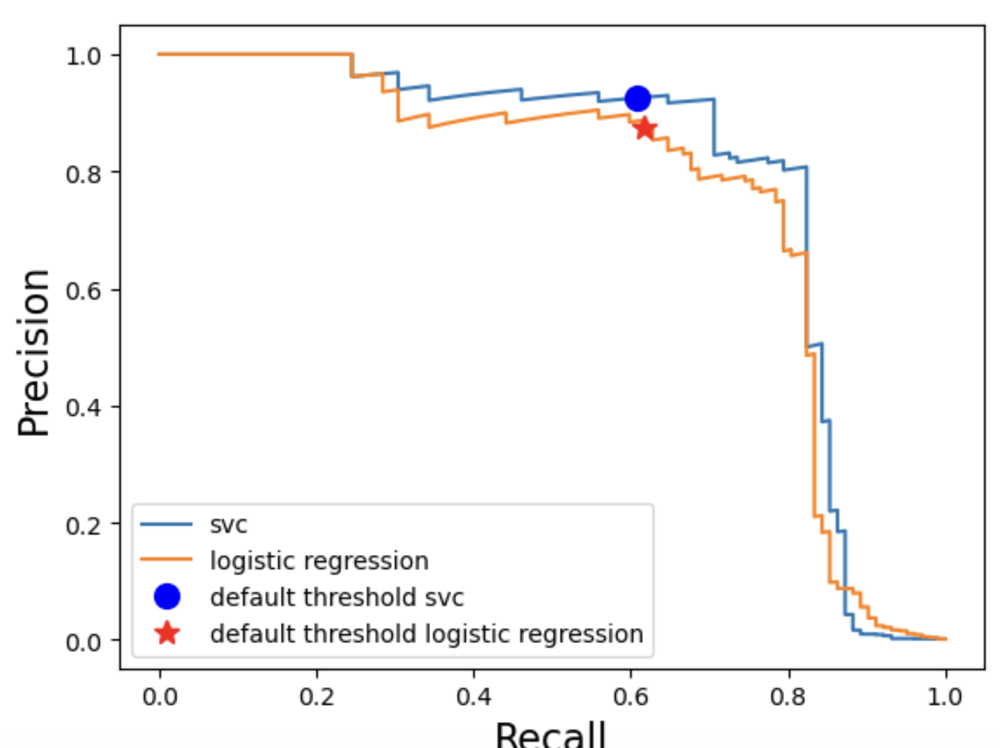
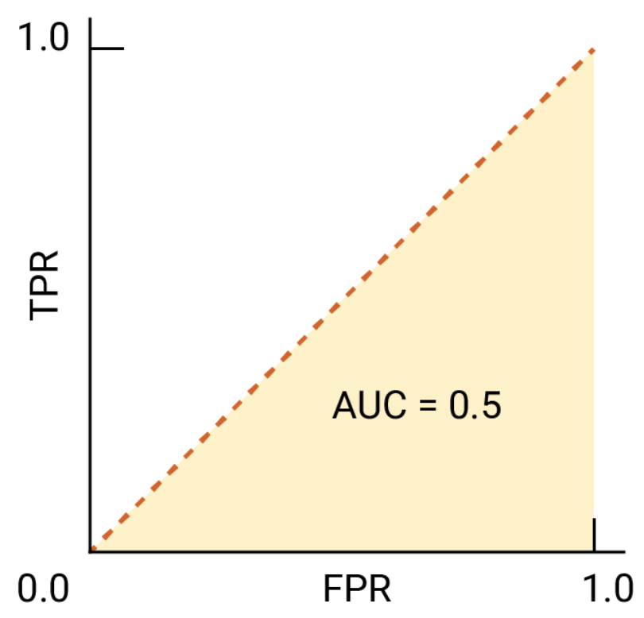
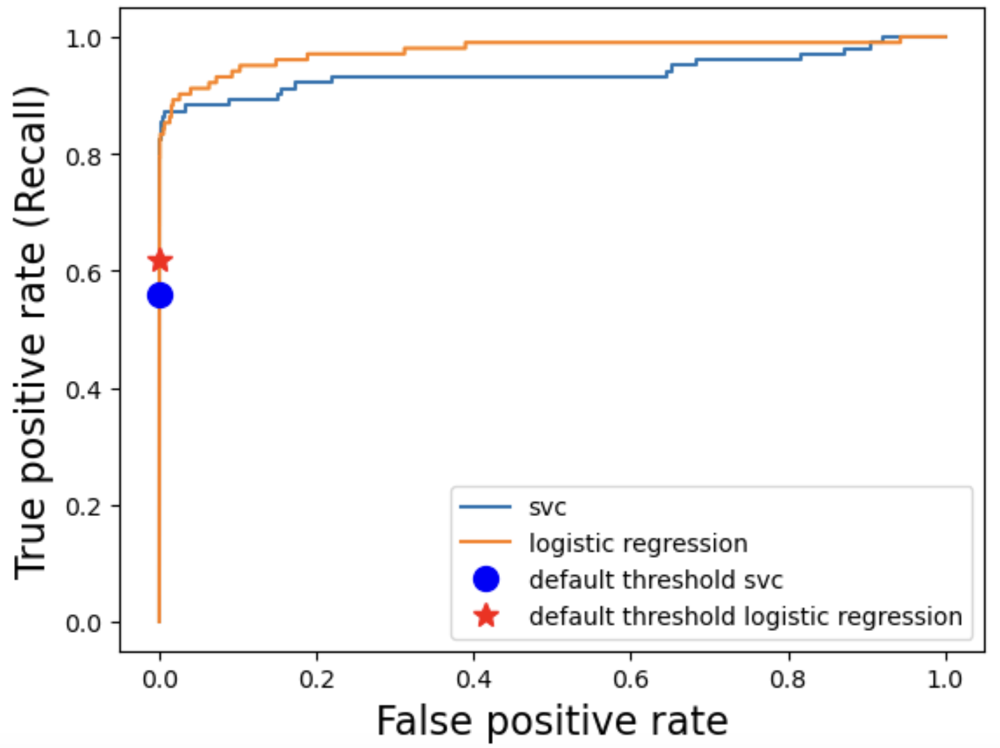

## Focus on the breath!

{.nostretch fig-align="center" width="500px"}

## Announcements

- Midterm next week. Important information about midterm 1
  - https://edstem.org/us/courses/104703/discussion/8335467
  - **Good news for you: You'll have access to our [course notes](https://ubc-cs.github.io/cpsc330-book/) and sklearn, pandas, and numpy documentation in the midterm!**
- HW4 was due Monday, Oct 12 at 11:59 pm.
- HW5 is now available and due Oct 26 at 11:59 pm. This project brings together what you've learned. Start early!

## Which metric fits best? {.slide-your-turn .smaller}

| Scenario | Data Imbalance | Main Concern | Best Metric(s) / Curve |
|-----------|----------------|---------------|------------------------|
| **Email Spam Detection** | 10% spam | Avoid false positives| |
| **Disease Screening** | 1 in 10,000 | Avoid false negatives | |
| **Credit Card Fraud** | 0.1% fraud | Focus on rare positive class | |
| **Sentiment Analysis** | 50/50 balanced | Overall correctness | |

::: {.notes}
Possible answers: spam precision if flagged mail is discarded; disease recall; fraud PR curve/AP for ranking and precision/recall at the operating threshold; sentiment accuracy if error costs are similar.
These are starting choices. Ask students to name the action taken and the consequences of FP and FN before choosing a metric.
:::

## PR curve and AP: Key takeaways {.slide-summary}

- **PR curve:** x = recall; y = precision. Each threshold gives a precision–recall pair.
- **Precision:** Of the examples flagged positive, what fraction are positive?
- **Recall:** Of all actual positives, what fraction did we find?
- **AP:** A single summary of precision across recall levels; higher is better.

**The curve helps choose an operating point; AP summarizes the ranking.**

::: {.notes}
Use predicted probabilities or decision scores to construct the curve, rather than thresholded class labels. Lowering the threshold includes more examples: recall cannot decrease, but precision need not move monotonically. Prefer high precision at the recall you need. AP weights precision by increases in recall: sum (R_n − R_{n−1})P_n. sklearn AP is not the trapezoidal area under a linearly interpolated PR curve. A horizontal no-skill precision reference is the positive-class fraction; AP depends on prevalence, so compare on the same representative evaluation set. AP does not choose a threshold and does not measure probability calibration.
Source: https://scikit-learn.org/stable/modules/generated/sklearn.metrics.average_precision_score.html
:::

## PR curves: Which model would you choose? {.slide-your-turn}

- What's the difference between the average precision (AP) score and F1-score?
- Which model would you pick if **high recall** is essential?

{.nostretch fig-align="center" width="400px"}

::: {.notes}
F1 evaluates binary decisions at a chosen threshold; AP summarizes the precision–recall ranking across thresholds. Ask which recall region matters before choosing a curve. Crossing curves do not imply a universally best model.
:::

## ROC curve and ROC AUC: Key takeaways {.slide-summary}

- **ROC curve:** x = false-positive rate; y = true-positive rate (recall).
- **TPR:** $TP/(TP+FN)$, the fraction of positives caught.
- **FPR:** $FP/(FP+TN)$, the fraction of negatives incorrectly flagged.
- **ROC AUC:** Area under the ROC curve; higher is better.

**FPR uses all actual negatives; precision uses all predicted positives.**

::: {.notes}
Each threshold gives one (FPR, TPR) pair. Lowering the threshold cannot decrease either rate. Both ROC AUC and AP evaluate ranking across thresholds; neither determines the deployment threshold or establishes calibrated probabilities. Select an operating point using validation data and task constraints, then evaluate independently. Do not equate a small FPR with a small number of false alarms when negatives are numerous.
Source: https://scikit-learn.org/stable/modules/generated/sklearn.metrics.roc_auc_score.html
:::

## Explore: One threshold, two curves {visibility="hidden"}

```{=html}
<iframe src="demos/metric-thresholds.html" title="Interactive precision–recall and ROC curves with a shared classification threshold" style="width:100%;height:490px;border:0;" loading="eager"></iframe>
```

::: {.notes}
Start at 0.50 on the balanced example. Ask students to predict what lowering the threshold does to TP, FP, recall, and FPR; precision can move either way. Move to 1.00 (no alerts) and 0.00 (everyone flagged). Switch to rare positives at the same threshold: recall, FPR, ROC curve, and ROC AUC remain the same because each negative score is replicated equally; FP counts increase, precision drops, and PR/AP change. These are synthetic scores, not calibrated probabilities. Thresholding uses score >= threshold. AP is recall-weighted step precision; ROC AUC uses trapezoids with tied scores grouped. At no predicted positives, precision is undefined; the PR endpoint (0,1) is a plotting convention, not an observed precision. For PDF delivery, use the static rare-positive calculation on the following slides and open the standalone demo in a browser.
:::

## ROC AUC: Baseline and interpretation {.smaller}

:::: {.columns}
:::{.column width="50%"}
{.nostretch fig-align="center" width="400px"}
:::
:::{.column width="50%"}
- **AUC = 1:** Perfect separation in the evaluated sample.
- **AUC = 0.5:** Baseline ranking reference.
- **AUC < 0.5:** Ranking worse than that reference.

AUC is the probability that a randomly chosen positive scores above a randomly chosen negative. 
:::
::::

::: {.notes}
The diagonal is the chance-ranking reference, not the curve of an always-negative classifier at a fixed threshold. A constant score gives AUC 0.5 through ties. A finite random ranking need not give exactly 0.5. AUC 0.9 does not mean 90% accuracy. AUC below 0.5 may suggest reversed score orientation; check the positive label and score definition rather than treating it as a deployment rule.
Image source: https://developers.google.com/machine-learning/crash-course/classification/roc-and-auc
:::

## ROC curves: Which model would you choose? {.slide-your-turn .smaller}

:::: {.columns}
:::{.column width="60%"}
{.nostretch fig-align="center" width="400px"}
:::
:::{.column width="40%"}
- Which model would you pick if **very few false alarms** are acceptable?
- Is the model with the largest overall AUC necessarily best there?
:::
::::

::: {.notes}
Ask students to compare the curves in the operating region that matters. AUC summarizes the whole curve and can hide differences at very low false-positive rates.
:::

## Why check precision when positives are rare? {.slide-your-turn}

Suppose there are **100 positives** and **9,900 negatives**.
At one threshold, **TPR = 80%** and **FPR = 1%**.

- How many true positives and false positives do we get?
- What fraction of alerts are correct?

::: {.notes}
TP = 80; FP = 99. Precision = 80/(80+99) ≈ 44.7%. Despite the small FPR, there are more false alerts than true alerts. ROC remains a valid ranking view; PR directly shows alert quality and coverage. These are values at one threshold, not enough information to infer either AUC or AP.
:::

## Summary: Choosing the right metric {.slide-summary .smaller}

| Metric / plot | Question it answers |
|---|---|
| **Precision, recall, F1** | How good are the decisions at a chosen threshold? |
| **PR curve** | What precision can we get at the recall we need? |
| **AP** | How well is precision maintained across recall levels? |
| **ROC curve** | What fraction of negatives do we flag at the recall we need? |
| **ROC AUC** | How well does the model rank positives above negatives overall? |

**Choose a threshold from the task's costs and constraints.**
When positives are rare, inspect precision even if ROC AUC is high.

::: {.notes}
Both curves vary thresholds; both scores summarize ranking. F1 balances precision and recall at a particular threshold, whereas AP and ROC AUC summarize performance across thresholds. None alone specifies error costs, review capacity, or the appropriate deployment threshold. Revisit the opening scenarios: the action and consequences determine what matters.
:::

## Dealing with class imbalance
- Under sampling
- Oversampling
- `class_weight="balanced"` (preferred method for this course)
- SMOTE

## Revision: Changing class weights {.slide-your-turn}

`class_weight="balanced"` gives rarer classes more weight during fitting.

For fraud detection, what changes might you expect?

- False negatives and recall?
- False positives and precision?
- Does the validation set become balanced?

::: {.notes}
Often fewer FN and higher recall, with more FP and potentially lower precision. These are empirical effects, not guarantees. Weighting changes fitting; it does not resample or balance the validation set. Evaluate on representative held-out data. Other imbalance methods must also be applied only within training folds.
:::

## Today's big questions {.slide-goals}

1. How do **MAE, RMSE, R², and MAPE** describe different aspects of prediction error?
2. How do we choose a metric and use it in **cross-validation and model selection**?
3. What changes when we **transform the target**?

## Notebook demo: Housing and preprocessing

**Predict `SalePrice` from information available for a new house.**

- Inspect feature meanings and missing values.
- Distinguish an absent amenity from unknown information.
- Build and inspect a complete preprocessing pipeline.

[Chapter 10 notebook](https://github.com/UBC-CS/cpsc330-book/blob/main/book/10_regression-metrics.ipynb)

::: {.notes}
Open the local updated chapter notebook. Demo cells 5–31 selectively: split; feature summary; absent amenities; representative encodings; transformed feature names. Skip reading the long feature lists aloud. Ask why MSSubClass is categorical despite its numeric dtype. All learned preprocessing must be fitted within each CV training fold; the full-training transformed table is for inspection.
:::

## iClicker Exercise 10.1 {.slide-your-turn}

**Select all statements that are TRUE.**

- (A) `SalePrice / GrLivArea` is a useful input when predicting a new house's `SalePrice`.
- (B) Larger `alpha` in ridge means stronger regularization, opposite to larger `C` in logistic regression.
- (C) Preprocessing must be fitted separately within each cross-validation training fold.

::: {.notes}
Answers: B and C. A leaks the target because the new house's sale price is unavailable. Fixed row-wise rules based on feature meanings can be applied before CV; learned medians, scaling, and encodings belong inside the pipeline.
:::

## Ridge regression and `alpha`

- Ridge fits a linear model with a penalty on squared coefficients.
- **Larger `alpha`:** stronger regularization; the coefficient vector shrinks overall.
- **Smaller `alpha`:** weaker regularization; more freedom to fit the training data.
- Too much regularization can underfit; too little can overfit.

::: {.notes}
Scaling matters because the penalty depends on coefficient magnitudes and therefore feature units. An individual coefficient need not shrink monotonically as alpha increases, especially with correlated features.
:::

## Notebook demo: Baseline and ridge tuning

- Compare `DummyRegressor` and ridge on the same CV folds.
- Search `ridge__alpha` around the **complete pipeline**.
- Inspect training/validation curves and selected coefficients.

**Predict:** What happens when `alpha` becomes very large?

::: {.notes}
Demo cells 34–40. Pause at the tuning curve before revealing best_params_. Select by validation performance, keeping the test set aside. DummyRegressor predicts the training mean; its held-out R² can be below zero. Coefficients are model associations, not causal effects.
:::

## Mean absolute error (MAE)

$$\operatorname{MAE}=\frac{1}{n}\sum_{i=1}^{n}|y_i-\hat y_i|$$

- Average absolute error, in the **target's units**.
- Each additional dollar of absolute error contributes equally.
- Smaller is better; perfect predictions have MAE = 0.

**MAE = \$20,000** means an average absolute error of \$20,000 on the evaluated houses.

::: {.notes}
Taking absolute values prevents opposite errors from cancelling. MAE does not imply every prediction, or most predictions, is within \$20,000. Inspect the error distribution as well.
:::

## MSE and RMSE

$$\operatorname{MSE}=\frac{1}{n}\sum_{i=1}^{n}(y_i-\hat y_i)^2,
\qquad \operatorname{RMSE}=\sqrt{\operatorname{MSE}}$$

- Squaring gives **large errors greater influence**.
- MSE has squared target units; RMSE has target units.
- Both have a best value of zero; smaller is better.

A \$20,000 error contributes **four times** as much to MSE imas a \$10,000 error.

::: {.notes}
MSE and RMSE rank models identically on one fixed evaluation set. Mean fold RMSE is not generally the square root of mean fold MSE; use the desired CV scorer directly.
:::

## Your turn: MAE versus RMSE {.slide-your-turn}

Absolute errors on three houses:

| Model | House 1 | House 2 | House 3 |
|---|---:|---:|---:|
| A | \$0 | \$0 | \$30,000 |
| B | \$10,000 | \$10,000 | \$10,000 |

1. Which model has lower MAE?
2. Which model has lower RMSE?

::: {.notes}
Both MAEs are \$10,000. RMSE A ≈ \$17,321; RMSE B = \$10,000. RMSE penalizes the concentrated large mistake more. Neither automatically represents the application's actual costs. Run notebook cell 49 after students predict.
:::

## Notebook demo: Error magnitudes and direction

- Calculate MAE, MSE, and RMSE for the same predictions.
- Inspect observed versus predicted prices.
- Count overpredictions and underpredictions.

**Can a low average error hide a pattern of costly mistakes?**

::: {.notes}
Demo cells 43–54. These training metrics illustrate calculations, not generalization. Above the identity line means overprediction; below means underprediction. Magnitude metrics discard direction; percentages of over/underprediction discard magnitude. Use CV or held-out errors for evaluating new-house performance.
:::

## Coefficient of determination: $R^2$

$$R^2=1-\frac{\sum_i(y_i-\hat y_i)^2}{\sum_i(y_i-\bar y)^2}$$

The reference predicts the **mean of the evaluation targets**.

- **1:** perfect predictions.
- **0:** same squared error as that reference.
- **Negative:** worse than that reference.

For ridge, `.score(X, y)` returns $R^2$ by default.

::: {.notes}
R² = 0.8 means model squared error is 20% of the reference error. It does not mean 80% of predictions are correct. The evaluation mean differs from the training mean used by a fitted DummyRegressor. R² depends on target variation, so it is not a universal comparison across datasets. Formula assumes nonconstant evaluation targets; sklearn handles constant targets specially. Keep r2_score(y_true, y_pred) argument order.
:::

## Mean absolute percentage error (MAPE)

$$\operatorname{MAPE}=\frac{1}{n}\sum_i\frac{|y_i-\hat y_i|}{|y_i|}$$

A \$30,000 error is **5%** of \$600,000, but **50%** of \$60,000.

- Use when proportional errors matter and targets are safely away from zero.
- Zero or near-zero targets can produce enormous values.
- sklearn returns a **proportion**: `0.093` means **9.3%**.

::: {.notes}
Demo cells 56–58. A percentage needs a meaningful zero; Celsius temperatures are a counterexample. The same dollar error has more influence for cheaper houses. sklearn uses a small denominator at zero, which avoids division by zero but does not solve interpretability.
:::

## iClicker Exercise 10.2 {.slide-your-turn .smaller}

**Select all statements that are TRUE.**

- (A) Precision and recall apply directly to continuous regression predictions.
- (B) Ridge's default `.score()` agrees with `r2_score(y_true, y_pred)`.
- (C) RMSE is always nonnegative.
- (D) MSE alone does not show whether a model overpredicts or underpredicts.
- (E) Regression searches can record multiple scoring metrics.

::: {.notes}
Answers: B, C, D, E. A is false for continuous regression outputs; precision and recall require a defined classification decision. Negative error scorers do not mean that the underlying errors are negative.
:::

## Which metric fits the scenario? {.slide-your-turn .smaller}

| Scenario | What matters most? | Primary metric? |
|---|---|---|
| House prices, \$60K–\$800K | Error relative to each house's price | |
| Exam scores, 0–100 | Each additional point of absolute error counts equally | |
| Energy consumption | Large errors deserve disproportionate emphasis | |
| Insurance claims | Squared error relative to predicting the evaluation mean | |

**What limitation would you check for each choice?**

::: {.notes}
Possible answers: MAPE, checking near-zero prices and meaning of ratios; MAE, inspecting large errors; RMSE, inspecting extreme errors and valid records; R², considering target variation and also reporting MAE/RMSE in monetary units. These metrics all treat equal-magnitude over/underprediction equally; asymmetric consequences need a cost-based criterion.
:::

## Regression metrics summary {.slide-summary .smaller}

| Metric | Interpretation | Units | Best |
|---|---|---|---:|
| MAE | Average absolute error | Target units | 0 |
| MSE | Average squared error | Target units squared | 0 |
| RMSE | Squared-error emphasis in familiar units | Target units | 0 |
| $R^2$ | Squared error relative to evaluation mean | Unitless | 1 |
| MAPE | Average absolute relative error | Proportion | 0 |

Choose a **primary metric before comparing models**; inspect errors as well as scores.

## Error functions versus sklearn scorers

Metric functions return nonnegative errors: **smaller is better**.

sklearn scorers use **higher is better**, so error scores are negated.

```python
scoring = {
    "MAE": "neg_mean_absolute_error",
    "RMSE": "neg_root_mean_squared_error",
    "R2": "r2",
    "MAPE": "neg_mean_absolute_percentage_error",
}
```

An MAE score of **−20,000** is better than **−30,000**.

::: {.notes}
Negate error scores again to report positive errors. Do not negate R²: a negative R² is a real possible value. make_scorer(..., greater_is_better=False) provides the same sign convention for a custom error function; keep the implementation in the notebook.
:::

## Notebook demo: Scoring and selection

- Record multiple metrics with `cross_validate`.
- Search with `GridSearchCV(..., scoring=scoring, refit="MAPE")`.
- Convert negative error scores to positive errors for reporting.

**Does selecting with MAPE make ridge fit by minimizing MAPE?**

::: {.notes}
Demo cells 60–64; skip the final test evaluation until choices are settled. Answer: no. Each ridge candidate still fits squared error plus regularization; MAPE selects among candidates. Fold standard deviations describe variation, not confidence intervals. Scores have different units and their numerical sizes cannot be compared directly.
:::

## Transforming the target

A log transformation compresses large target values more than small ones.

```python
ttr = TransformedTargetRegressor(
    Ridge(alpha=best_alpha),
    func=np.log1p,
    inverse_func=np.expm1,
)
ttr_pipe = make_pipeline(preprocessor, ttr)
```

- `.fit()` transforms the training targets.
- `.predict()` returns predictions on the **original scale**.

::: {.notes}
ColumnTransformer transforms X; TransformedTargetRegressor handles y. log1p needs targets greater than −1; positive house prices meet that requirement. A less skewed histogram alone does not establish improved predictions. The wrapped ridge fits squared error plus regularization on the transformed scale; it does not directly minimize MAPE.
:::

## Notebook demo: Does transforming the target help?

- Inspect price distributions before and after a log transformation.
- Fit the transformed-target pipeline.
- Compare approaches with **training-set CV**, scored in dollars or relative errors.

Reserve the test set for evaluating the final selected workflow.

::: {.notes}
Demo cells 70–79. Replace the exploratory test comparison in cell 80 with cross_validate(ttr_pipe, X_train, y_train, cv=10, scoring=scoring), and compare with the untransformed workflow using the same folds. Tune alpha for each approach within the training data for a considered comparison. Do not compare training MAPE with test MAPE or choose a transformation by trying alternatives on the test set. Run one final test evaluation after selection.
:::

## Exit questions {.slide-your-turn}

1. When would you prefer MAE to RMSE?
2. What does a negative $R^2$ tell you?
3. How does changing the scoring metric differ from log-transforming the target?

::: {.notes}
MAE when each added unit of absolute error contributes equally; RMSE when large errors deserve extra emphasis. Negative R² means worse squared error than predicting the evaluation-target mean. Scoring changes candidate evaluation/selection; target transformation changes the scale of fitting, with predictions inverse-transformed for evaluation.
:::
