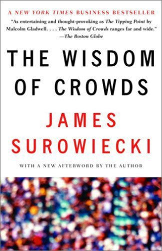
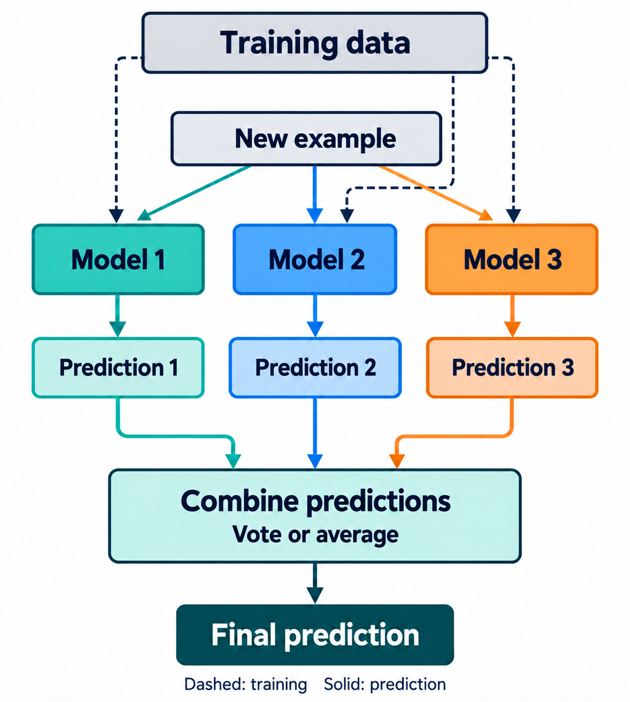
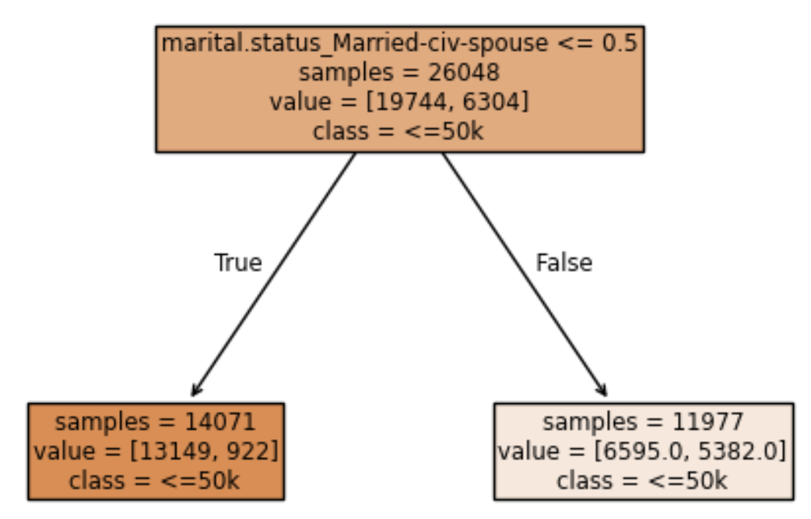
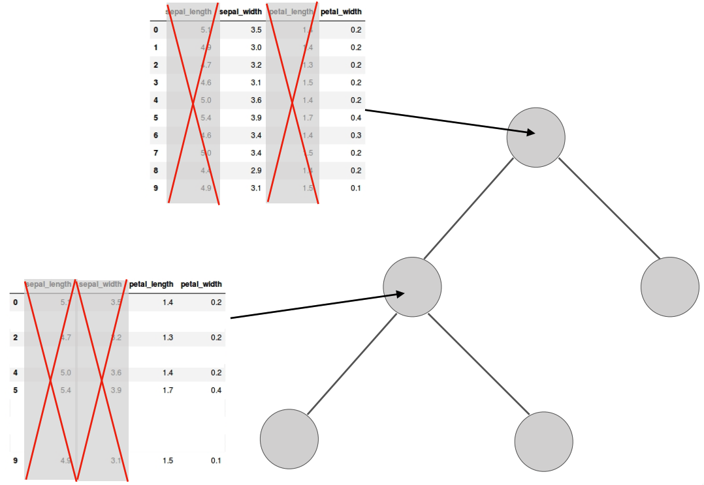

## Focus on the breath!

{.nostretch fig-align="center" width="500px"}

## Announcements

- Midterm next week. Important information about midterm 1
  - https://edstem.org/us/courses/104703/discussion/8335467
  - **Good news for you: You'll have access to our [course notes](https://ubc-cs.github.io/cpsc330-book/) and sklearn, pandas, and numpy documentation in the midterm!**
- HW4 was due Monday, Oct 12 at 11:59 pm.
- HW5 is now available and due Oct 26 at 11:59 pm. This project brings together what you've learned. Start early!

## Today's big questions {.slide-goals}

1. When does **combining models** improve predictions?
2. How do **random forests and boosting** build and combine trees differently?
3. How do **voting and stacking** combine different model types, and when is the extra cost worthwhile?

## iClicker Exercise 11.0 {.slide-your-turn}

Which of the following scenarios has worked effectively for you in the past?

- (A) Working independently on a project/assignment
- (B) Working with like-minded people
- (C) Teaming up with a diverse group offering varied perspectives and skills

::: {.notes}
Use this as a discussion prompt, not a question with one correct answer. Diverse perspectives motivate the analogy, but model ensembles still need validation evidence.
:::

## The wisdom of crowds

Groups can make better decisions when members contribute useful, different perspectives.

{.nostretch fig-align="center" width="250px"}

[Source](http://wisdomofcrowds.blogspot.com/2009/12/introduction-part-i.html)

## Can averaging help? {.slide-your-turn}

A house sells for **\$500,000**.

| Model | Predicted price |
|---|---:|
| Linear model | \$460,000 |
| Decision tree | \$520,000 |

- What is their average prediction?
- What if both models predicted \$460,000?

::: {.notes}
The average is \$490,000: an error of $10,000, smaller than either individual error. If both predict \$460,000, averaging changes nothing. This is an illustration on one example, not evidence that the ensemble generalizes better.
:::

## Ensembles: The key idea {.smaller}

:::: {.columns}
::: {.column width="48%"}
{.nostretch height="490px"}

<small>Image created by GPT-6.1 Sol</small>

:::
::: {.column width="52%"}
An **ensemble** combines predictions from multiple models.

- **Classification:** combine labels or class probabilities
- **Regression:** average numerical predictions

The aim is better predictions on new examples.
:::
::::

::: {.notes}
AI-generated redraw of the ensemble schematic, with separate training and prediction paths. Original conceptual reference: https://sebastianraschka.com/pdf/lecture-notes/stat451fs20/07-ensembles__slides.pdf
:::

## Same accuracy, different mistakes {.slide-your-turn .prediction-tables}

Each model gets **2 of 3 correct**. Which ensemble performs better?

[✓ Correct]{.prediction-correct} · [✗ Wrong]{.prediction-wrong} — binary classification

:::: {.columns}
::: {.column width="50%"}
**Same mistakes**

| Example | Model 1 | Model 2 | Model 3 | Majority vote |
|---|:---:|:---:|:---:|:---:|
| Example 1 | [✗]{.prediction-wrong} | [✗]{.prediction-wrong} | [✗]{.prediction-wrong} | [✗]{.prediction-wrong .fragment data-fragment-index="1"} |
| Example 2 | [✓]{.prediction-correct} | [✓]{.prediction-correct} | [✓]{.prediction-correct} | [✓]{.prediction-correct .fragment data-fragment-index="1"} |
| Example 3 | [✓]{.prediction-correct} | [✓]{.prediction-correct} | [✓]{.prediction-correct} | [✓]{.prediction-correct .fragment data-fragment-index="1"} |

[Majority vote: **2/3 correct**]{.fragment data-fragment-index="1"}
:::
::: {.column width="50%"}
**Different mistakes**

| Example | Model 1 | Model 2 | Model 3 | Majority vote |
|---|:---:|:---:|:---:|:---:|
| Example 1 | [✗]{.prediction-wrong} | [✓]{.prediction-correct} | [✓]{.prediction-correct} | [✓]{.prediction-correct .fragment data-fragment-index="1"} |
| Example 2 | [✓]{.prediction-correct} | [✗]{.prediction-wrong} | [✓]{.prediction-correct} | [✓]{.prediction-correct .fragment data-fragment-index="1"} |
| Example 3 | [✓]{.prediction-correct} | [✓]{.prediction-correct} | [✗]{.prediction-wrong} | [✓]{.prediction-correct .fragment data-fragment-index="1"} |

[Majority vote: **3/3 correct**]{.fragment data-fragment-index="1"}
:::
::::

::: {.notes}
All three examples have true class 1. A check means prediction 1; a cross means prediction 0. This shared true label makes majority voting on correctness equivalent to voting on class labels. Each base model has accuracy 2/3 in both tables. Ask students to calculate the vote before revealing the last column and results together. Complementary errors improve the vote in the second table. These three-row examples illustrate arithmetic, not generalization evidence. Adapted from the expertise–diversity examples in DSCI 573 notes.
:::

## Diversity alone isn't enough {.slide-your-turn .prediction-tables}

Each model gets **1 of 3 correct**, on a different example.
What does the majority vote predict?

[✓ Correct]{.prediction-correct} · [✗ Wrong]{.prediction-wrong} — binary classification

| Example | Model 1 | Model 2 | Model 3 | Majority vote |
|---|:---:|:---:|:---:|:---:|
| Example 1 | [✓]{.prediction-correct} | [✗]{.prediction-wrong} | [✗]{.prediction-wrong} | [✗]{.prediction-wrong .fragment data-fragment-index="1"} |
| Example 2 | [✗]{.prediction-wrong} | [✓]{.prediction-correct} | [✗]{.prediction-wrong} | [✗]{.prediction-wrong .fragment data-fragment-index="1"} |
| Example 3 | [✗]{.prediction-wrong} | [✗]{.prediction-wrong} | [✓]{.prediction-correct} | [✗]{.prediction-wrong .fragment data-fragment-index="1"} |

::: {.fragment data-fragment-index="1"}
Majority vote: **0/3 correct** — two wrong predictions outvote one correct prediction on every row.
:::

::: {.notes}
All three examples again have true class 1; correct predictions are 1 and wrong predictions are 0. Diversity does not guarantee improvement: this particular hard vote is wrong on every example. Do not infer that weak models can never help an ensemble, or that every model must individually outperform chance. Evaluate the combination on held-out data. Adapted from DSCI 573 notes.
:::

## Useful predictions and different mistakes {.slide-summary}

- **Expertise:** individual models learn useful patterns
- **Diversity:** their errors can offset one another
- Identical predictions gain nothing from averaging

**Use validation results to check whether combining models helps.**

## Today's methods

- **Random forests:** train randomized trees independently, then average
- **Gradient boosting:** build trees sequentially to correct the current ensemble
- **Voting and averaging:** combine different types of models directly
- **Stacking:** learn a model that combines base predictions

# Random forests

## What can we randomize between trees? {.slide-your-turn}

{.nostretch fig-align="center" height="420px"}

## Two sources of randomness

1. **Bootstrap samples:** each tree draws its own training rows, with replacement
2. **Random feature subsets:** each split considers a new random subset of features

Both encourage trees to make different predictions.

## Building a training set for each tree {.bootstrap-example}

**Original training rows:** [A]{.row-a} [B]{.row-b} [C]{.row-c} [D]{.row-d} [E]{.row-e} [F]{.row-f}

Each ID represents a **complete row: features and target**.

::: {.fragment data-fragment-index="1"}
1. Draw one row: select **[B]{.row-b}**
2. Put it back: **all six rows remain available**
3. Repeat six times: **[B]{.row-b} [B]{.row-b} [A]{.row-a} [E]{.row-e} [B]{.row-b} [D]{.row-d}**
:::

::: {.fragment data-fragment-index="2"}
| | Training row IDs | Repeated IDs | Missing IDs |
|---|---|---|---|
| Tree 1 | [B]{.row-b} [B]{.row-b} [A]{.row-a} [E]{.row-e} [B]{.row-b} [D]{.row-d} | [B]{.row-b} (3 times) | [C]{.row-c}, [F]{.row-f} |
| Tree 2 | [F]{.row-f} [C]{.row-c} [C]{.row-c} [A]{.row-a} [F]{.row-f} [D]{.row-d} | [C]{.row-c}, [F]{.row-f} (twice each) | [B]{.row-b}, [E]{.row-e} |

**Each tree gets six rows; some repeat and others are absent.**
:::

::: {.notes}
Before revealing the table, ask which IDs repeat and which are missing from the first sample. The second sample is drawn independently from the original six rows, not from the first sample or from its omitted rows. Repeated IDs mean repeated copies of the same complete training row, not new observations. For a training set of n rows, the default bootstrap sample uses n draws with replacement; other sample sizes are possible. Different samples encourage different trees but do not guarantee distinct samples or predictions. Training models on bootstrap samples and aggregating their predictions is bagging: bootstrap aggregating. This slide illustrates the sampling step; random feature subsets provide the forest's second source of randomness.
:::

## Random features at each split

:::: {.columns}
::: {.column width="50%"}
{.nostretch height="350px"}

[Source](https://sebastianraschka.com/pdf/lecture-notes/stat451fs20/07-ensembles__slides.pdf)
:::
::: {.column width="50%"}
- Sample candidate features at each split
- Choose the best split among those candidates
- An excluded feature can be available at a later split
:::
::::

## Why choose a new subset at each split? {.slide-your-turn}

Suppose a useful feature is excluded from a tree's candidate subset.

- **One subset per tree:** when could that tree use the feature?
- **A new subset per split:** what changes?

::: {.notes}
With one fixed subset, the feature is unavailable throughout that tree. With fresh subsets, it may be available at later splits. This preserves access to useful information while encouraging different trees. Neither strategy has a universally fixed level of diversity or predictive strength.
:::

## How a forest predicts

- **Classification in scikit-learn:** average the trees' class probabilities; choose the class with the largest average
- **Regression:** average the trees' numerical predictions

Trees are trained **independently**: no tree corrects an earlier tree.

::: {.notes}
RandomForestClassifier uses probability averaging, which can disagree with majority voting on class labels. Trace a row through the small forest in the chapter demo.
:::

## Random-forest hyperparameters {.smaller}

| Hyperparameter | Controls |
|---|---|
| `n_estimators` | Number of trees in the average |
| `max_depth` | Maximum depth of each tree |
| `min_samples_leaf` | Minimum samples supporting a leaf |
| `max_features` | Candidate features considered at each split |

Fewer candidate features encourage diversity but can weaken individual trees.

## More trees versus deeper trees {.slide-summary}

- **Deeper trees** can fit finer details, including noise
- **More trees** stabilize the average from the same training procedure
- Gains from more trees often level off; computation and memory keep growing

**Adding trees does not automatically fix a training–validation gap.**

::: {.notes}
Validation scores need not improve monotonically as trees are added. Use cross-validation to investigate tree depth and leaf size as well as forest size. A forest can still overfit.
:::

## iClicker Exercise 11.1 {.slide-your-turn .smaller}

**Select the most accurate statement about a standard random forest.**

- (A) Each tree independently draws a bootstrap sample of the training rows
- (B) Each tree is restricted to one randomly selected feature subset throughout training
- (C) Choose `n_estimators` using whichever value scores best on the reserved test set
- (D) Each tree learns to correct the predictions of the previous tree
- (E) Averaging cannot outperform the most accurate individual model

::: {.notes}
Answer: A. Independent draws need not produce distinct samples. B describes a fixed feature subset per tree, rather than per split. C uses test data for model selection. D describes the sequential idea of boosting. E is contradicted by complementary errors, as in the opening example.
:::

## Demo: From one tree to a forest

In the Chapter 11 notebook:

- Trace a prediction through the small forest
- Compare the tree and forest on the same validation folds
- Inspect accuracy and fit time as the forest grows

**Does the gain justify the extra computation?**

# Gradient boosting

## Random forests and boosting

| Random forests | Gradient boosting |
|---|---|
| Train trees independently | Train trees sequentially |
| Average predictions | Add learned corrections |
| Randomness encourages different trees | Each tree improves the current ensemble |

Both require validation; neither guarantees better generalization.

## Boosting: Correct the current prediction

For **squared-error regression**:

1. Start with the mean training target
2. Compute residuals: actual value − current prediction
3. Fit a small tree to residuals using the original features
4. Add a scaled correction, then repeat

::: {.notes}
Each new tree corrects the whole current ensemble, not just the immediately preceding tree. A correction tree need not fit each residual exactly. For classification and other losses, corrections depend on the loss; they are not residuals formed by subtracting class labels.
:::

## One boosting update

Prices in **thousands of dollars**:

| Quantity | Value |
|---|---:|
| Actual price | 200 |
| Current prediction | 280 |
| Residual | −80 |
| Tree's predicted correction | −53.3 |
| Learning rate | 0.5 |

**New prediction:** $280 + 0.5(-53.3) \approx 253.3$

::: {.notes}
This row comes from the chapter's invented house-price example. The small tree groups several houses, so its correction differs from this row's residual. At prediction time, start with the same initial prediction and add all scaled tree corrections. Do not average these trees' outputs.
:::

## Controlling boosting complexity

- **Rounds:** how many corrections we add
- **Learning rate:** how much of each correction we apply
- **Tree size:** how complex each correction can be

Tune these together using validation data.

**More rounds can overfit; smaller steps may need more rounds.**

::: {.notes}
Early stopping uses a validation score or loss to decide when to stop. This is model selection: never use the reserved test set. Within cross-validation, early-stopping data must come from the training portion of the fold. Boosting can also include random row or feature sampling.
:::

## Gradient-boosted tree implementations {.smaller}

| Implementation | Useful distinction |
|---|---|
| scikit-learn | Classic and histogram-based implementations |
| XGBoost | Efficient tree building and explicit regularization |
| LightGBM | Histogram splits and leaf-wise tree growth |
| CatBoost | Built-in handling of categorical features |

**Compare on your task; no library is a universal winner.**

::: {.notes}
These are emphases, not exclusive capabilities. In the notes' common encoded-data comparison, CatBoost does not use its native categorical handling. Keep library-specific options and code in the notebook.
:::

## Demo: Compare boosting candidates

Use the same training data, validation folds, and metric.

- Compare against the single tree and random forest
- Read validation scores alongside fold-to-fold variation
- Compare fit and prediction costs

**A small score difference may not justify a much slower model.**

# Voting, averaging, and stacking

## Combining different model types

For example: logistic regression + random forest + boosted trees.

- **Classification:** combine labels or probabilities
- **Regression:** average numerical predictions
- Different model types can encourage complementary errors

Check the combination against its strongest individual model.

## Hard and soft voting

:::: {.columns}
::: {.column width="50%"}
**Hard voting**

- Combine predicted labels
- Choose the class with the most votes
:::
::: {.column width="50%"}
**Soft voting**

- Average class probabilities
- Choose the class with the largest average
:::
::::

::: {.notes}
VotingClassifier supports both methods. VotingRegressor averages numerical predictions. Equal weighting is a starting point; selecting weights is also a model-selection decision.
:::

## Can hard and soft voting disagree? {.slide-your-turn}

Three binary classifiers predict these positive-class probabilities:

| Model A | Model B | Model C |
|---:|---:|---:|
| 0.51 | 0.51 | 0.01 |

- Which class wins the hard vote at a 0.5 threshold?
- Which class wins the soft vote?
- Is using probabilities always better?

::: {.notes}
Hard voting selects positive, two votes to one. The mean probability is 1.03/3 ≈ 0.343, so soft voting selects negative. An inaccurate, overconfident model can distort probability averages. Validate the choice rather than assuming soft voting wins.
:::

## Stacking: Learn the combination {.smaller}

Base predictions become **features for a meta-model**.

Illustrative training inputs: each model supplies **$P(\text{income} > 50K)$**.

|  | Logistic regression | Random forest | LGBM | Target |
|---:|---:|---:|---:|:---|
| 0 | 0.34 | 0.40 | 0.10 | ≤50K |
| 1 | 0.72 | 0.65 | 0.85 | >50K |
| 2 | 0.48 | 0.55 | 0.30 | ≤50K |
| 3 | 0.20 | 0.65 | 0.80 | >50K |

- **Inputs:** the three probability columns, using out-of-fold predictions
- **Target:** the original income label; index is only a row identifier
- For a new row, the meta-model predicts from the base probabilities

::: {.notes}
The values are illustrative, not measured results. LGBM denotes LightGBM. Every probability refers to the same positive class, income >50K; a value of 0.34 means a predicted probability of 34% for that class, even when the observed target is ≤50K. Each training row's probabilities must come from base pipelines fitted without that row, including preprocessing. Neither the index nor the target is an input feature. For binary classification, one class probability per base model suffices. A logistic-regression meta-model learns a combination beyond a simple average; its coefficients are not accuracy rankings or percentages of trust.
:::

## Train the meta-model on held-out predictions {.smaller}

1. Split the training data into folds
2. Fit each base pipeline on the other folds; predict the held-out fold
3. Repeat until every training row has **out-of-fold predictions**
4. Fit the meta-model on those predictions and the training labels

**Each row's inputs come from base models fitted without that row.**

Refit base pipelines on **all training data**. For a new row, pass their predictions to the trained meta-model.

::: {.notes}
Do not train the meta-model on in-sample predictions from base models fitted on all those same rows: overfitting can give it an unrealistically favourable view of the models. Keep learned preprocessing inside every base pipeline.
:::

## Evaluating the whole stack {.slide-summary}

- Evaluate the **complete training procedure** on held-out data
- Keep evaluation rows out of base-model and meta-model fitting
- Compare with voting and the strongest individual candidate

Stacking adds fitting cost; improvement is not guaranteed.

::: {.notes}
With outer cross-validation, each outer training portion has its own internal folds for generating meta-model inputs. The outer validation portion evaluates the complete fitted stack. Do not precompute a single out-of-fold table on all training data and then cross-validate just the meta-model: some base fits would have seen labels from the evaluation fold. Keep the reserved test set out of all selection decisions.
:::

## Demo: Does combining models help?

- Compare voting and stacking with their constituent models
- Inspect their probability calculations and validation results
- Weigh any gain against training, prediction, and maintenance costs

**Keep the ensemble only when the evidence supports it.**

## Comparing ensemble methods {.slide-summary .smaller}

| Method | Training | Prediction |
|---|---|---|
| Random forest | Independent randomized trees | Average probabilities or numbers |
| Gradient boosting | Successive correction trees | Add scaled corrections |
| Voting / averaging | Separate base models | Vote or average |
| Stacking | Base models + meta-model trained on held-out predictions | Pass base predictions to meta-model |

All have classification and regression versions.

## Key takeaways {.slide-summary}

- Useful, complementary predictions make ensembles promising
- More forest trees stabilize an average; more boosting rounds add corrections
- Stacking needs held-out base predictions for meta-model training
- Choose using **validation performance and practical cost**

## Ensembles class demo

Continue with the corresponding **Chapter 11 notebook**.

[Existing class demo notebook](https://github.com/UBC-CS/cpsc330-2026W1/tree/main/content/classes/varada)
