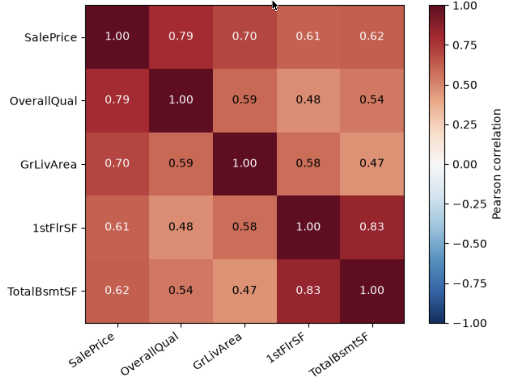
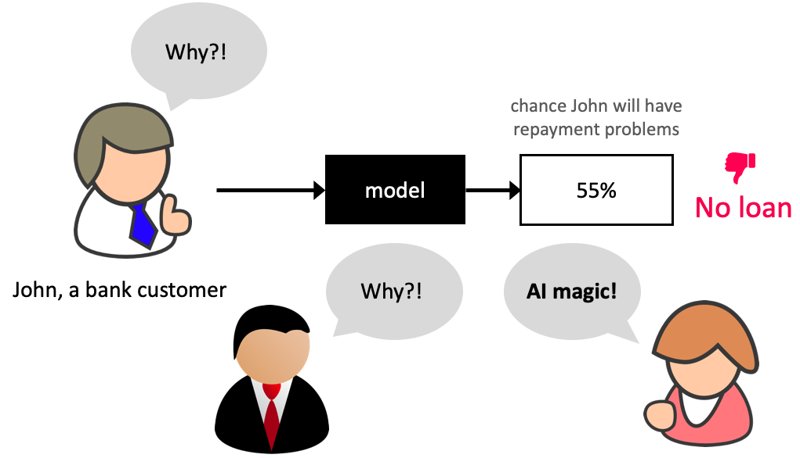
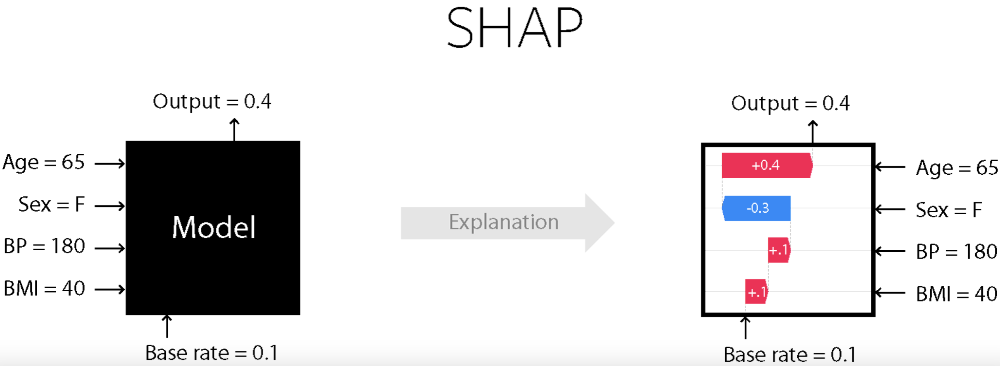

## Focus on the breath!

{.nostretch fig-align="center" width="500px"}

## Today's big questions {.slide-goals}

1. When do we need **model transparency** alongside predictive performance?
2. How do we interpret **linear-model coefficients** for numeric, ordinal, and one-hot encoded features?
3. How do **tree-based feature importances and SHAP** help explain a model's predictions?
4. What can feature importances tell us, and why don't they establish **cause and effect**?

## Scenario 1: Which model would you pick? Why? {.slide-your-turn}

**Photo organization:** A model suggests labels for personal photos that users can easily correct. You have two models:

- LGBM which results in 0.9 F1 score
- Logistic regression which results in 0.84 F1 score

## Scenario 2: Which model would you pick? Why? {.slide-your-turn}

**Health screening:** A model flags patients for further testing, with a clinician reviewing the recommendation. You have two models:

- LGBM which results in 0.9 F1 score
- Logistic regression which results in 0.84 F1 score

## Scenario 3: Which model would you pick? Why? {.slide-your-turn}

**Loan applications:** A model automatically rejects applications predicted to be unlikely to repay. You have two models:

- LGBM which results in 0.9 F1 score
- Logistic regression which results in 0.84 F1 score

## Transparency

In many domains understanding the relationship between features and predictions is critical for trust and regulatory compliance.

## Feature importances

- How does the output depend upon the input?
- How do the predictions change as a function of a particular feature?
- How can we quantify and visualize feature importances?

# How to get feature importances?

## Correlations

:::: {.columns}

::: {.column width="60%"}
{.nostretch fig-align="center" width="600px"}
:::

::: {.column width="40%"}
What are some limitations of correlations?
:::
::::

## Interpreting coefficients {.smaller}

- Linear models are interpretable because you get coefficients associated with different features.
- Each coefficient represents the estimated impact of a feature on the target variable, assuming all other features are held constant.
- In a `Ridge` model,
  - A positive coefficient indicates that as the feature's value increases, the predicted value also increases.
  - A negative coefficient indicates that an increase in the feature's value leads to a decrease in the predicted value.

## Interpreting coefficients {.slide-your-turn}

- When we have different types of preprocessed features, what challenges you might face in interpreting them?
  - Ordinally encoded features
  - One-hot encoded features
  - Scaled numeric features

## Class demo: coefficients and global importance

[Feature importances notebook](https://github.com/UBC-CS/cpsc330-2026W1/blob/main/content/classes/varada/lecture-12-feat-importances-demo.ipynb)

Pause after **Section 5: Global feature importance**. We will return to SHAP after building some intuition.

## iClicker: feature importances {.smaller}

**Which statements are true? Select all that apply.**

- (A) Strong correlation with the target guarantees high importance in a fitted model.
- (B) A global feature-importance ranking tells us whether increasing a feature will increase or decrease a prediction.
- (C) In a linear regression model, a positive coefficient means increasing that model input increases the prediction, holding other model inputs fixed.
- (D) Impurity-based importances in random forests have signs indicating positive or negative relationships.
- (E) A large validation-score drop after shuffling _education_ indicates that the fitted model relies on that feature on these data.

::: {.notes}
Answers: C and E. A: correlated features can substitute; correlation is not model importance. B and D: magnitude-only rankings do not provide direction or a response curve. C refers to model inputs after preprocessing; changing a raw category may change multiple inputs. E describes reliance on this evaluation sample and metric, not causation.
:::

# From global importance to individual explanations

## Why do we need more than a ranking?

- Global importance asks: **Which features does this model rely on overall?**
- A person receiving a prediction might ask: **Why did the model make this prediction for me?**
- The same feature can push predictions up for some examples and down for others.
- We need a **local explanation**: contributions to one particular prediction.

## Model transparency: what might we discover?

{.nostretch fig-align="center" height="390px"}

An explanation can help us investigate whether a model relies on sensible signals or surprising shortcuts.

::: {.notes}
Ask students what evidence would make them trust or question the prediction. Explanations can suggest problems to investigate; they do not prove that a model is correct, fair, or suitable for deployment.
:::

## SHAP: share the credit for a prediction

**SHAP = SHapley Additive exPlanations**

- Think of the features as players on a team producing a model output.
- Start with a **base value**: what the model predicts on average for a chosen set of reference examples.
- For one example, allocate the difference between its output and the base among its features.
- Each feature receives a signed contribution, called a **SHAP value**.

## A prediction as a sum of contributions {.smaller}

$$
f(x) = \underbrace{\text{base value}}_{\text{reference output}}
       + \underbrace{\sum_j \phi_j(x)}_{\text{feature contributions for this example}}
$$

**Illustrative house-price explanation:**

| Base value | Living area | Quality | Age | Prediction |
|---|---|---|---|---|
| $300,000 | +$60,000 | +$30,000 | −$20,000 | **$370,000** |

- Positive contributions push the output **above** the base; negative ones push it **below**.
- These are contributions to this prediction, not coefficients or renovation effects.

::: {.notes}
These numbers illustrate the additive accounting; they were not computed from the demo model. The base is an average model output, not necessarily the output for an average input. SHAP values have the units of the output being explained.
:::

## SHAP: what to look for

For one prediction, ask:

- **Direction:** Which features push the model output up or down from the base value?
- **Size:** Which features have the largest contributions?
- **Variation:** How do those contributions differ for another example?

SHAP handles the calculation; we will focus on **reading and using the explanations**.

::: {.notes}
Optional intuition if asked: SHAP shares credit by considering a feature's contribution alongside different combinations of other features. We do not need the calculation details to read the plots. A SHAP value attributes part of a prediction; it does not tell us what would happen if we changed that feature in the real world.
:::

## Reading a local SHAP explanation

{.nostretch fig-align="center" height="370px"}

Find the **base**, the largest **positive and negative contributions**, and the **final output**.

::: {.notes}
Use the figure to practise reading an additive explanation. Check the output scale printed on a plot before interpreting its numbers; classification explanations are not always in probability units.
:::

## In our demo: explain the income score {.smaller}

- Model: fitted **LightGBM**; class 1 is income **`>50K`**.
- Reference: **100 fitting examples**; explain **300 validation examples**.
- SHAP explains the raw score in **log-odds**, not probability.

$$
s = \text{base value} + \sum_j \phi_j(x),
\qquad P(\text{income}>50K) = \frac{1}{1+e^{-s}}
$$

- A positive SHAP value raises the score and therefore the probability of `>50K` relative to the base.
- Add contributions **first**, then convert the total to probability.

::: {.notes}
For example, base −1.0 plus contributions +0.8, +0.5, −0.3 gives score 0 and probability 0.5. A contribution of +0.5 is not a 50-percentage-point probability increase. The base is the mean background raw score, not the class frequency.
:::

## From one explanation to a global summary {.smaller}

| Plot | What to read |
|---|---|
| **Waterfall** | One example: how signed contributions move the base to the prediction. |
| **Bar** | Many examples: rank features by **mean absolute SHAP value**. |
| **Beeswarm** | Many examples: each dot is one example's contribution for a feature; colour shows its feature value. |

A large mean absolute SHAP value means large contributions on average; it does **not** measure a drop in predictive performance.

::: {.notes}
In a beeswarm, horizontal position is the signed contribution; colour is the input value. Red means a high feature value, not necessarily a positive contribution. For a one-hot indicator, a high value means category present. Features in this demo are transformed columns, so standardized values are not original units and one-hot categories appear separately.
:::

## Class demo: SHAP

[Return to the feature importances notebook](https://github.com/UBC-CS/cpsc330-2026W1/blob/main/content/classes/varada/lecture-12-feat-importances-demo.ipynb), **Section 6**.

1. Check that base + contributions = model output.
2. Compare waterfall plots for two different predictions.
3. Read the bar and beeswarm plots: what changes when we summarize many examples?

**Discuss:** Does a high feature value always give the same SHAP contribution?

## What SHAP does and does not tell us

- SHAP explains a **fitted model's output**, relative to a chosen reference.
- Contributions depend on the example, model, background, and treatment of dependent features.
- A positive contribution does **not** establish that changing that feature would improve the real-world outcome.
- Use explanations to investigate model behaviour; assess predictive performance and fairness separately.

::: {.notes}
For a linear model with an interventional background, a feature's SHAP value is its coefficient times its deviation from the background mean. Thus even a positive coefficient can produce a negative SHAP contribution for a below-reference value. With correlated features, attribution can depend strongly on how missing features are handled.
:::

## iClicker: SHAP {.smaller}

**Which statements are true? Select all that apply.**

- (A) SHAP values are parameters learned when the predictive model is trained.
- (B) The same feature can have a positive SHAP value for one example and a negative value for another.
- (C) SHAP can explain only tree-based models.
- (D) A waterfall plot shows how feature contributions add to a base value to recover one model output.
- (E) A SHAP value of +0.2 always means a 20-percentage-point increase in predicted probability.

::: {.notes}
Answers: B and D. A: SHAP values explain an already-fitted model. C: SHAP methods also support other model types. E: contributions use the explained output's units; our demo uses log-odds.
:::

## Takeaways

- **Coefficients:** interpret a change in a model input, holding other inputs fixed; account for preprocessing.
- **Global importance:** summarize model reliance or contribution magnitude; read what the method measures.
- **SHAP:** explain individual outputs relative to a reference, then summarize across examples.
- Explaining a prediction does **not** establish cause and effect.

::: {.notes}
SHAP references: [Introduction](https://shap.readthedocs.io/en/latest/example_notebooks/overviews/An%20introduction%20to%20explainable%20AI%20with%20Shapley%20values.html), [waterfall plots](https://shap.readthedocs.io/en/latest/example_notebooks/api_examples/plots/waterfall.html), and [beeswarm plots](https://shap.readthedocs.io/en/latest/example_notebooks/api_examples/plots/beeswarm.html).
:::
