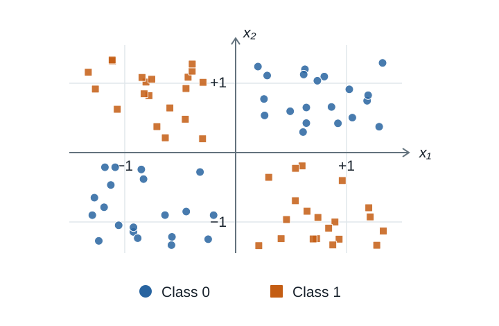

## Focus on the breath!

{.nostretch fig-align="center" width="500px"}

## Announcements

- HW5 extension

## iClicker

How did you feel about the exam ?

- (A) I felt well-prepared and it went smoothly
- (B) I think it went okay. We'll see when grades come back
- (C) I struggled and didn't feel fully prepared
- (D) I noticed some gaps between what we practiced and what appeared on the exam
- (E) It was a stressful experience for me 😔

## Today's big questions {.slide-goals}

1. How can **changing the features** help a model learn?
2. What do **interaction features** let a linear model express?
3. When might we want **fewer features**?
4. How do **model-based selection and RFE** work, and how do we evaluate them?

# Give the model useful inputs

## Design a feature: flight delays {.slide-your-turn}

Suppose we want to predict, **before departure**, whether a flight will arrive on time or be delayed. Our dataset includes:

- **Scheduled departure time**
- **Expected flight duration** (in minutes)

In the training data, flights scheduled to depart during the **evening rush (4–7 p.m.)** are delayed more often.

**With a neighbour:** What feature could we create from these inputs to help the model capture this pattern?

::: {.notes}
This is a hypothetical pattern, not a claim about actual flight delays. Give students 30 seconds to think, then a minute in pairs. Ask how they would calculate their proposed feature before showing the next slide. A departure-rush indicator is 1 during the specified interval and 0 otherwise. The next slide illustrates it with departures at 8 a.m., 5 p.m., and 10 p.m., giving 0, 1, 0. A linear model using departure hour as a number gives each extra hour the same effect; the indicator lets it capture a higher risk within a particular interval.

If students suggest scheduled arrival time: it is derived from departure and duration (accounting for time zones and date rollover), so it adds no new measurement. In a simple numeric representation without rollover, their sum adds no expressive power to an unregularized linear model that already has both inputs. A rush-hour indicator is a nonlinear transformation and can change what that model expresses. Derived features can still be useful; being correlated is not by itself a reason to reject one.
:::

## Feature engineering: change the representation {.smaller}

Add **“scheduled departure is during rush hour”**:

| Flight | Departure hour | Rush-hour indicator |
|---|---:|---:|
| A | 8 | 0 |
| B | 17 | 1 |
| C | 22 | 0 |

- The model can now assign an extra contribution to rush-hour flights.
- We added **no new measurement**; we made a pattern easier to represent.
- This is **feature engineering**. Check whether it helps using validation data.

::: {.notes}
The indicator is 1 for scheduled departures from 4 p.m. up to, but not including, 7 p.m. It supplements the original inputs. This lets a linear model capture an extra effect during that interval rather than requiring delay risk to rise steadily with departure hour. The example motivates a candidate feature; it does not establish a performance improvement. Use scheduled rather than actual departure information because we predict before departure. Scaling, one-hot encoding, and bag-of-words also change the representation.
:::

## Three different questions

| Idea | Question |
|---|---|
| **Feature importance** <br> (lecture 12) | How does a fitted model use its inputs? |
| **Feature engineering** | Could a different representation help the model? |
| **Feature selection** | Which subset of inputs should we keep? |

Today: propose a representation or subset, **refit**, and compare validation performance.

# Interaction features

## Can a straight line separate these classes? {.slide-your-turn .smaller}

Can you draw one straight line with all blue circles on one side and all orange squares on the other?

{.nostretch fig-align="center" height="390px"}


::: {.notes}
Give students time to try drawing or tracing a line before revealing the answer. No straight line separates the two classes because each occupies opposite corners. This is exclusive OR (XOR): the target is 1 when the input signs differ. The plot contains 80 synthetic observations, with class 1 when the signs differ. The next slide uses four representative inputs to make the product calculation easy; the same sign rule applies to every point in this dataset.
:::

## Build a feature that exposes the pattern {.slide-your-turn}

**Complete the product column. What rule separates the classes now?**

| $x_1$ | $x_2$ | $x_1x_2$ | Target |
|---:|---:|:---:|---:|
| −1 | −1 | ? | 0 |
| +1 | −1 | ? | 1 |
| −1 | +1 | ? | 1 |
| +1 | +1 | ? | 0 |

::: {.notes}
Allow 30–45 seconds. Products are +1, −1, −1, +1. Predict class 1 when the product is negative. We calculated a new feature from existing measurements.
:::

## An interaction captures a combination

Add the product to a linear classifier's score:

$$s = b + w_1x_1 + w_2x_2 + w_{12}x_1x_2.$$

- The model is still **linear in its supplied features**.
- Its boundary can be nonlinear in the original inputs.
- The effect of $x_1$ can now depend on $x_2$.
- Trees can already represent interactions through successive splits.

::: {.notes}
For XOR, a negative product coefficient and zero intercept can separate the four points. The product adds no new measurement; it changes the pattern the model can express. Do not derive the boundary unless students ask.
:::

## Class demo: interaction features

[Feature engineering and selection notebook](https://github.com/UBC-CS/cpsc330-2026W1/blob/main/content/classes/varada/lecture-13-feature-engineering-selection-demo.ipynb)

Compare logistic regression **with and without** the product feature.

**Before running:** Which model should do better on XOR?

**After running:** What changed—the data we measured, or the representation?

::: {.notes}
Use the feature interactions section; pause before the categorical example. Keep the focus on the before/after comparison rather than every code line. The corresponding chapter also demonstrates PolynomialFeatures in a cross-validated pipeline.
:::

## Interactions between categories {.slide-your-turn .smaller}

We predict parking availability from **location** and **time**.

| Location | 9 a.m. | 7 p.m. |
|---|---|---|
| UBC campus | ? | ? |
| Rogers Arena | ? | ? |

**Discuss (60 seconds):** Would “7 p.m.” have the same effect at both locations? Propose a feature for one specific combination.

::: {.fragment}
For example, create **location AND time** indicators:

| Location | Time | UBC AND 9 a.m. | Rogers Arena AND 7 p.m. |
|---|---|---:|---:|
| UBC campus | 9 a.m. | 1 | 0 |
| UBC campus | 7 p.m. | 0 | 0 |
| Rogers Arena | 9 a.m. | 0 | 0 |
| Rogers Arena | 7 p.m. | 0 | 1 |
:::

::: {.notes}
Treat this as a hypothetical pattern, not measured parking availability. Students might suggest an indicator for Rogers Arena AND 7 p.m.; an event indicator could add useful information too. Reveal the example indicators after the discussion. Multiplying two one-hot indicators gives 1 only when both categories are present: for example, is_UBC * is_9am. These are two candidate interaction features; other location–time combinations are possible. They let the model adjust its prediction for specific combinations beyond the separate location and time effects. Avoid claiming that location alone or time alone is uninformative.
:::

## iClicker: what did the interaction add? {.slide-your-turn .smaller}

Logistic regression improves on XOR after we add $x_1x_2$. **Choose the best explanation.**

- (A) We collected a new measurement.
- (B) The pattern becomes separable by a linear classifier in the transformed space.
- (C) Adding any feature must improve validation performance.
- (D) The interaction must help every model equally.

::: {.notes}
Answer: B. The product uses existing inputs. Extra features can fit noise; benefits depend on the model. Generating every possible interaction can produce many poorly supported columns.
:::

# Other ways to represent numeric inputs

## Counts or ratios? {.slide-your-turn}

Each row describes a **California census block group**.

| Block group | Total rooms | Households | Rooms per household |
|---|---:|---:|---:|
| A | 4,000 | 1,000 | 4 |
| B | 2,000 | 200 | 10 |

**Which has more rooms? Which has more rooms per household?**

Would you use the counts, the ratio, or both to predict median house value?

::: {.notes}
Give students a minute in pairs. A has more rooms overall; B has more rooms per household. These describe different quantities. There is no guaranteed best feature set without evaluation. A block group is not an individual house.
:::

## Binning: let different ranges have different effects {.smaller}

- A continuous input in ridge regression has a **constant slope**, holding other inputs fixed.
- **Binning + one-hot encoding** gives each interval its own coefficient.
- Values in the same bin receive the same contribution; adjacent bins can differ.

| Rooms per household | Bin indicator |
|---|---|
| 4.01 | Bin A |
| 4.09 | Bin A |
| 4.10 | Bin B |

**Does a larger value have to give a larger prediction?**

::: {.notes}
No. The bin coefficients determine direction. These boundaries are illustrative. Binning loses distinctions within intervals and creates jumps. More bins increase flexibility but leave fewer observations per bin. Keep binning as a supporting example rather than a separate technical lesson.
:::

## Class demo: numeric feature engineering

Return to **feature engineering with numeric features** in the notebook.

1. Inspect rooms per household alongside the original counts.
2. Compare continuous and binned inputs for ridge regression.
3. Inspect the bin coefficients.

**Predict before running:** Will a more flexible representation always improve validation performance?

::: {.notes}
No guarantee. The chapter's controlled comparison finds that replacing counts with a ratio slightly lowers validation R², while binning improves it in that example. Avoid promising those exact results for the separate class demo. Learned bin boundaries belong inside the CV pipeline. Compare candidate representations on the same folds.
:::

# Do we need every feature?

## Why consider feature selection?

Interactions and bins can create many columns. Some may be irrelevant or redundant.

Keeping a subset may help us:

- Reduce opportunities to fit noise.
- Reduce fitting and prediction costs.
- Inspect a smaller model.
- Avoid collecting expensive measurements—if we can drop the original measurement entirely.

**Removing features can also discard useful information.**

## Low importance: safe to delete? {.slide-your-turn}

Two related features have low permutation importance in the current model.

A teammate proposes removing **both**.

**Discuss (60 seconds):** What could go wrong? What comparison would you run before agreeing?

::: {.notes}
Either feature may substitute for the other when shuffled individually; removing both could hurt. Refit and validate the proposed subset against an all-features baseline. Importance describes the current fitted model; it does not evaluate a refitted model. This connects to lecture 12.
:::

## Model-based selection: one importance threshold

1. Fit a **selection model** that provides feature importances or coefficients.
2. Keep features whose importance reaches a chosen threshold.
3. Fit the **final predictor** using the retained columns.

**Example:** random forest selects columns → logistic regression predicts.

The selection model and final predictor can be different.

::: {.notes}
SelectFromModel implements this transformer. For a single-output linear model, selection uses coefficient magnitudes, so a large negative coefficient can be important. Scaling matters when comparing coefficient magnitudes. The selector passes columns to the predictor, not its predictions.
:::

## Keep selection inside the pipeline

**Training fold:**

Preprocess → fit selector and retain columns → fit predictor

**Validation fold:**

Apply fitted preprocessing → retain the same columns → predict and score

```python
make_pipeline(
    StandardScaler(),
    SelectFromModel(RandomForestClassifier(random_state=123),
                    threshold="mean"),
    LogisticRegression(max_iter=2000),
)
```

::: {.notes}
Illustrative numeric-data pipeline; imports and cross-validation calls belong in the notebook. Scaling serves logistic regression, not the forest. The pipeline is refitted on each fold; selected columns may differ across folds. SelectFromModel keeps importances at or above the threshold.
:::

## Class demo: model-based selection

Return to **model-based selection** in the notebook.

- Compare an all-features baseline with a selection pipeline.
- Inspect which columns remain and how many are retained.
- Compare validation performance and fitting cost.

**Before running:** Is a smaller feature set guaranteed to score better?

::: {.notes}
No. Use the chapter's irrelevant-feature example if demonstrating when selection helps; its breast-cancer example shows that selection can hurt. The class demo uses breast-cancer data and a median threshold; the preceding slide illustrates a mean threshold. Do not equate a median threshold with exactly half the columns when importances tie.
:::

## RFE: remove, refit, repeat

**Recursive feature elimination (RFE)** chooses a subset through repeated fitting.

1. Choose how many features to retain, $k$.
2. Fit the estimator on the remaining features.
3. Remove the least important feature(s).
4. **Refit and repeat** until $k$ remain.

Importances can change after each removal.

::: {.notes}
RFE requires an estimator with usable coefficients or feature importances. The step parameter controls how many features are removed each round. Repeated fitting makes it more expensive than a single threshold-based selection pass.
:::

## Trace one RFE step {.slide-your-turn}

We want **two features**. The current estimator gives these importances:

| Feature | A | B | C | D |
|---|---:|---:|---:|---:|
| Importance | 0.50 | 0.30 | 0.15 | 0.05 |

With one feature removed per step:

1. Which feature goes first?
2. Can we already conclude that C goes next? Why?

::: {.notes}
Give pairs one minute. D goes first. Refit on A, B, C before deciding the next removal; the new importances could differ. Ask students to explain how correlated inputs might make a remaining feature more important. These numbers are illustrative.
:::

## Model-based selection versus RFE

| | Model-based selection | RFE |
|---|---|---|
| Decision rule | Importance threshold | Repeatedly remove least important |
| Selection fitting | One fit for a given threshold | Refit after each removal round |
| Main setting | Threshold | Number to retain; removal step |
| Guarantee of best subset? | No | No |

Both depend on the **estimator, data, and other available features**.

::: {.notes}
Both require evaluating a final predictor. A large negative coefficient should not be pruned just because its signed value is small. In RFE, ranking_ equals 1 for retained features; other ranks record elimination rounds, not importance magnitudes or the initial model's ranking.
:::

## Class demo: RFE

Return to **recursive feature elimination** in the notebook.

1. Inspect the retained features and `ranking_`.
2. Compare validation performance with model-based selection and all features.
3. Discuss the cost of fitting repeatedly.

**How many features should we retain?** Treat the count as a hyperparameter and choose it using cross-validation.

::: {.notes}
The chapter demonstrates GridSearchCV over the whole pipeline, including an all-features option. Keep the test set for final evaluation. RFECV is an optional extension, not a new core algorithm to teach here. Preprocessing must respect any internal validation splits too.
:::

## iClicker: find the leakage {.slide-your-turn .smaller}

A student fits `SelectFromModel` on **all labelled data**, keeps its selected columns, then cross-validates logistic regression on the reduced matrix.

**Is this evaluation valid? Choose one.**

- (A) Yes: logistic regression never fits on validation targets.
- (B) Yes: the selector is only a transformation.
- (C) No: every fold must select different features.
- (D) No: validation targets helped select the columns before cross-validation.

::: {.notes}
Answer: D. The selector learns from targets too. Cross-validate the complete pipeline on the training split, and reserve the test set. Folds may select different columns, but are not required to. If responses are split, allow 45 seconds of peer discussion and vote again before explaining.
:::

## Choose features by evaluating the workflow

- Compare engineered features and selected subsets with a **baseline**.
- Fit learned preprocessing and selection **inside each training fold**.
- Tune thresholds or feature counts using **cross-validation**.
- Keeping **all features** is a legitimate outcome.
- Use the test set once the workflow is fixed.

::: {.notes}
Ratios calculated from a single row are fixed rules; fitted bin boundaries and supervised selection learn from data. Trying many fixed formulas and picking the best can still overfit validation results. Selection is not a unique discovery of relevant or causal variables. Regularization is another way to control flexibility without dropping columns.
:::

## Today's takeaways {.slide-summary}

- **Feature engineering** changes the representation; interactions let effects depend on combinations of inputs.
- **Feature selection** keeps a subset; it can help or hurt predictive performance.
- **Model-based selection** applies a threshold; **RFE** removes and refits repeatedly.
- Evaluate the **whole pipeline**, including feature decisions.

## Exit question {.slide-your-turn}

A new interaction improves training accuracy but lowers mean cross-validation accuracy.

**Write one sentence:** Would you keep it, and what evidence supports your decision?

::: {.notes}
Allow 45 seconds of individual writing. The result does not support keeping the interaction for predictive performance; it may be fitting noise. Inspect variation across folds and compare with the baseline before making a strong claim about a small difference. Ask for one or two responses, or collect via the usual course channel.
:::
