## Focus on the breath!

{.nostretch fig-align="center" width="500px"}

## Today's big questions {.slide-goals}

1. What can we learn when there is **no target to predict**?
2. How can we turn **similarity into groups**?
3. How do we choose a useful **number of clusters**?
4. What if our clusters miss the **similarity we care about**?

# What can we learn without targets?

## Organizing an online store

**Problem:** Help customers browse furniture that has no group labels.

{.nostretch fig-align="center" height="320px"}

We know how to train a classifier but **what would its target be?**

::: {.notes}
Use this as an opening problem, not a separate pair activity. Existing supervised tools need example targets. Here the goal is to discover an organization rather than reproduce supplied categories. Possible groupings include room, function, material, or style.
:::

## Unsupervised learning

Our supervised models learn from **features $X$ and targets $y$**.

Here we have **$X$, without a target column**. We can instead look for useful structure:

- **Clustering:** which examples form similar groups? For the furniture store, discover groups without supplied category labels.
- **Representation learning:** can we describe the data using useful new features?

**Dimensionality reduction** seeks a representation with fewer features.

::: {.notes}
These are two broad goals, not an exhaustive taxonomy. Representation learning need not reduce dimensionality and can also use supervision; today's example motivates the unsupervised setting. Clustering assigns groups to examples; dimensionality reduction produces a representation of each example.
:::

## Representation learning: clicks to interests {.smaller}

**Problem:** Thousands of article-click features are difficult to interpret; total clicks hide interests.

Instead learn a smaller set of interest dimensions from patterns of articles read together.

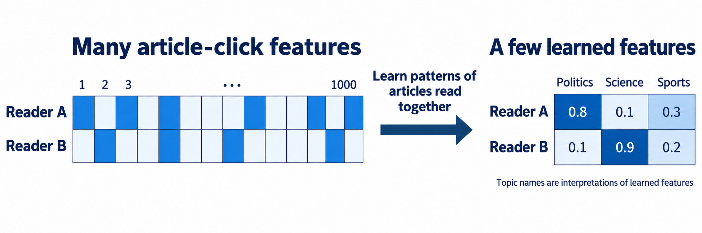{.nostretch fig-align="center" height="280px" fig-alt="The same readers represented by many article-click features and then learned features interpreted as politics, science, and sports."}

<center><small>Image created by GPT-6.1 Sol Light</small></center>

::: {.notes}
Two readers may each click 20 articles but have very different interests. A learned representation could describe each reader with a few topic-like scores instead of thousands of article columns. The diagram is an illustrative example, not the output of a fitted model. Its scores are features, not probabilities. Rows remain readers; the new columns are learned dimensions, not cluster IDs. Topic names are possible interpretations added after learning, not supplied training labels. These dimensions need interpretation; they are not guaranteed to correspond to named topics. Illustration generated using the built-in OpenAI image-generation tool. We motivate dimensionality reduction here; its algorithms come later. Manually counting known topics is feature engineering, not itself unsupervised representation learning.
:::

# How can we group similar examples?

## Your turn: group the foods {.slide-your-turn .smaller}

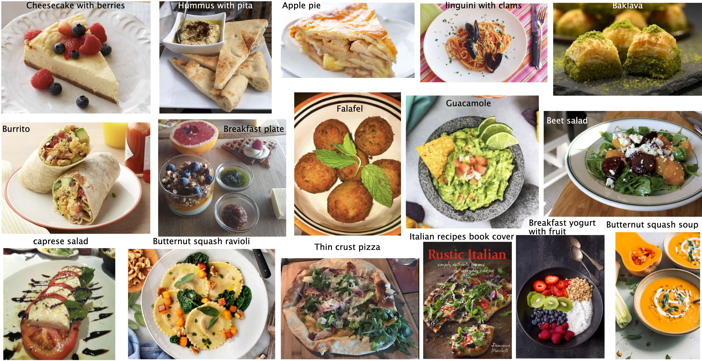{.nostretch fig-align="center" height="330px"}

**With a neighbour (2 minutes):** Propose two useful groupings. For each, explain its purpose and the features you would use. Would raw pixels capture what you mean by “similar”?

::: {.notes}
Examples: sweet/savoury, meal type, ingredients, or visual appearance. There need not be one correct grouping. Pixel colour, ingredient indicators, and learned image representations encode different similarities. Ask how the intended use affects the choice.
:::

## The goal of clustering

**Group similar examples without predefined group labels.**

- **Within a cluster:** examples should be similar.
- **Between clusters:** examples should differ.

What counts as "similar" depends on the **features, distance, and purpose**, as in your food groupings.

The algorithm returns memberships; **we interpret what the groups mean**.

::: {.notes}
Connect the definition to two groupings proposed during the food activity. For example, grouping by ingredients and grouping by appearance use different notions of similarity. The input is X without target group labels; the output identifies which examples belong together. Within-group similarity and between-group differences describe the broad aim, not a single objective shared by every clustering algorithm. There need not be one universally correct partition or useful clusters in every dataset. Cluster IDs are arbitrary identifiers, not explanations: renaming 0, 1, 2 leaves memberships unchanged. Next, use the familiar Euclidean-distance toolbox to develop one specific approach, K-Means.
:::

## Using the distance tools we already know 

Represent each food by numeric features and choose $k$ groups.

- **KNN** taught us to compare points using Euclidean distance.
- Represent each group by a **centre**; assign points to the nearest one.
- Use the group's **mean** as its centre.

But **we need groups to calculate centres, and centres to assign groups**.

::: {.notes}
This is the problem K-Means resolves. Means are feature-wise averages and may not correspond to an actual food item. Keep k fixed for now; how to choose it is the next major problem.
:::

## The K-Means algorithm

**Input:** features $X$ and $k$. **Output:** $k$ centroids and one label per example.

1. Choose $k$ initial centres.
2. **Assign:** send each point to its nearest centre.
3. **Update:** move each centre to the mean of its assigned points.
4. Repeat assignment and update until the centres change very little, or the iteration limit is reached.

**The number of clusters stays fixed during a run.**

::: {.notes}
The teaching walkthrough uses Lloyd's alternating steps. Given centres we can assign points; given assignments we can calculate means. Alternating resolves the dependency. Centroids need not be observed examples. Cluster IDs have no inherent order. Exact ties can be broken deterministically. Empty clusters require an implementation rule; the interactive demo retains their previous centres and explicitly reports that choice.
:::

## Your turn: act out K-Means {.slide-your-turn .smaller}

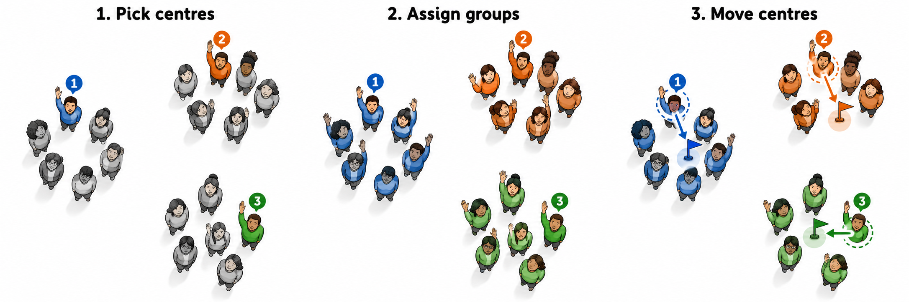{.nostretch fig-align="center" height="250px"}

1. **Pick centres:** three volunteers mark the initial centre positions.
2. **Assign:** raise your hand when your nearest centre is called.
3. **Update:** move each centre to its group's average row/column position.
4. **Repeat:** reassign, then update.

Keep everyone else's position fixed. A centre can lie **between seats**.

::: {.notes}
Allow 4–5 minutes. Students can participate from their seats. Choose three visible volunteers as initial centres; they stand or raise a hand. Treat seat rows and columns as coordinates and use physical distance consistently. During assignment, call each centre in turn and ask students nearest to it to raise their hands. Resolve ties with the lower centre number. Freeze memberships while estimating all three means, then move the centre markers before anyone reassigns. If possible, volunteers serve as movable centre markers while the original seat positions remain the fixed data; otherwise mark the mean with a gesture or object. The centroid need not coincide with a student or seat. The illustration is schematic: flags move while observations stay fixed. Stop after two or three rounds. Ask what stayed fixed (k=3 and the data), what changed (memberships and centre locations), and whether different starting volunteers could give a different result. Use the following interactive slide briefly to show exact updates rather than repeat the full activity. Illustration generated with OpenAI image generation.
:::

## Discuss: what happened during K-Means? {.slide-your-turn}

1. Did anyone **switch clusters** in the second round? Why?
2. When do you think **K-Means should stop**?
3. Could we get a **different result** with different initial centres?

::: {.notes}
Allow a minute for discussion before inviting responses. A point can switch clusters because a different centre becomes closest after the centres move; switching is possible, not required. With exact updates, stable centres and assignments indicate convergence. Practical implementations stop when changes are sufficiently small or the maximum number of iterations is reached. The number of clusters stays fixed, so an unchanged k is not a stopping criterion. Different initial centres can lead to different final groupings, even with the same data and k; convergence does not guarantee a global optimum. Use “initial centres” rather than “initial clusters” because the centres are chosen before the first assignment. Connect the observations to the following interactive check and revisit initialization later in the lecture.
:::

## Interactive check: assign, average, repeat {.slide-your-turn .smaller}

**Before Assign:** Which centre will the highlighted point join? **Before Update:** Where will its centre move?

<div class="kmeans-live">
<iframe src="demos/k-means.html" title="Interactive K-Means: assignment, centroid updates, initialization and k" style="width:100%;height:450px;border:0;" loading="eager"></iframe>
</div>

<div class="kmeans-print">

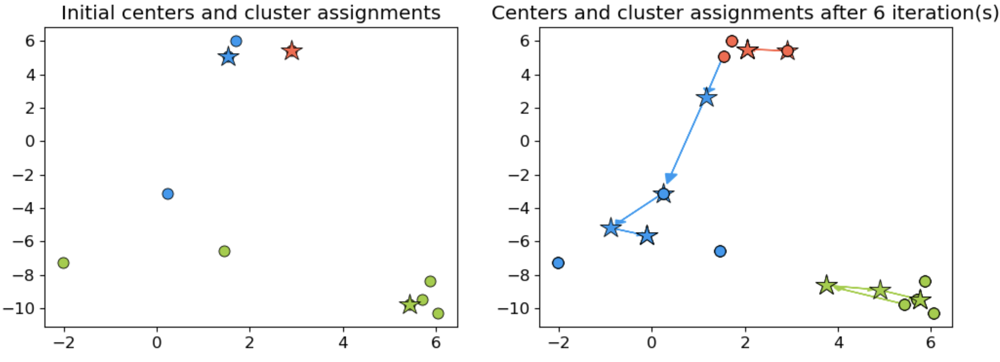{.nostretch fig-align="center" height="300px"}

Assign each point to its nearest centre, then move each centre to its cluster's mean.

</div>

::: {.notes}
Keep k=3 and the Spread initialization for the first walkthrough. Point 7 is highlighted initially: it first joins centre 2, then switches to centre 1 after the first update. Point 23 is another boundary example to inspect. Ask for predictions before each separate step. Click a point to highlight it; turn on distances to compare its distances to all centres. Points stay uncoloured until the first assignment. After an update, colours still show the preceding assignments until Assign is pressed again. During the update, ask students to average coordinates for one selected cluster; a centroid need not be an observed point. Revisit this demo for initialization and k later. Open the standalone demo if more space is needed: demos/k-means.html. Static PDFs show the existing worked-example image instead of the controls.
:::

## K-Means in scikit-learn

```{.python}
from sklearn.cluster import KMeans

km = KMeans(n_clusters=3, random_state=42)
labels = km.fit_predict(X)  # no target y
centres = km.cluster_centers_
new_labels = km.predict(X_new)
```

`predict` assigns new examples to their nearest **learned centre**.

::: {.notes}
X and X_new must use the same feature representation and preprocessing. This is a code illustration, not an executable slide cell. Explicit n_init avoids relying on a version-specific default. predict does not move centres or refit the model.
:::

## Your turn: predict a new example {.slide-your-turn .smaller}

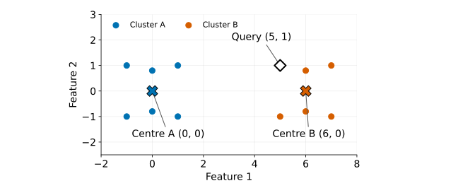{.nostretch fig-align="center" height="350px"}

**Which cluster gets the query point? Explain using distance.**

Does `predict` move either centre? What if we instead refit on the expanded dataset?

::: {.notes}
Allow one minute. The learned centres are A=(0,0) and B=(6,0); query=(5,1). Distances are sqrt(26) and sqrt(2), so predict assigns B. It does not refit or move centres. Refitting including this point can change centres and potentially assignments; it is a different operation. Plot points are synthetic and have means exactly at the labelled centres. Use the same preprocessing for training and new inputs.
:::

## iClicker: assignments and prediction {.slide-your-turn .smaller}

**Select all true statements.**

- (A) A centroid must coincide with an observed example.
- (B) A point may change clusters during fitting.
- (C) $k$ increases automatically as fitting proceeds.
- (D) `predict` assigns a new point without moving the learned centres.
- (E) Renaming cluster IDs leaves the grouping unchanged.

::: {.notes}
Answers: B, D, E. Centroids are means and need not be observations. k is fixed during a run. All points are assigned at each assignment step. Contrast predict with refitting.
:::

## Initialization: same data, different groups {.smaller .slide-your-turn}

We have fixed $X$ and $k$. Does that determine a single final result? Which initilization is better here? 

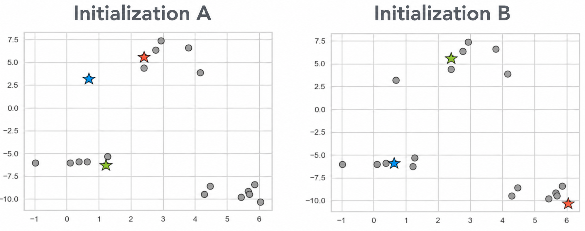{.nostretch fig-align="center" height="350px"}

## Getting a better starting point

**Problem:** one initialization can produce a poor solution.

- **K-Means++** spreads out the initial centres.
- **Multiple starts** try different initializations and retain the lowest within-cluster sum of squares.
- A fixed **`random_state`** makes the result reproducible.

If you use `n_init=10`: try ten starts, then retain the best run.

::: {.notes}
K-Means++ is scikit-learn's default initialization. The within-cluster sum of squares is inertia, defined in the next section. These strategies improve the chance of finding a good solution but do not guarantee the global optimum. Reproducibility and quality are different properties.
:::

## iClicker: has K-Means found the best solution? {.slide-your-turn}

The centres have stopped moving. **Which statement follows?**

- (A) This is the globally smallest possible sum of squared distances.
- (B) Every other initialization must produce the same grouping.
- (C) Another assignment/update cycle will leave this solution unchanged, using the same tie rules.
- (D) The chosen $k$ must be appropriate for the application.

::: {.notes}
Answer: C for the exact stable-centre case stated. Practical implementations can stop with small changes under a tolerance or at an iteration cap. Convergence does not prove global optimality, uniqueness, or an appropriate k.
:::

## Scaling: should changing units change the groups?

- We cluster customers using **age in years** and **spending in dollars**.

- Changing spending to **thousands of dollars** changes its contribution to Euclidean distance even though the customers are unchanged.

- **Use the preprocessing tools we know:** usually scale numeric features before K-Means.

- Fit the scaler on the fitting data and apply the same transformation to new examples.

::: {.notes}
Spending differences shrink by a factor of 1,000 and squared contributions by one million. StandardScaler is a reasonable starting point; scaling is a modelling choice, not a guarantee of meaningful similarity. Use a pipeline when applying scaling and K-Means together. Scaling cannot recover semantic information missing from the features.
:::

## K-Means: strengths and limitations {.smaller}

| Strength | Limitation |
|---|---|
| Simple and usually efficient | We must choose $k$ |
| Centres summarize groups compactly | Means are sensitive to outliers |
| Effective for compact, roughly spherical, similarly sized groups | Curved or elongated groups can be split unnaturally |
| Assigns every example to a group | No explicit rejection of noise or ambiguous points |

**Initialization and feature representation affect the result.**

::: {.notes}
Tie each limitation back to the algorithm rather than presenting a disconnected list. Nearest-centre assignment favours this geometry; averaging explains outlier sensitivity. Distance explains scale sensitivity. Other clustering methods in the next lecture relax some of these assumptions.
:::

# How many groups should we create?

## How many clusters?

K-Means asks us to choose $k$ **before fitting**.

- **Too few:** we may merge groups whose differences matter.
- **Too many:** we may split useful groups into small fragments.
- There may not be one correct $k$; the intended use and domain knowledge matter.

**How can we compare candidate values of $k$?**

::: {.notes}
Connect to the preceding fits with a fixed k. We now need to choose how detailed a grouping should be. Some datasets have a clear grouping at a particular scale; others support several reasonable choices or have no useful cluster structure. The goal is usefulness for the intended task, not a convenient narrative.
:::

## Evidence for choosing $k$ {.smaller}

:::: {.columns}
::: {.column width="50%"}

### Quantitative evidence

- **Elbow plot:** how much does another centre reduce inertia?
- **Silhouette:** how cohesive and separated are the groups?

:::
::: {.column width="50%"}

### Qualitative evidence

- Inspect examples: what do members of each group share?
- Are the groups useful for the intended task?

:::
::::

**Use numerical diagnostics alongside interpretation.**

::: {.notes}
This is a roadmap for the next slides. Numerical diagnostics quantify properties of a particular representation and distance; they do not establish the real-world meaning of the groups. Use domain knowledge and inspect multiple examples, including ambiguous ones. Neither approach alone establishes a uniquely correct k.
:::

## Measuring fit with inertia

We can fit K-Means for several values of $k$. How can we compare them?

**Inertia** is the sum of squared distances to assigned centroids:

$$\text{inertia}=\sum_{i=1}^{n}\lVert x_i-c_{z_i}\rVert^2.$$

For a fixed $k$, lower inertia means a better fit to this objective.

**Does the smallest inertia necessarily give the most useful grouping?**

::: {.notes}
z_i identifies point i's cluster. Inertia depends on the representation and scale. The best achievable objective cannot increase with k, but separately fitted heuristic runs can be nonmonotone due to local minima. Use multiple starts. The following example will expose the k=n extreme; leave the answer open here.
:::

## The elbow method 

**Adding centres can reduce inertia but how much improvement is enough?**

- Fit K-Means for several values of $k$.
- Plot **inertia** against $k$.
- Look for an **elbow**, where further reductions become much smaller.

The elbow suggests a **candidate $k$**. It may be weak or absent.

::: {.notes}
The elbow is a diminishing-returns heuristic, not a guarantee of the optimal number of clusters. Compare fits on the same data and representation. Inertia is a sum of squared distances, not a sum of unsquared distances.
:::

## The elbow method example {.smaller .slide-your-turn}

:::: {.columns}
::: {.column width="60%"}

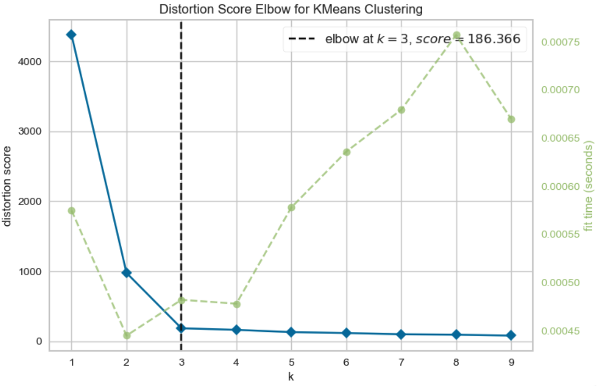{.nostretch fig-align="center" width="540px"}

:::
::: {.column width="40%"}

- At **$k=1$**, where is the centre? What does inertia measure?
- At **$k=n$**, what can inertia be?
- Why don't we always choose **$k=n$**?

:::
::::

**Which candidate $k$ would you investigate from this plot?**

::: {.notes}
At k=1 the centroid is the overall feature-wise mean, and inertia is the sum of squared distances from all examples to that mean. With one centre at each example, inertia can be zero at k=n; this gives no useful grouping or compression. Coincident examples need not form n distinct groups. Walk through the large early drops and smaller later drops, then invite candidate k values rather than a unique correct answer. The legacy figure also includes a fitting-time curve; focus on the within-cluster squared-distance curve. Some datasets have no clear elbow.
:::

## Are individual points in suitable groups?

Inertia tells us how close points are to **their own centres**.

It does not directly compare a point's own group with its **nearest competing group**.

We already know how to calculate distances. Compare:

- How close is this point to others **inside its group**?
- How close is it to points in the **best alternative group**?

This motivates the **silhouette score**.

## {.slide-your-turn}

Which blue point seems more confident about belonging to the blue cluster? Why?

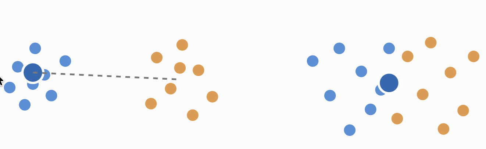

## {.slide-your-turn}

Which blue point seems more confident about belonging to the blue cluster? Why?

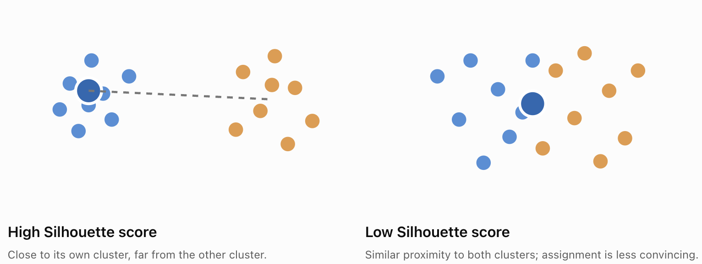


## Silhouette: cohesion and separation {.smaller}

For one point $i$:

- $a(i)$: mean distance to **other points in its own cluster**.
- $b(i)$: smallest mean distance to points in **another cluster**.

$$s(i)=\frac{b(i)-a(i)}{\max(a(i),b(i))}.$$

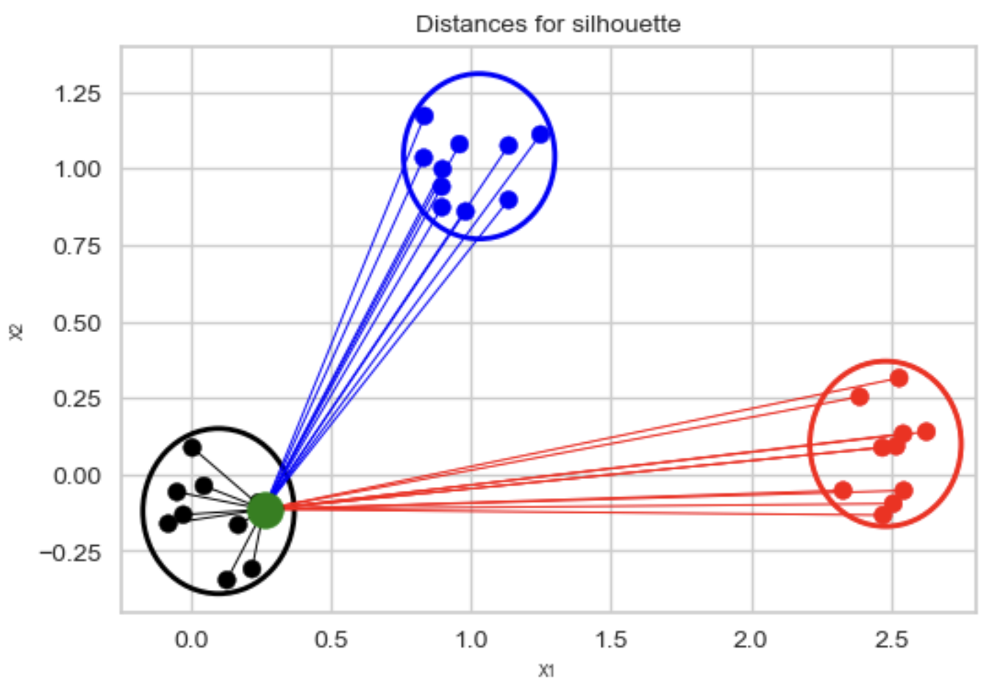{.nostretch fig-align="center" height="230px"}

::: {.notes}
b is based on all points in the nearest competing cluster by average distance, not distance to a competing centroid. The overall score averages the point scores. Silhouette can evaluate clusterings from methods other than K-Means. A singleton's silhouette is conventionally set to zero; the overall metric requires between 2 and n−1 distinct labels.
:::

## Interpreting silhouette scores {.smaller}

| Score | What it suggests |
|---|---|
| Near **1** | Own-cluster distances are small relative to competing-cluster distances |
| Near **0** | Own and nearest-competing cluster distances are similar |
| **Negative** | A competing cluster is closer on average |

Higher average scores suggest more cohesive, separated groups **under the chosen distance**.

They do not establish that the groups match our intended meaning.

## Reading a silhouette plot {.smaller}

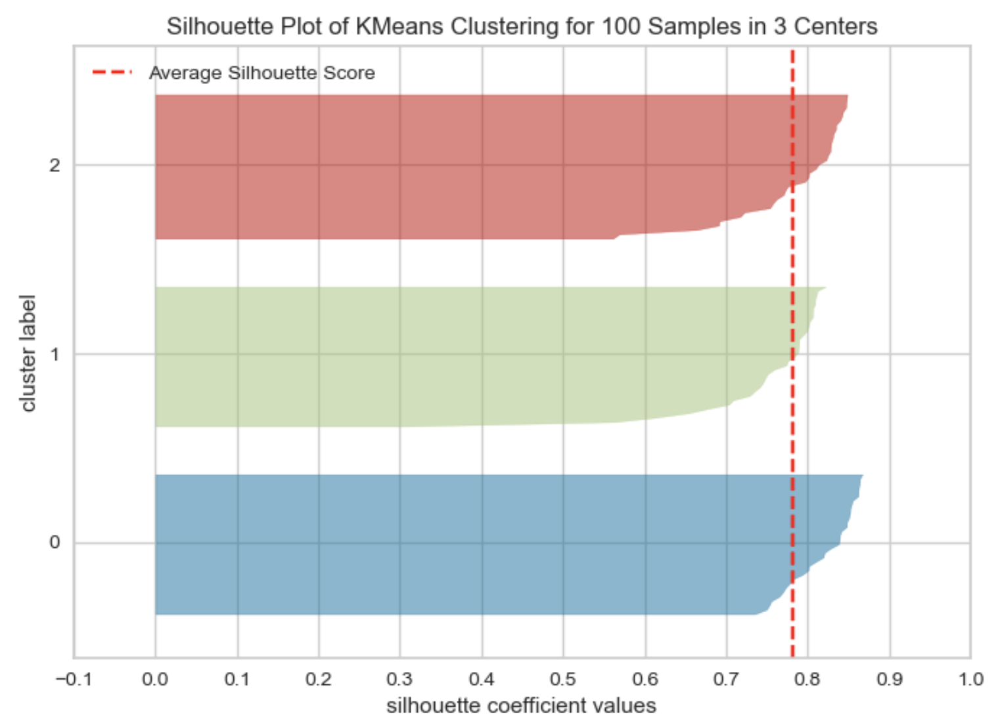{.nostretch fig-align="center" height="360px"}

Each band is a cluster; its thickness shows its size. Horizontal position is the score; the dashed line is the overall mean.

::: {.notes}
No negative scores appear in this example. Each band contains the scores for one cluster; its vertical thickness reflects its number of points. Horizontal position is silhouette score. The dashed line marks the overall average. Ask which clusters have low-score points and inspect their examples and competing groups. Not every cluster or every point needs to exceed the global mean. Similar cluster sizes are not a requirement for useful clustering.
:::

## Your turn: compare candidate clusterings {.slide-your-turn .smaller}

**Illustrative results on the same representation:**

| Fit | $k$ | Inertia | Mean silhouette |
|---|---:|---:|---:|
| A | 3 | 120 | 0.62 |
| B | 5 | 80 | 0.41 |

1. In B, one point has $a=6$, $b=2$. Calculate its silhouette. What does it suggest?
2. Which fit would you investigate first? Does either score settle the choice?
3. What would you inspect before recommending a grouping?

::: {.notes}
Allow two minutes in pairs. These numbers are hypothetical and are not outputs of the preceding plot. The point's score is (2−6)/6=−2/3: on average it is closer to a competing cluster. A is a reasonable initial candidate because it is simpler and has better average separation, but neither metric proves application usefulness. Inspect members, low-score examples, cluster sizes, stability, and domain relevance. B's lower inertia is not sufficient to prefer it. Other justified choices are welcome.
:::

## iClicker: choosing $k$ {.slide-your-turn .smaller}

**Which statements are true? Select all that apply.**

- (A) Every dataset has one obvious elbow.
- (B) Silhouette compares point-to-point distances, so it can assess methods without centroids.
- (C) A negative silhouette suggests a competing group is closer on average.
- (D) The largest silhouette score proves the clusters have useful real-world meanings.
- (E) Elbow and silhouette diagnostics should be combined with inspection.

::: {.notes}
Answers: B, C, E. Both diagnostics favour particular geometries; they can mislead on complex shapes, unequal densities, or application-specific groupings. An elbow can be weak or absent. A numerical optimum is not a guarantee of usefulness.
:::

## Class demo: image clustering

[K-Means demo notebook](https://github.com/UBC-CS/cpsc330-2026W1/blob/main/content/classes/varada/lecture-14-k-means-demo.ipynb)

1. Compare bird clusters from **pixels** and **pretrained features**.
2. Inspect the more varied **food images**.
3. Consider what changing $k$ would do to these groups.

**Before running:** Which visual similarities can the chosen features capture?

::: {.notes}
Use the current lecture-14 notebook. Focus on the chosen representation and interpretation rather than every code line. Only X is supplied to the clustering fit. Any external labels used to inspect results are not training targets for K-Means.
:::

## Today's takeaways {.slide-summary}

- **Without targets:** discover groups or learn useful representations.
- **To form groups:** K-Means alternates nearest-centre assignments and mean updates.
- **To get useful results:** consider initialization, scaling, and cluster geometry.
- **To choose $k$:** combine elbow and silhouette diagnostics with inspection.
- **From the image demo:** changing the representation changes similarity; we interpret the resulting groups.

::: {.notes}
Summarize immediately after the notebook. Ask students to connect the actual pixel-versus-feature results to the opening food representations. Avoid claiming that pretrained features always recover the desired categories.
:::

## Exit question {.slide-your-turn}

Your image clusters have a **high average silhouette score**, but they group backgrounds together rather than the objects you care about.

**What would you investigate or change next, and why?**

Explain why changing $k$ alone might not solve the problem.

::: {.notes}
Ask for an individual response in one or two sentences. A strong answer connects the score to distances in the supplied representation, inspects members and preprocessing, and proposes a representation that captures object content. Changing k alters the partition but does not add missing semantic information. Other justified investigations are acceptable.
:::

<style>
.kmeans-print { display: none; }
@media print {
  .kmeans-live { display: none !important; }
  .kmeans-print { display: block !important; }
}
html.print-pdf .kmeans-live { display: none !important; }
html.print-pdf .kmeans-print { display: block !important; }
</style>
