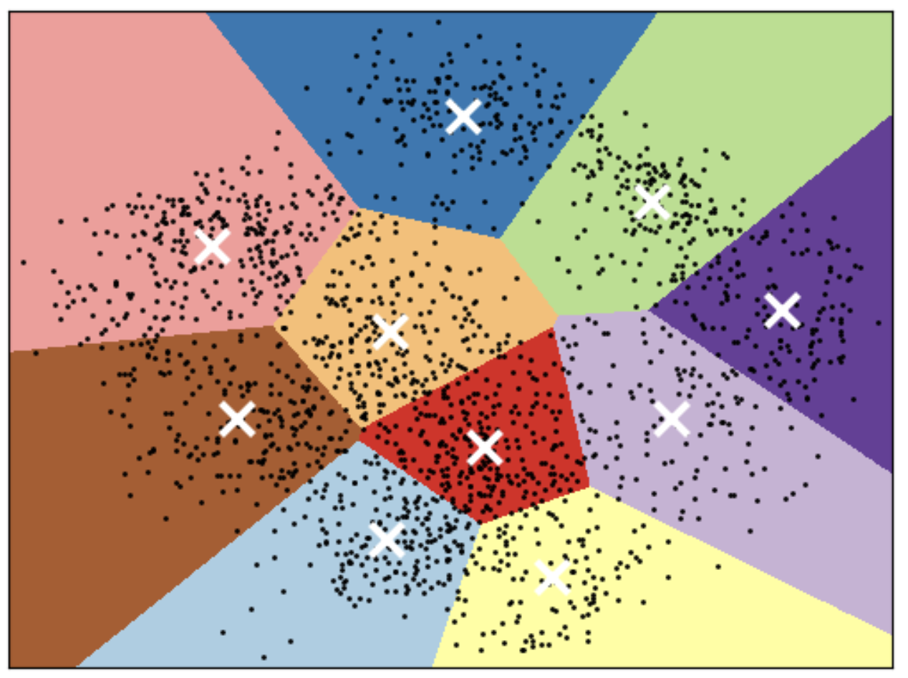

```{python}
#| echo: false
#| include: false
import os
import sys

import matplotlib.pyplot as plt
import numpy as np
import pandas as pd
from matplotlib.patches import Circle
from scipy.cluster.hierarchy import dendrogram, fcluster, linkage
from sklearn.cluster import DBSCAN, KMeans
from sklearn.datasets import make_blobs, make_circles, make_moons
from sklearn.preprocessing import StandardScaler

sys.path.insert(0, os.path.join(os.path.abspath("."), "code"))
from plotting_functions_unsup import (
    discrete_scatter, plot_kmeans, plot_kmeans_gmm, plot_original_clustered,
)
plt.close("all")  # Discard figures created when importing the existing helpers.

# Keep the later parameter comparisons on the lecture-notes dataset.
X_moons, _ = make_moons(n_samples=180, noise=0.07, random_state=42)

plt.rcParams.update({"font.size": 12, "figure.figsize": (6, 4)})


def plot_cluster_labels(X, labels, ax=None, title=None, annotate=False):
    """Plot a partition, with noise shown as grey crosses."""
    if ax is None:
        _, ax = plt.subplots()
    labels = np.asarray(labels)
    for label in np.unique(labels):
        mask = labels == label
        colour = "grey" if label == -1 else f"C{int(label) % 10}"
        ax.scatter(
            X[mask, 0], X[mask, 1], s=70, color=colour,
            marker="x" if label == -1 else "o",
            **({"edgecolors": "black", "linewidths": 0.6} if label != -1 else {}),
            label="noise" if label == -1 else f"cluster {label}",
        )
    if annotate:
        ax.margins(0.15)
        for i, point in enumerate(X):
            ax.annotate(str(i), point, xytext=(6, 6), textcoords="offset points")
    ax.set(xlabel="Feature 0", ylabel="Feature 1", title=title)
    ax.set_aspect("equal", adjustable="box")
    return ax


def plot_dbscan(X, model, ax, title):
    """Use colour for cluster membership and marker size for point type."""
    labels = model.labels_
    core = np.zeros(len(X), dtype=bool)
    core[model.core_sample_indices_] = True
    for label in sorted(set(labels) - {-1}):
        colour = f"C{int(label) % 10}"
        for is_core, size in [(True, 55), (False, 22)]:
            mask = (labels == label) & (core == is_core)
            ax.scatter(X[mask, 0], X[mask, 1], s=size, color=colour,
                       edgecolor="black", linewidth=0.4)
    noise = labels == -1
    ax.scatter(X[noise, 0], X[noise, 1], color="grey", marker="x", s=35)
    n_clusters = len(set(labels) - {-1})
    cluster_word = "cluster" if n_clusters == 1 else "clusters"
    ax.set_title(f"{title}\n{n_clusters} {cluster_word}; {noise.mean():.0%} noise")
    ax.set(xlabel="Feature 0", ylabel="Feature 1")
    ax.set_aspect("equal", adjustable="box")


def plot_hierarchy_cut(X, Z, labels, height, title):
    """Match dendrogram branch colours to flat-cluster colours."""
    n = len(X)
    members = {i: [i] for i in range(n)}
    for i, row in enumerate(Z):
        members[n + i] = members[int(row[0])] + members[int(row[1])]

    def branch_colour(node):
        groups = np.unique(labels[members[node]])
        return f"C{int(groups[0]) % 10}" if len(groups) == 1 else "grey"

    fig, axes = plt.subplots(1, 2, figsize=(11, 4.5))
    dendrogram(Z, ax=axes[0], link_color_func=branch_colour,
               leaf_font_size=11)
    axes[0].axhline(height, color="black", linestyle="--", label=f"cut = {height:.2f}")
    axes[0].set(xlabel="Sample index", ylabel="Merge height", title=title)
    axes[0].legend()
    plot_cluster_labels(X, labels, ax=axes[1], title="Flat clusters", annotate=True)
    plt.tight_layout()
```

## Focus on the breath!

{.nostretch fig-align="center" width="500px"}

## Announcements {.smaller}

## Today's big questions {.slide-goals}

1. When does a **nearest-centre** grouping fail?
2. How can **density** define a cluster and identify noise?
3. How can we explore **nested groups** with a dendrogram?
4. What evidence makes a clustering **useful**?

## iClicker 15.1: recalling K-Means {.slide-your-turn}

**Select all statements that are true.**

- (A) With $n$ examples and $d$ features, K-Means learns $k$ centres, each with $d$ coordinates.
- (B) The parameter $k$ plays the same role in KNN and K-Means.
- (C) Changing feature units can change a distance-based clustering.
- (D) When choosing the number of clusters, we should prefer values that produce clusters of roughly equal size.

::: {.notes}
Answers: A and C. KNN uses k neighbours for a prediction; K-Means requests k groups. Units affect distances unless preprocessing compensates. Equal group sizes are not a general clustering goal. Cluster IDs are arbitrary.
:::

# K-Means limitations {.smaller}

## Shape of clusters

- Good for compact, roughly spherical clusters of comparable sizes.

{.nostretch fig-align="center" width="500px"}

::: {.notes}
K-Means uses nearest-centre assignments under Euclidean distance. Comparable sizes describe a favourable setting, not a requirement or an equal-size constraint. Scaling, representation, initialization, and outliers also affect the result.
:::

## When nearest-centre assignments fail

Even with the intended $k$, K-Means can split natural groups.

```{python}
#| fig-width: 12
#| fig-height: 5.2
X_elongated, _ = make_blobs(random_state=170, n_samples=200)
rng = np.random.RandomState(74)
X_elongated = X_elongated @ rng.normal(size=(2, 2))
failure_cases = [
    ("Two moons", make_moons(n_samples=200, noise=0.05, random_state=42)[0], 2),
    ("Concentric rings", make_circles(n_samples=200, noise=0.06, factor=0.4, random_state=42)[0], 2),
    ("Elongated groups", X_elongated, 3),
]
fig, axes = plt.subplots(2, 3, figsize=(12, 5.2))
for col, (title, X_case, k) in enumerate(failure_cases):
    model = KMeans(n_clusters=k, n_init="auto", random_state=42).fit(X_case)
    discrete_scatter(X_case[:, 0], X_case[:, 1], ax=axes[0, col])
    discrete_scatter(X_case[:, 0], X_case[:, 1], model.labels_,
                     markers="o", ax=axes[1, col])
    discrete_scatter(model.cluster_centers_[:, 0], model.cluster_centers_[:, 1],
                     range(k), s=15, markers="*", markeredgewidth=1.0,
                     ax=axes[1, col])
    axes[0, col].set_title(title)
    axes[1, col].set_title(f"K-Means ($k={k}$)")
    for ax in axes[:, col]:
        ax.set_xticks([])
        ax.set_yticks([])
    axes[1, col].set_xlim(axes[0, col].get_xlim())
    axes[1, col].set_ylim(axes[0, col].get_ylim())
axes[0, 0].set_ylabel("Original data")
axes[1, 0].set_ylabel("K-Means clusters")
fig.tight_layout()
```

::: {.notes}
Ask students where nearest-centre boundaries will cut each dataset. We supply the intended number of groups in every case, so choosing k is not the difficulty. Moons and rings require curved group boundaries; elongated groups can also be split by nearest-centre assignments. More initializations cannot remove this geometry. The original-data row is unlabelled; generating labels do not define the only useful partition.
:::

# Can we do better?

## DBSCAN {.smaller}

- **D**ensity-**B**ased **S**patial **C**lustering of **A**pplications with **N**oise
- Forms clusters from connected dense regions, leaving isolated points as noise.

```{python}
#| echo: true
X, y = make_moons(n_samples=200, noise=0.08, random_state=42)
dbscan = DBSCAN(eps=0.2, min_samples=5)
dbscan.fit(X)
plot_original_clustered(X, dbscan, dbscan.labels_)
```

::: {.notes}
DBSCAN follows connected dense regions instead of assigning points to the nearest centre. The default min_samples is 5. We did not supply the number of clusters. Later parameter comparisons use the slightly different moons dataset from the lecture notes, held fixed across those comparisons.
:::

## Two choices define “locally dense”

- **`eps`:** radius of a point's neighbourhood.
- **`min_samples`:** minimum number of examples in that neighbourhood, **including the point itself**, needed to make it a **core point**.

We choose these parameters; the **number of clusters emerges**.

Their values depend on the **features, scale, and distance metric**.

## Core, border, and noise

- **Core:** at least `min_samples` examples within `eps`, counting itself.
- **Border:** not core, but within `eps` of a core point.
- **Noise:** neither core nor within `eps` of any core point.

**Only core points extend a cluster.** Border points can join it.

## Your turn: who can extend the group? {.slide-your-turn .smaller}

`eps=0.5`, `min_samples=4`. Why is point 5 noise even though it is near point 4?

```{python}
#| echo: false
#| fig-width: 11
#| fig-height: 4.2
X_points = np.array([
    [0.0, 0.0], [0.1, 0.1], [-0.1, 0.1], [0.0, -0.15],
    [0.55, 0.0], [1.0, 0.0],
])
point_model = DBSCAN(eps=0.5, min_samples=4).fit(X_points)
point_types = np.full(len(X_points), "border", dtype=object)
point_types[point_model.labels_ == -1] = "noise"
point_types[point_model.core_sample_indices_] = "core"

fig, axes = plt.subplots(1, 2, figsize=(11, 4.2))
label_offsets = [(-14, -8), (10, 10), (-15, 10), (0, -18), (0, -20), (0, -20)]
for ax, centre, colour, title in zip(
    axes, [1, 4], ["C0", "C1"],
    ["Point 1: core neighbourhood", "Point 4: border neighbourhood"],
):
    ax.add_patch(Circle(X_points[centre], 0.5, facecolor=colour,
                        edgecolor=colour, alpha=0.12, zorder=0))
    ax.add_patch(Circle(X_points[centre], 0.5, fill=False,
                        linestyle="--", linewidth=2, edgecolor=colour))
    for kind, marker, point_colour, size in [
        ("core", "o", "C0", 150),
        ("border", "s", "C1", 140),
        ("noise", "x", "grey", 150),
    ]:
        mask = point_types == kind
        ax.scatter(X_points[mask, 0], X_points[mask, 1], marker=marker,
                   color=point_colour, s=size, zorder=3, label=kind,
                   **({"edgecolors": "black", "linewidths": 0.8}
                      if kind != "noise" else {"linewidths": 2.5}))
    for i, point in enumerate(X_points):
        ax.annotate(str(i), point, xytext=label_offsets[i],
                    textcoords="offset points", ha="center", va="center",
                    fontsize=12, fontweight="bold",
                    bbox=dict(facecolor="white", edgecolor="none", pad=1),
                    zorder=4)
    count = np.count_nonzero(np.linalg.norm(X_points - X_points[centre], axis=1) <= 0.5)
    ax.set_title(title, fontsize=14, pad=12)
    ax.set_xlabel(f"{count} points within eps (including point {centre})", fontsize=12)
    ax.set(xlim=(-0.65, 1.15), ylim=(-0.6, 0.7), xticks=[], yticks=[])
    ax.set_aspect("equal")
    for spine in ax.spines.values():
        spine.set_visible(False)
handles, labels = axes[0].get_legend_handles_labels()
fig.legend(handles, labels, loc="lower center", ncol=3, frameon=False,
           bbox_to_anchor=(0.5, 0.0))
fig.tight_layout(rect=(0, 0.1, 1, 1))
```

::: {.notes}
Points 0–3 are core, 4 is border, and 5 is noise. Point 4 cannot extend the cluster to 5. The two panels show the same data with one eps-neighbourhood highlighted at a time. Point 1 has five points in its neighbourhood; point 4 has only three (1, 4, and 5). Count each centre point itself. Point 5 is within eps of border point 4, but no core point. Its distance from 4 is 0.45, safely inside eps rather than exactly on the boundary. A chain of border points cannot connect clusters.
:::

## How DBSCAN grows clusters {.smaller}

:::: {.columns}
::: {.column width="48%"}
{.nostretch height="300px" fig-alt="DBSCAN expanding clusters through neighbouring core points."}
:::
::: {.column width="52%"}
1. Visit an unprocessed point.
2. If core, start a cluster and add its neighbours.
3. Expand through any core neighbours.
4. Repeat until no further expansion is possible.
5. Continue with unprocessed points.

Points never reached from core points remain **noise**.
:::
::::

::: {.notes}
A point initially marked noise can later join a cluster. Border points never propagate a label. Core components are fixed for fixed data and parameters; an ambiguous border point reachable from two components can receive either label depending on processing order. Animation source: https://dashee87.github.io/data%20science/general/Clustering-with-Scikit-with-GIFs/ .
:::

## DBSCAN in scikit-learn

```{python}
#| echo: true
#| eval: false
model = DBSCAN(eps=0.22, min_samples=6)
labels = model.fit_predict(X_moons)
# After fitting, these labels are also in model.labels_
```

- One label per input row; **`-1` means noise**.
- Other integers are arbitrary group identifiers.
- Standard DBSCAN has **no `predict` method** for new points.

::: {.notes}
Adding observations can change density connections. Fitting the expanded dataset can change memberships; it is not equivalent to K-Means assigning new observations to fixed centres.
:::

## Your turn: human DBSCAN {.slide-your-turn}

**Keep the same students and positions for every run.**

- Each student is a point; distance is physical seat distance.
- Start with `eps` about 1 m and `min_samples=4`.
- Count neighbours **including yourself**; identify all core points first.
- Give connected core points one label, then label their border neighbours.
- Everyone else is noise. **Border points do not spread labels.**

::: {.notes}
Allow about 4 minutes. Use one clearly bounded group of seats, and count only participating students. Students can remain seated and signal roles by raised hands. Use row/seat IDs to record memberships. Start a new label only for a core point not already reached. If a border point touches two core components, assign it to the first component processed, without merging the components.
:::

## Repeat: change one parameter {.slide-your-turn}

| Run | `eps` | `min_samples` | What changed? |
|---|---|---|---|
| Baseline | ~1 m | 4 | Identify core, border, noise |
| Wider neighbourhood | ~3 m | 4 | Which groups connect? |
| Stricter density | ~1 m | 15 | Who remains core? |

**Reset labels between runs. Keep positions fixed.**

::: {.notes}
Compare each changed run with baseline, not with the previous run. Choose radii appropriate to the room. The larger radius can be judged from seats rather than asking students to move or reach. Exact outcomes depend on seating density; do not promise a particular cluster count.
:::

## Predict: increase `eps` {.slide-your-turn .smaller}

Hold `min_samples=6` fixed. Which setting fragments or merges the moons?

**Large dots:** core. **Small dots:** border. **Grey crosses:** noise.

```{python}
#| echo: false
X_density = np.vstack([
    X_moons, [[-1.5, 1.5], [2.4, 1.4], [0.5, -1.0], [1.6, -0.9]]
])
fig, axes = plt.subplots(1, 3, figsize=(12, 4), sharex=True, sharey=True)
for ax, eps in zip(axes, [0.12, 0.22, 0.40]):
    model = DBSCAN(eps=eps, min_samples=6).fit(X_density)
    plot_dbscan(X_density, model, ax, f"eps={eps}, min_samples=6")
plt.tight_layout()
```

::: {.notes}
Small neighbourhoods fragment the groups; the middle setting recovers the moons; the large setting joins them. Colours are local identifiers within each panel, not correspondence across runs. Increasing eps can grow or merge core components; the cluster count need not change monotonically because new components can also appear from noise.
:::

## Predict: increase `min_samples` {.slide-your-turn .smaller}

Hold `eps=0.22` fixed. Does every parameter change alter the partition?

```{python}
#| echo: false
fig, axes = plt.subplots(1, 3, figsize=(12, 4), sharex=True, sharey=True)
for ax, min_samples in zip(axes, [3, 6, 12]):
    model = DBSCAN(eps=0.22, min_samples=min_samples).fit(X_density)
    plot_dbscan(X_density, model, ax, f"eps=0.22, min_samples={min_samples}")
plt.tight_layout()
```

::: {.notes}
The first two settings retain two groups here; the stricter threshold fragments them. A stricter core requirement cannot create new core points, but cluster counts can change in either direction as components split or disappear.
:::

## How should we tune DBSCAN? {.smaller}

1. Choose a meaningful **representation, scaling, and metric**.
2. Try a small grid of `eps` and `min_samples` values.
3. Inspect **cluster sizes, noise fraction, and representative examples**.
4. Check whether useful interpretations persist at nearby settings.

**Can we use our usual grid search or random search?**

::: {.notes}
Usually there is no target y or natural held-out prediction score. GridSearchCV is not a drop-in solution for standard DBSCAN: it has no predict method or default score. Custom evaluation is possible, but internal scores alone do not establish usefulness. Almost all noise suggests trying larger eps or smaller min_samples; one large group suggests the reverse. These are diagnostic directions, not guarantees. Suitable numerical settings are representation-specific.
:::

## One density threshold may not suit every group {.smaller}

A small radius can discard a sparse group; a large radius can merge distinct groups.

```{python}
#| echo: false
X_varied, _ = make_blobs(
    n_samples=200, cluster_std=[1.0, 5.0, 1.0], random_state=10
)
fig, axes = plt.subplots(1, 4, figsize=(14, 4), sharex=True, sharey=True)
axes[0].scatter(X_varied[:, 0], X_varied[:, 1], s=25, color="grey")
axes[0].set_title("Data: unequal densities")
axes[0].set_aspect("equal", adjustable="box")
for ax, eps in zip(axes[1:3], [0.7, 3.0]):
    model = DBSCAN(eps=eps, min_samples=5).fit(X_varied)
    plot_dbscan(X_varied, model, ax, f"DBSCAN, eps={eps}")
kmeans_labels = KMeans(n_clusters=3, n_init=10, random_state=42).fit_predict(X_varied)
plot_cluster_labels(X_varied, kmeans_labels, ax=axes[3], title="K-Means, K=3")
plt.tight_layout()
```

::: {.notes}
K-Means receives K=3 and offers an alternative partition, not a guaranteed correct answer. DBSCAN uses one global density definition. Neither method is universally better.
:::

## A dense bridge can join groups {.smaller}

DBSCAN follows **core-point connections**, even when we would prefer two groups.

```{python}
#| echo: false
rng = np.random.default_rng(42)
X_groups = np.vstack([
    rng.normal(loc=(-1, 0), scale=0.13, size=(60, 2)),
    rng.normal(loc=(1, 0), scale=0.13, size=(60, 2)),
])
bridge_x = np.linspace(-0.8, 0.8, 35)
bridge = np.column_stack([bridge_x, rng.normal(0, 0.02, len(bridge_x))])
X_bridge = np.vstack([X_groups, bridge])
fig, axes = plt.subplots(1, 2, figsize=(10, 4), sharex=True, sharey=True)
for ax, X, title in zip(axes, [X_groups, X_bridge], ["Without a bridge", "With a dense bridge"]):
    model = DBSCAN(eps=0.22, min_samples=5).fit(X)
    plot_dbscan(X, model, ax, title)
plt.tight_layout()
```

::: {.notes}
Contrast this with the six-point example: border points alone do not extend a cluster. Tuning cannot always reconcile our desired grouping with density connectivity. High-dimensional representations can also make distances less informative.
:::

# What if we want nested groups?

## Agglomerative hierarchical clustering

Start with **one cluster per example**.

1. Merge the two closest clusters.
2. Recalculate which clusters are closest.
3. Repeat until all examples form one cluster.

After $n-1$ merges, we have a **hierarchy of nested groups**.

**Merges are not undone.** We can choose a level of detail afterward.

## Your turn: read the merge sequence {.slide-your-turn .smaller}

Find the first pair that merges. Where are those points in the scatter plot?

```{python}
#| echo: false
X_hier_original, _ = make_blobs(n_samples=11, centers=3, random_state=0)
X_hier = StandardScaler().fit_transform(X_hier_original)
Z = linkage(X_hier, method="ward", metric="euclidean")

fig, axes = plt.subplots(1, 2, figsize=(11, 4))
axes[0].scatter(X_hier[:, 0], X_hier[:, 1], s=110, color="grey", edgecolor="black", linewidth=0.7)
for i, point in enumerate(X_hier):
    axes[0].annotate(str(i), point, xytext=(6, 6), textcoords="offset points")
axes[0].set(xlabel="Feature 0", ylabel="Feature 1", title="Eleven numbered examples")
axes[0].set_aspect("equal", adjustable="box")
dendrogram(Z, ax=axes[1], leaf_font_size=11, color_threshold=0)
axes[1].set(xlabel="Sample index", ylabel="Merge height", title="Ward-linkage dendrogram")
plt.tight_layout()
```

::: {.notes}
Points 0 and 2 merge first, then 5 and 9, then 4 and 7. Each merge reduces the cluster count by one. The input is standardized, as in the notes.
:::

## Reading a dendrogram

- **Leaves:** individual examples, identified by original row number.
- **Connections:** merges of two points or groups.
- **Height:** merge dissimilarity under the chosen linkage rule.

Horizontal spacing **does not measure similarity**. Branches can rotate.

Large vertical gaps suggest possible cuts, rather than proving a correct number of groups.

::: {.notes}
For Ward, height relates to the increase in within-cluster squared deviation, not simply the distance between individual points. Leaf order in the display differs from original row order.
:::

## What does “closest clusters” mean? {.smaller}

A **distance metric** compares points. A **linkage criterion** compares clusters.

| Linkage | Merge the pair with the smallest… |
|---|---|
| Single | Minimum cross-cluster point distance |
| Complete | Maximum cross-cluster point distance |
| Average | Average cross-cluster point distance |
| Ward | Increase in total within-cluster squared deviation |

**Ward requires Euclidean distance** and favours compact groups. It does not enforce equal sizes.

## Example: single linkage, three clusters {.slide-your-turn .smaller}

To go from **three clusters to two**, which clusters would you merge?

Single linkage compares the **closest pair of points across each pair of clusters**.

```{python}
#| echo: false
Z_single = linkage(X_hier, method="single", metric="euclidean")
labels_single_three = fcluster(Z_single, t=3, criterion="maxclust")
cut_single_three = (Z_single[-3, 2] + Z_single[-2, 2]) / 2
plot_hierarchy_cut(
    X_hier, Z_single, labels_single_three, cut_single_three,
    "Single linkage: three clusters",
)
```

::: {.notes}
Use the same standardized eleven-point dataset as the earlier Ward dendrogram, but recompute the hierarchy with single linkage. Ask students to identify the nearest cross-cluster pair in the scatter plot, then locate the next merge above the dashed cut in the dendrogram. Distances between cluster centres do not determine this merge.
:::

## Example: single linkage, two clusters {.smaller}

Points **6 and 8** are the closest cross-cluster pair: merge their two clusters.

```{python}
#| echo: false
labels_single_two = fcluster(Z_single, t=2, criterion="maxclust")
cut_single_two = (Z_single[-2, 2] + Z_single[-1, 2]) / 2
plot_hierarchy_cut(
    X_hier, Z_single, labels_single_two, cut_single_two,
    "Single linkage: two clusters",
)
```

The **same hierarchy** gives two clusters when we raise the cut past the next merge.

::: {.notes}
Point out which two groups have joined; colours are assigned from the new flat labels and can change between cuts. Only one close pair is needed to join two groups, even if other points are far apart. This explains why single linkage can form long chains. The following slide compares this behaviour with other linkage criteria.
:::

## Your turn: does linkage change the result? {.slide-your-turn .smaller}

Same data, Euclidean distance, and **two clusters**. Which rule keeps the long chain together?

```{python}
#| echo: false
link_rng = np.random.default_rng(12)
X_chain = np.column_stack([
    np.linspace(0, 8, 25), link_rng.normal(0, 0.04, 25),
])
X_compact = link_rng.normal(loc=[8, 2], scale=0.15, size=(18, 2))
X_link = np.vstack([X_chain, X_compact])
fig, axes = plt.subplots(1, 2, figsize=(11, 3.5), sharex=True, sharey=True)
for ax, method in zip(axes, ["single", "complete"]):
    Z_method = linkage(X_link, method=method, metric="euclidean")
    labels = fcluster(Z_method, t=2, criterion="maxclust")
    plot_cluster_labels(X_link, labels, ax=ax, title=f"{method.title()} linkage")
plt.tight_layout()
```

- **Single:** one nearby pair can join groups $\to$ loose, elongated clusters.
- **Complete:** the farthest pair determines closeness $\to$ tighter clusters.

::: {.notes}
Pause before explaining the two panels. Single linkage joins all 25 chain points because consecutive points are close, even though the endpoints are far apart. The compact group remains separate. Complete linkage splits the chain: joining the entire chain would require a large maximum pairwise distance. Some chain points instead join the nearby compact group. Here the largest within-cluster distance is smaller under complete linkage. This illustrates a tendency, not a guarantee of round or equally sized clusters, and neither partition is inherently correct. Colours identify groups within each panel; their numerical labels are arbitrary across methods. Features use the same units and both panels use identical axis scales.
:::

## Distance and linkage are separate choices

```{python}
#| echo: true
#| eval: false
Z = linkage(X, method="complete", metric="cosine")
```

- **Cosine:** dissimilarity between individual feature vectors.
- **Complete:** compare clusters using their farthest pair.

Choose the metric for the representation. **Ward cannot use cosine distance.**

::: {.notes}
For example, cosine can compare directions of numerical document vectors; avoid zero vectors. Single, complete, and average support other metrics. Keep this API distinction concise; extended examples are in the notes.
:::

## From the tree to flat cluster labels {.smaller}

Cut horizontally: each connected group below the cut becomes a cluster.

```{python}
#| echo: false
labels_three = fcluster(Z, t=3, criterion="maxclust")
cut_three = (Z[-3, 2] + Z[-2, 2]) / 2
plot_hierarchy_cut(X_hier, Z, labels_three, cut_three, "At most three clusters")
```

## Two ways to cut the same hierarchy

```{python}
#| echo: true
#| eval: false
# At most three clusters
labels = fcluster(Z, t=3, criterion="maxclust")

# A merge-height threshold
labels = fcluster(Z, t=0.7, criterion="distance")
```

Both reuse **the same fitted hierarchy `Z`**.

Changing dendrogram colours alone does not extract labels.

::: {.notes}
fcluster returns labels in original input-row order, starting at 1. maxclust requests at most t clusters, not a guarantee of exactly t when merge heights tie. The distance threshold depends on the linkage rule. The figure's branch colours match its flat labels.
:::

## Optional: a smaller display {.slide-optional}

```{python}
#| echo: true
#| eval: false
dendrogram(Z, truncate_mode="lastp", p=8)
```

- Truncation collapses branches **for display**.
- All observations still contribute to the fitted hierarchy.
- It does **not** reduce fitting cost; standard methods often need roughly quadratic memory.

::: {.notes}
Parenthesized leaf labels count observations in collapsed groups. Display limits and computational limits are separate. A full dendrogram is not required to extract flat labels.
:::

## iClicker 15.2: interpreting clusters {.slide-your-turn .smaller}

**Select all statements that are true.**

- (A) Hierarchical clustering avoids choosing random initial centres.
- (B) Truncating a dendrogram reduces the memory needed to fit the hierarchy.
- (C) DBSCAN's cluster count emerges from its density settings.
- (D) We can combine clustering results by taking a majority vote of their numeric labels.
- (E) A high silhouette score proves that clusters capture the meaning we care about.

::: {.notes}
Answers: A and C. B confuses display with fitting. D is false because IDs can be permuted without changing memberships. E is false because distance-based separation does not establish semantic usefulness. Tied hierarchical merge choices may still require deterministic tie-breaking.
:::

# Which grouping is useful?

## Your turn: compare the methods {.slide-your-turn .smaller}

**With a neighbour:** fill in the table and give one reason for each choice.

| Consideration | K-Means | DBSCAN | Hierarchical |
|---|---|---|---|
| Meaning of a group | ? | ? | ? |
| Main choices | ? | ? | ? |
| Noise handling | ? | ? | ? |
| Assign new points with `predict`? | ? | ? | ? |

::: {.notes}
Allow 2 minutes. Answers: nearest centre / connected dense region / nested merge sequence. Main choices: k (and initialization) / eps, min_samples, metric / metric, linkage, cut. K-Means and standard hierarchical flat cuts assign every point; DBSCAN can leave noise. Standard scikit-learn K-Means provides predict; DBSCAN and standard agglomerative clustering do not. K-Means is usually the most scalable of these; hierarchical methods often face quadratic memory. K-Means uses Euclidean geometry; DBSCAN supports other metrics; hierarchical compatibility depends on linkage.
:::

## Your turn: choose a starting method {.slide-your-turn .smaller visibility="hidden"}

**Explain your representation and what should count as a group.**

1. Retail: millions of customers, compact segments, and immediate assignment of new customers.
2. Ecology: winding spatial regions of a plant species, plus isolated measurement errors.
3. Furniture: explore nested similarities among 40 items before choosing a level of detail.

**What additional information could change your choice?**

::: {.notes}
Reasonable starts: K-Means for scale and prediction; DBSCAN for spatial density and noise; hierarchical for nested exploration. These are not unique correct answers. Ask about units, features, varying densities, and whether spatial proximity, buying behaviour, function, material, or style defines similarity. A rare observation is not automatically an error. Noise requires domain inspection.
:::

## Evaluating clusters: evidence beyond one score {.smaller}

- Inspect representative members **and exceptions** in each group.
- Check nearby parameter settings and reasonable preprocessing changes.
- Use silhouette as supporting evidence; it can undervalue curved groups.
- For DBSCAN, report the **noise fraction** alongside any score.

**Stable, separated groups can still reflect the wrong similarity.**

::: {.notes}
If computing silhouette on non-noise points, explicitly report that exclusion. At least two clusters must remain, with more points than clusters. Treating all -1 points as a single ordinary cluster is often misleading. For documents, read representative texts and noise examples. Stability alone cannot establish usefulness. External partition comparisons such as adjusted Rand index handle arbitrary label permutations; ordinary label accuracy does not.
:::

## Class demo: inspect and explain groups 

Compare density settings and hierarchy cuts. For each result:

1. Describe what members share and inspect exceptions.
2. Explain what changed when the settings changed.
3. Decide whether the grouping serves the task.

::: {.notes}
Use the corresponding lecture notebook, 15_DBSCAN-hierarchical.ipynb, for parameter exploration, cut examples, and interpretation. The previous slide linked a 2025 class demo; use the current course notebook instead. No new student-facing notebook URL is assumed.
:::

## Today's takeaways {.slide-summary .smaller}

- **DBSCAN:** core points extend density-connected groups; border points join; noise remains unassigned.
- **Density settings:** tune together and inspect noise, stability, and examples. Varying densities and bridges can cause trouble.
- **Hierarchical clustering:** repeated merging gives nested groups; linkage defines closeness and a cut gives flat labels.
- **Representation defines similarity:** useful groups require interpretation, beyond a numerical score.

## Exit question {.slide-your-turn}

Two DBSCAN settings both produce three clusters.

One marks half the dataset as noise; the other marks almost none.

**What would you inspect before choosing, and why is cluster count alone insufficient?**

::: {.notes}
Look at memberships, sizes, representative examples, exceptions, noise examples, and stability across nearby settings. Relate the interpretation to the task; neither low noise nor the desired count is automatically better.
:::

## Happy Halloween

{.nostretch fig-align="center" height="430px"}
