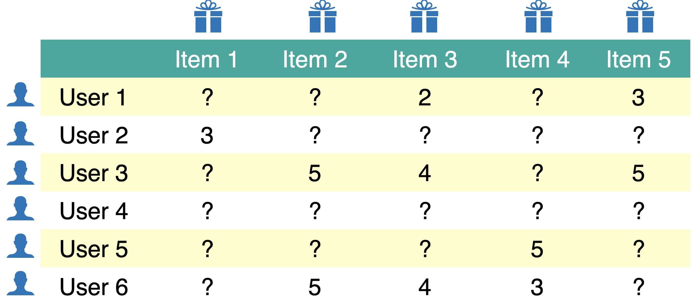
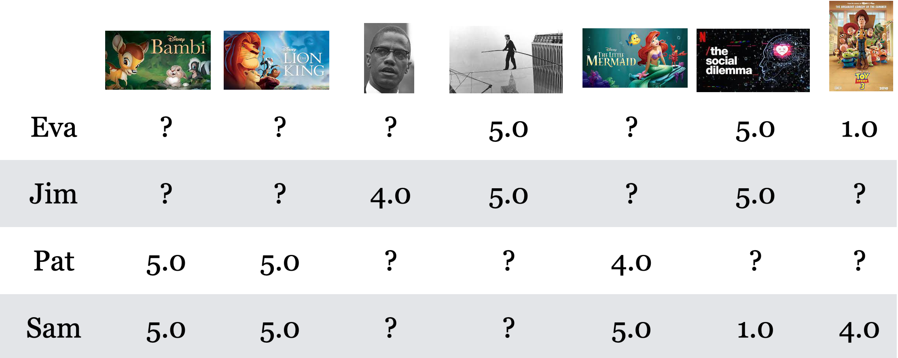
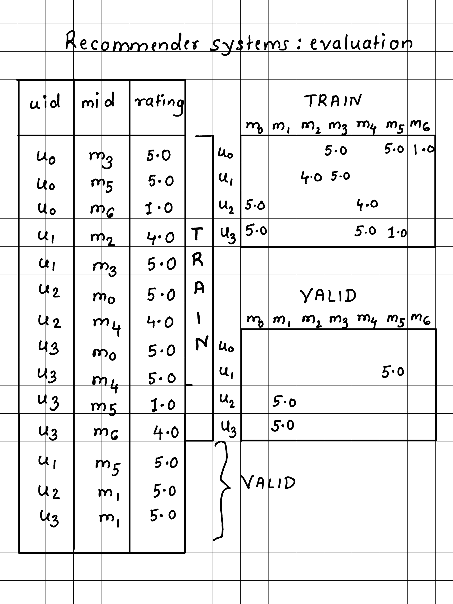
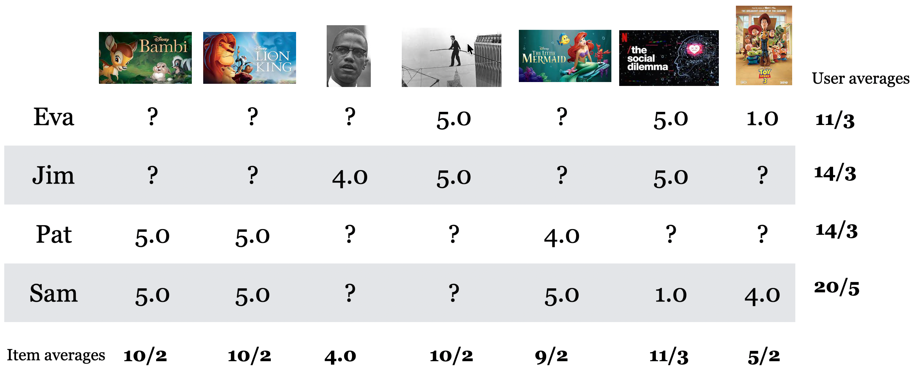
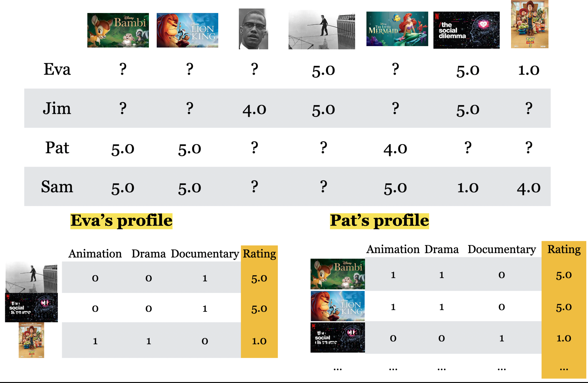
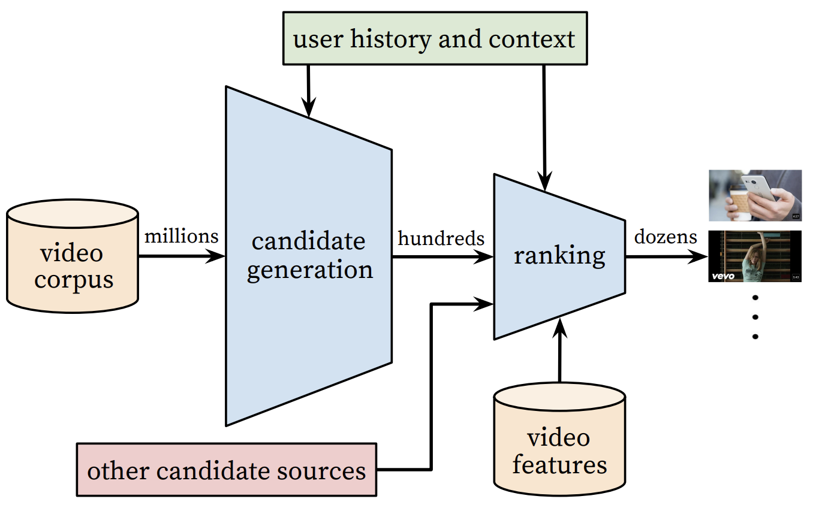
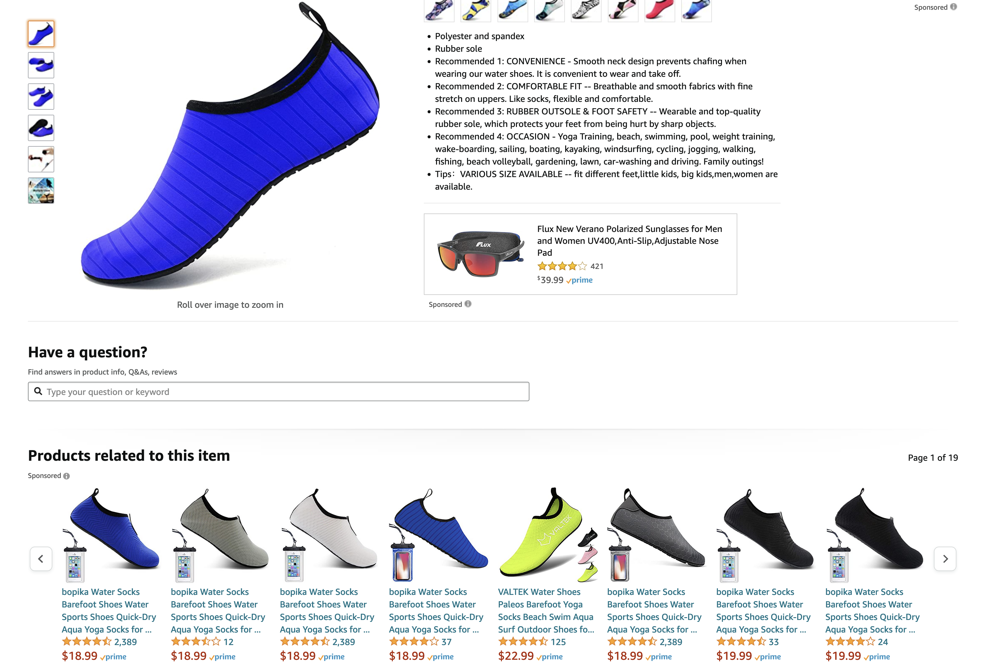

```{python}
#| include: false
from pathlib import Path
import numpy as np
import pandas as pd

DATA_DIR = Path("data")
pd.set_option("display.max_colwidth", 60)


def create_Y_from_ratings(data, N, M, user_mapper, item_mapper):
    Y = np.full((N, M), np.nan)
    for _, row in data.iterrows():
        Y[user_mapper[row["user_id"]], item_mapper[row["movie_id"]]] = row["rating"]
    return Y
```

## Focus on the breath!

{.nostretch fig-align="center" width="500px"}

## Announcements {.smaller}

- HW6 was due yesterday.
- HW7 has been released (a new homework on transfer learning)
- No classes or OH during the midterm break.
- Midterm 2 coming up next week!
- If you find the breathing exercises helpful, you're very welcome to join our weekly meditation sessions.
  - 🕑 When? **Every Tuesday at 1 PM**
  - 📍 Where? **ICCS 146**


## iClicker question {.slide-your-turn}

What percentage of watch time on YouTube do you think comes from recommendations?

- (A) 50%
- (B) 70%
- (C) 20%
- (D) 90%

## Today's big questions {.slide-goals}

1. How do we represent **ratings** when most are missing?
2. How can we **evaluate predictions** for unseen ratings?
3. How do **similar users** and **item features** help us recommend items?
4. Does lower prediction error mean **better recommendations**?


## What is a recommendation system?

A recommendation system suggests products, services, or content that a user is likely to consume or enjoy.

- Items could be movies, songs, videos, products, or news articles.
- The system uses past data to predict what a user may want next.
- It helps users choose from a large catalogue.


::: {.notes}
Use this example to introduce the information sources before naming the methods. Return to differences between sales objectives and user benefit in the final section, where they inform evaluation choices. For the technical work today, we predict explicit movie ratings and use the predictions to rank unseen movies.
:::

## Why recommendation systems? {.smaller}

- They help users navigate **information overload**.
- Searching a large catalogue takes effort.
- Good recommendations help users find relevant choices.

{.nostretch fig-align="center" height="300px"}

## The other side: filter bubbles

- Recommenders can reinforce existing interests by repeatedly showing similar content.
- This can contribute to filter bubbles, limiting exposure to different information or viewpoints.
- In news, politics, and science, narrowed exposure can affect what people learn and believe.

Recommendation quality includes the information people have an opportunity to encounter.

## Explicit vs. implicit feedback

:::: {.columns}
::: {.column width="50%"}

### Explicit feedback

- The user directly reports a preference.
- Example: a 1-to-5 movie rating.

:::
::: {.column width="50%"}

### Implicit feedback

- We infer preferences from behaviour.
- Examples: clicks, watch time, purchases.

:::
::::

**Behaviour needs interpretation: a purchase could be a gift.**

::: {.notes}
Neither signal is a complete measure of satisfaction. A missing click could mean the user never saw the item. Even explicit ratings depend on what users encountered and chose to rate. Our observed movie ratings provide numerical targets for rating prediction.
:::


::: {.notes}
This is one recommendation formulation. Other systems predict clicks or learn to rank directly. We are not claiming that every type of interaction has the same meaning or that accurate rating prediction alone solves recommendation.

Ratings and clicks are not an unbiased sample of all user–item pairs. Position and exposure affect behaviour. Held-out ratings are a useful starting point, but evaluating a ranked list and longer-term usefulness needs additional evidence. Clicks alone do not establish satisfaction. Ask what feedback or interface evidence could distinguish the explanations.
:::

## The utility matrix

- **Rows:** users. **Columns:** items.
- Entry $y_{ij}$ is user $i$'s rating of item $j$.
- Blank entries represent **unknown ratings**.

{.nostretch fig-align="center" height="330px"}

## 7-movie illustration: ratings data {.smaller}

```{python}
#| echo: true
#| output: false
toy_ratings = pd.read_csv(DATA_DIR / "toy-movie-ratings.csv")
users = np.unique(toy_ratings["user_id"])
movies = np.unique(toy_ratings["movie_id"])
N_toy, M_toy = len(users), len(movies)
```

```{python}
#| output: asis
print(toy_ratings.head(6).to_html(index=False, border=0))
```

**First six rows shown.** The full table has 14 ratings, 4 users, and 7 movies.

::: {.notes}
This is the seven-movie illustration from the supplied DSCI 563 sequence. Each row is one observed rating. The companion regression demo later uses a different, twelve-movie dataset from the course notes; do not silently treat the datasets as identical. Avoid a scrolling table during teaching: show a representative sample, then the full utility matrix.
:::


::: {.notes}
np.unique sorts the IDs, so the row order is Eva, Jim, Pat, Sam and Toy Story is movie column 6. Forward mappings locate array entries; inverse mappings recover labels for displayed predictions. IDs are identifiers, not numerical features to regress on.

The setup cell defines the same helper shown here. A NaN marks missing evidence. We use a dense array because the example is tiny; large datasets generally store observed interactions instead. This helper assumes one rating per user–movie pair in the supplied data.
:::

## 7-movie illustration: utility matrix

{.nostretch fig-align="center" width="900px"}

**Four users × seven movies.** A question mark means no observed rating.

::: {.notes}
The supplied movie-poster illustration matches toy-movie-ratings.csv exactly, with rows Eva, Jim, Pat, Sam and alphabetically ordered movie columns. Ask students to locate Sam's Toy Story rating and Jim's missing Toy Story rating. Image reused from the instructor's supplied DSCI 563 course materials.
:::

## Missing ratings and sparsity

Most users rate only a small fraction of the catalogue.

- **Low rating:** observed evidence of a low reported preference.
- **Missing rating:** the user may never have encountered the movie.
- Filling missing entries with zero changes their meaning.

**Our task:** estimate ratings we have not observed.

::: {.notes}
The toy notebook uses NaN for unknown values. For large catalogues, store observed interactions rather than a dense completed matrix. Implicit zeros in a sparse representation must not be confused with observed zero ratings. Our predictions estimate ratings, not whether someone has seen a movie.
:::


::: {.notes}
Allow one minute. The 1-star rating is an explicit low rating; the blank is unknown. Zero imputation treats an unobserved preference as an observed low value and can distort both averages and similarities. Pat may not have seen the movie, may not know it exists, or may have watched without rating it.
:::

## Recommendation approaches {.smaller}

| Approach | Evidence used | This lecture's example |
|---|---|---|
| **Collaborative filtering** | Patterns in user–item interactions | Average ratings from similar users |
| **Content-based filtering** | Known item features and a user's ratings | Per-user regression on genres |
| **Hybrid** | Both sources | Combine candidate sources or scores |

Our focus is **content-based rating prediction** using regression we already know.

::: {.notes}
Do not classify all collaborative filtering as unsupervised or say it always learns latent features. The neighbourhood method here uses observed rating histories directly. Matrix factorization is another collaborative approach, outside this lecture's scope. Our content-based implementation fits separate user models; shared models using user and item features are a different design.
:::

## Hold out observed ratings

We cannot check a rating that the user has never provided.

1. Split the **observed ratings table** into training and validation rows.
2. Fit using **training ratings only**.
3. Compare predictions with **held-out ratings**.

The held-out ratings give us targets for evaluation.

::: {.notes}
Use the same held-out ratings for every method. Splitting ratings asks about additional preferences within the catalogue. Holding out entire users or movies instead tests a different generalization problem. In deployment, splitting by time may better reflect predicting future interactions from past data. Fit any learned preprocessing and tune models within training data.
:::

## Train and validation sets

:::: {.columns}
::: {.column width="40%"}
{.nostretch fig-align="center" width="500px"}
:::
::: {.column width="60%"}

- The train and validation utility matrices typically have the same shape:
same users, same items.

- The difference is which entries are observed.

- Validation entries are masked during training and revealed only for evaluation.

:::
::::

## Train and validation sets {.smaller visibility="hidden"}

**Illustrative split:** hide two observed ratings for evaluation.

:::: {.columns}
::: {.column width="50%"}

### Training

| User | Movie A | Movie B | Movie C |
|---|---:|---:|---:|
| Eva | 5 | ? | ? |
| Pat | ? | 4 | ? |

:::
::: {.column width="50%"}

### Validation

| User | Movie A | Movie B | Movie C |
|---|---:|---:|---:|
| Eva | ? | **2** | ? |
| Pat | ? | ? | **5** |

:::
::::

Same users and movies; **different observed entries**. “?” means unknown in that split.

**Never train on a held-out rating.**

::: {.notes}
Trace Eva's Movie B rating: it is hidden in training and revealed only for evaluation. Pat's Movie C rating is the other held-out target. Some entries are unknown in both matrices. This small illustration is separate from both movie datasets. The shapes are identical because the catalogue of IDs is fixed; knowing an ID exists does not reveal its rating.
:::

## RMSE on held-out ratings

List the **$n$ held-out ratings** as $y_1,\ldots,y_n$, with predictions $\hat y_1,\ldots,\hat y_n$.

$$\mathrm{RMSE}=\sqrt{\frac{1}{n}\sum_{i=1}^{n}(y_i-\hat y_i)^2}.$$

- Lower RMSE means closer predictions, in **rating units**.
- Unknown ratings contribute **no terms**.
- Every evaluated entry needs a finite prediction.

::: {.notes}
Here i numbers held-out ratings, rather than users or movies; n is the number of held-out ratings, not the number of users. The residual is the observed rating minus the predicted rating, consistent with Chapter 10. Mask the observed targets, not whichever predictions happen to be available. Silently dropping missing predictions can make a model look better. Require at least one observed rating overall. A user with no validation ratings contributes nothing to this aggregate; other users can still be evaluated.
:::


::: {.notes}
The validation values must not enter baseline fitting or any other training step. This slide reviews the metric; students calculate RMSE later in the ranking exercise.
:::

## Global-average baseline

Predict the mean of the **observed training ratings** for every pair:

$$\hat y_{ij}=\bar y_{\mathrm{train}}.$$

```{.python}
avg = np.nanmean(train_mat)
pred_g = np.full(train_mat.shape, avg)
```

A simple reference: does personalization improve held-out predictions?

::: {.notes}
The baseline ignores differences between users and movies. Use training ratings only, excluding NaNs. It also supplies a fallback if a more specialized prediction has no evidence. Content-based filtering is not guaranteed to beat it, particularly with few ratings or weak features.
:::

## Per-user and per-item baselines {.smaller}

**7-movie illustration: arithmetic before splitting, using all 14 ratings.**

{.nostretch fig-align="center" width="900px"}

- **Per-user:** predict the user's mean observed rating.
- **Per-item:** predict the item's mean observed rating.
- **Combined:** average the user and item means.

**For evaluation, compute all means from training ratings only.**

::: {.notes}
This supplied illustration uses all 14 ratings to demonstrate the arithmetic. Eva's average is 11/3; Toy Story's is 5/2. If these data were split for evaluation, hide validation ratings before calculating the means. A user or item with no training ratings needs a fallback. Averaging the user and item means is a heuristic, distinct from fitting an additive bias model. Image reused from the instructor's DSCI 563 course materials.
:::

## KNN-style imputation: intuition {.slide-your-turn}

Jim has not rated **Toy Story**. How could we predict his rating?

{.nostretch fig-align="center" width="900px"}

**Which users have overlapping ratings with Jim? Who has rated Toy Story?**

::: {.notes}
Jim and Eva both rated Man on Wire and The Social Dilemma, giving both 5. Eva rated Toy Story 1. Sam has a very different rating for The Social Dilemma and rated Toy Story 4. Pat has no jointly observed items with Jim, so absence of overlap is not evidence of either similarity or dissimilarity. This motivates a similarity rule rather than guessing from movie titles. With one nearest eligible neighbour, Eva supplies a prediction of 1; the later demo uses two neighbours on a different dataset.
:::

## KNN imputation and missing evidence {.smaller}

```{.python}
imputer = KNNImputer(n_neighbors=2, keep_empty_features=True)
pred_knn = imputer.fit_transform(train_mat)
```

- Compare users using **jointly observed ratings**, then average neighbours' ratings for the target movie.
- No movie ratings or no user history? Use a **fallback** (implemented in the demo).
- The imputer copies known ratings: **zero training RMSE is automatic**.

::: {.notes}
KNNImputer uses a distance adjusted for the number of overlapping entries. When distances are undefined it can use the column mean. keep_empty_features preserves entirely empty movie columns; explicitly replace their default zero with the global training mean. If no user-specific evidence exists, popularity or onboarding ratings are possible recommendation strategies. A global mean supplies a rating fallback, not a meaningful personalized ranking.
:::


::: {.notes}
Connect to familiar KNN. Here a row represents a user and columns are movies. Similarity requires overlapping evidence. With only a few jointly observed movies, distances can be unreliable. This is a simple neighbourhood-based collaborative filter, not matrix factorization.

Similarity uses jointly observed ratings, with the imputer's distance adjusted for the amount of overlap. For each missing entry, eligible donor users must have rated the target item. An item-based imputation would compare columns, for example by transposing the matrix; do not imply the shown code does both simultaneously.

The imputer copies observed training entries, so zero training error is not evidence of perfect generalization. Ridge will instead predict training targets, and need not have zero training error. Compare held-out performance on the same targets.
:::

## Class demo 1: ratings, split, and baselines {.smaller}

We now switch to the **12-movie demo**, which includes genre features.

The user names recur, but **these are different ratings** from the 7-movie illustration.

[Open the recommender demo notebook](https://github.com/UBC-CS/cpsc330-2026W1/blob/main/content/classes/varada/lecture-16-recommender-systems-demo.ipynb)

1. Inspect the new ratings table and utility matrix.
2. Check which entries move into validation.
3. Compare the global mean and KNN predictions.

**Before running:** What happens if a movie has no training ratings?

::: {.notes}
Use the first half of the companion notebook, ending at the content-based section. Inspect train_mat and valid_mat before evaluation. Ask students to predict why KNN has zero training error. Compare validation errors without treating this tiny split as strong evidence of general model quality.
:::

## iClicker 16.1: evaluation and baselines {.slide-your-turn .smaller}

**Select all statements that are true in our setup.**

- (A) Training and validation utility matrices have the same shape.
- (B) Replacing missing ratings with zero preserves their meaning.
- (C) Validation ratings must be excluded when calculating the global baseline.
- (D) Zero training RMSE proves that KNN predicts unseen ratings perfectly.
- (E) A global-mean fallback provides a prediction for a movie with no training ratings.

::: {.notes}
Answers: A, C, E. The fixed catalogue determines matrix shape. A missing rating is unknown. KNN preserves its observed inputs; its training score does not measure prediction of unseen entries. A fallback provides coverage, not evidence of a particular user's taste.
:::

## iClicker 16.2: a movie with no ratings {.slide-your-turn .smaller}

A **new movie** arrives. Pat has rated other movies, but **nobody has rated this one**: its utility-matrix column is all missing.

We use similar-user KNN to predict Pat's rating.

**Which statement is correct? Select one.**

- (A) We can average the nearest users' ratings for the new movie.
- (B) No users have rated it, so KNN needs a fallback rather than a neighbour-based prediction.
- (C) The missing ratings show that everyone dislikes the movie.
- (D) Increasing the number of neighbours guarantees a personalized prediction.

::: {.notes}
Answer: B. Even if we identify users similar to Pat from their other ratings, none can supply a rating for this movie. This is the new-item cold-start problem. More neighbours cannot create missing evidence, and missing does not mean disliked. In our demo, KNNImputer with keep_empty_features=True initially fills an entirely empty training column with zero; our code explicitly replaces that value with the global training mean. That is a non-personalized fallback, not a rating learned for this movie. Do not confuse this with the per-column-mean fallback for a new user: this movie has no training column mean. Ask: what if we know the movie's genres? Content-based filtering can use those features with Pat's existing fitted model, without requiring ratings for the new movie. A new user with no rating history remains a different problem for our separate-user models.
:::

# Content-based filtering

## Content-based filtering intro  

One way to address cold start is content-based filtering. The key idea is to recommend items similar to what the user liked before based on item features. Examples of item features:

- movie genres
- plot text
- actors
- release year
- budget

## Content-based filtering example

{.nostretch fig-align="center" width="900px"}

## Movie features provide another source of evidence {visibility="hidden"}

**What if nobody has rated a new movie, but we know its genres?**

In the **12-movie demo**, fit a model for Pat:

$$\underbrace{X_{\mathrm{Pat}}}_{\text{movie genres}}
\quad + \quad
\underbrace{y_{\mathrm{Pat}}}_{\text{Pat's training ratings}}
\quad \longrightarrow \quad
\text{Pat's Ridge model}$$

Then use it:

$$\text{another movie's genres} \longrightarrow
\text{Pat's model} \longrightarrow \text{predicted rating}$$

**No ratings from other users are required by this model.**

::: {.notes}
This stays with the 12-movie demo introduced in Demo 1. Item features provide evidence even when no other user has rated a movie. The existing user still needs training ratings to fit a model. The next slide shows exactly which movies and ratings form Pat's training dataset.
:::

## Pat's regression dataset {.smaller visibility="hidden"} 

**12-movie demo: one row per movie Pat rated in training.**

| Movie | Action | Romance | Drama | Comedy | Children | Documentary | Rating |
|---|---:|---:|---:|---:|---:|---:|---:|
| Bambi | 0 | 0 | 1 | 0 | 1 | 0 | 4 |
| Jerry Maguire | 0 | 1 | 1 | 1 | 0 | 0 | 5 |
| Titanic | 0 | 1 | 1 | 0 | 0 | 0 | 3 |
| Cast Away | 0 | 1 | 1 | 0 | 0 | 0 | 3 |
| Lion King | 0 | 0 | 1 | 0 | 1 | 0 | 4 |
| Downfall | 0 | 0 | 0 | 0 | 0 | 1 | 2 |

$X_{\mathrm{Pat}}$: **6 movies × 6 genre features**. $y_{\mathrm{Pat}}$: **6 ratings**.

::: {.notes}
These are actual values from toy_ratings.csv and toy_movie_feats.csv after train_test_split(test_size=0.2, random_state=42). Genres are toy annotations, not an authoritative classification of these movies. Movie names identify rows, rather than serving as predictive features. Held-out ratings are excluded.
:::


::: {.notes}
These are actual ratings in Pat's training split of the toy dataset. The matrix initially has no single target column. Constructing a dataset for one user gives one row per movie they rated, with genres as input features and that user's rating as the target. The notebook constructs this dataset explicitly.

IDs connect the ratings table with the feature table. Alignment is essential: each row of X must correspond to the same movie as its target in y. The notebook explicitly aligns feature rows with utility-matrix columns when constructing predictions for all users.
:::

## Fit a separate Ridge model for each user

$$\hat y_{ij}=b_i+x_j^\top w_i.$$

```{.python}
pat_model = Ridge(alpha=1.0)
pat_model.fit(X_pat, y_pat)
```

- $x_j$: known genre features of movie $j$.
- $w_i$ and $b_i$: learned preferences and intercept for user $i$.
- Ridge regularization helps when each user has **few ratings**.

::: {.notes}
A model profile summarizes associations learned from that user's ratings. A coefficient does not prove that a genre caused enjoyment: features overlap and data are scarce. Regularization helps control coefficient magnitude but does not create missing evidence. A user with no training ratings cannot fit this model and needs a fallback.
:::


::: {.notes}
Eva has four training ratings in the supplied split, compared with Pat's six. This implementation does not share training evidence between users. Each user's predictions depend on their own model, and sparse histories make profiles uncertain. A high rating for one movie does not imply liking every one of its genres.
:::

## Predictions to recommendations 

For Pat:

1. Score movies from their features.
2. Exclude movies already rated **in training**.
3. Sort the remaining candidates by predicted rating.

::: {.notes}
Held-out movies can be candidates because their ratings were unavailable during fitting. In an actual system, exclude items already consumed or unavailable according to the information available when serving. Scoring every movie is practical for this toy catalogue; a large catalogue often needs candidate generation first. Regression can predict outside the rating scale; any clipping policy should be consistent in evaluation and serving.
:::

## Class demo 2: content-based regression {.smaller}

[Continue the recommender demo notebook](https://github.com/UBC-CS/cpsc330-2026W1/blob/main/content/classes/varada/lecture-16-recommender-systems-demo.ipynb)

1. Inspect Pat's $X$, $y$, and fitted coefficients.
2. Compare Pat's and Eva's predictions for the same movies.
3. Compare validation RMSE with the baselines and rank Pat's candidates.

**Before running:** Must content-based Ridge beat the global mean?

::: {.notes}
Start at the content-based section. It need not beat the baseline: useful features and adequate rating evidence matter. All methods use the same validation entries. The small validation set makes modest differences weak evidence. Ridge predicts rather than copies training targets, so its training RMSE need not be zero.
:::

## Pat's top recommendations {visibility="hidden"}

**12-movie demo:** exclude Pat's training movies, then sort predicted ratings.

| Rank | Movie | Predicted rating |
|---|---|---:|
| 1 | Roman Holidays | 4.19 |
| 2 | A Beautiful Mind | 3.39 |
| 3 | Inception | 3.36 |

**Would these three make a useful list? What information is missing?**

::: {.notes}
Computed with the demo's random_state=42 split and Ridge(alpha=1.0), without clipping predictions. A Beautiful Mind is held out for Pat, so it remains a candidate in this offline exercise. The scores are estimates, not probabilities or guarantees of enjoyment. We have not used context, availability, or a variety objective. Return to this list when discussing quality beyond RMSE.
:::

## Comparing the models: 12-movie demo 

| Method | Training RMSE | Validation RMSE |
|---|---:|---:|
| Global mean | 1.41 | 0.83 |
| KNN imputation | 0.00 | 0.66 |
| Content-based Ridge | 0.52 | 0.58 |

**Same five held-out ratings. A small difference is weak evidence.**

::: {.notes}
Computed from the supplied toy data with test_size=0.2 and random_state=42. There are 21 ratings, of which five are held out. KNN uses two neighbours and Ridge uses alpha=1. KNN's training error is zero because it preserves observed values. Content-based Ridge performs best on this particular split, which does not establish general superiority. Do not tune repeatedly against these five validation values and treat the result as an independent final assessment.
:::

## New items and new users {.smaller}

| Situation | Similar-user KNN | Our content-based model |
|---|---|---|
| **New movie**, known features, no ratings | No movie ratings to average | Score using an existing user's fitted model |
| **New user**, no ratings | No personal history for similarity | No ratings to fit that user's model |

For a new user: request **onboarding ratings** or use a **non-personalized fallback**.

**Feature limit:** for a given user, movies with identical genre vectors receive identical predictions.

::: {.notes}
Content-based filtering handles a new item only when the required features are available at prediction time. It does not automatically handle a new user. Popular or trending recommendations can supply initial candidates but do not establish personal preferences. User features in a shared model would be a different design.
:::


::: {.notes}
The predictions are identical under this model because both x and the user-specific parameters are identical. More ratings may change the model but cannot distinguish identical feature vectors. Features such as descriptions, actors, or release years could help if they capture relevant differences and are available when predicting. Feature quality limits the recommendation.
:::

## iClicker 16.3: content-based filtering {.slide-your-turn .smaller}

**Select all statements that are true for our separate user models.**

- (A) Pat's model requires rating-history similarity to Eva.
- (B) Each training example contains movie features and that user's rating.
- (C) A new movie can be scored if its features and a fitted user model are available.
- (D) Genre features alone tell us a completely new user's preferences.
- (E) A user with no validation ratings prevents evaluating all other users.

::: {.notes}
Answers: B and C. A confuses this content-based implementation with user-based collaborative filtering. D lacks a personal preference signal. E is false: evaluate all observed validation entries overall. A user without validation ratings contributes no terms; an entirely empty validation set cannot yield RMSE.
:::

## Your turn: lower error, better top choice? {.slide-your-turn .smaller}

**Pat's held-out ratings and two illustrative models:**

| Movie | Pat's rating | Model A | Model B |
|---|---:|---:|---:|
| A | 5 | 4.0 | 5.0 |
| B | 4 | 4.1 | 3.0 |
| C | 1 | 1.0 | 2.0 |

1. Which model has lower RMSE?
2. Which recommends Pat's highest-rated movie if we show **one** suggestion?
3. Why do these answers differ?

::: {.notes}
Allow two minutes. Model A RMSE = sqrt(1.01/3), approximately 0.58. Model B RMSE = sqrt(2/3), approximately 0.82. A ranks Movie B first (4.1 > 4.0), but B ranks Movie A first, Pat's highest-rated movie. Average numerical accuracy and top-choice quality measure different properties. This example comes from the supplied chapter exercise and is not the fitted toy model's output.
:::

## Beyond prediction error

**Lower RMSE does not guarantee better recommendations.**

Users see a **ranked list**, not a table of predicted ratings.

- **Relevance:** does the list match what the user wants now?
- **Diversity:** does it offer useful variety?
- **Freshness:** can recently released items be discovered?
- **Long-term satisfaction:** does it remain useful over time?

These objectives can conflict: a familiar favourite may feel safer than an unfamiliar choice.

::: {.notes}
Connect this to the preceding exercise: rating accuracy and the quality of the top choice differed. RMSE evaluates rating predictions; it does not directly measure list variety, discovery, trust, or long-term satisfaction. The right balance depends on the task and user context. More clicks alone do not establish user benefit.
:::

## From a catalogue to a short list

{.nostretch fig-align="center" height="330px" fig-alt="Video catalogue narrowed by candidate generation and ranking, with user history informing both stages."}

::: {style="font-size: 0.5em; text-align: center;"}
YouTube example; counts are illustrative. [Covington et al. (2016), Fig. 2](https://research.google.com/pubs/archive/45530.pdf).
:::

**Ranking cannot recover an item excluded from the candidates.**

Where could we introduce **new releases** or **more variety**?

::: {.notes}
The toy model scores every movie. This figure shows the YouTube architecture described in 2016, not a claim about its current implementation. Candidate generation retrieves a manageable set of relevant items; ranking scores those candidates using preferences and context. Read millions, hundreds, and dozens as illustrative scales rather than fixed requirements. At larger scale, one design combines candidates from content similarity, collaborative patterns, and new releases before ranking. The final list can also account for availability, already-consumed items, and variety. Collaborative and content-based ideas can play complementary roles. This is a conceptual extension; implementing a production retrieval system is outside this lecture.
:::

## Useful variety depends on context

You are considering a **solar robot toy**. Are these useful alternatives?

<div style="width: 950px; max-width: 100%; margin: 0 auto;">

</div>

::: {style="font-size: 0.55em; text-align: center;"}
Amazon screenshot: sponsored related products.
:::

**What changes once you have already bought the toy?**

::: {.notes}
Pause for responses before and after changing the purchase context. Similar products can help someone compare alternatives before purchase. After purchase, another very similar toy may be less useful; a compatible accessory or a different project might be better. Repeat purchases and gifts are possible, so do not assume a similar item is always unwanted. The screenshot labels the related products as sponsored: it illustrates a displayed list, not evidence about Amazon's recommendation algorithm or its objective.
:::

## Diversity and timing

**Diversity** describes how different the items in a recommendation list are from one another.

- **Before purchase:** similar toys help compare alternatives.
- **After purchase:** a compatible accessory or a different project may be more useful.
- **As interests change:** update recommendations using recent feedback.

Too little variety can narrow discovery. More variety is useful only when the items remain relevant.

::: {.notes}
Diversity concerns the mix within a list; timing and context affect whether that mix is useful. Three sequels could suit a movie marathon but disappoint someone seeking a new genre. Low diversity alone does not establish a filter bubble. Assess user benefit rather than assuming either similarity or diversity is always preferable.
:::

## Freshness, novelty, and exploration

| Idea | Meaning | Movie example |
|---|---|---|
| **Freshness** | Recently released | A movie released this week |
| **Novelty** | New to this user | A classic they have never seen |
| **Exploration** | Try an uncertain choice to learn | A genre they have not rated |

A fresh item can match familiar tastes. An older item can support exploration.

::: {.notes}
New items may have little interaction data, but item features can still provide evidence. Freshness does not imply uncertainty, novelty does not necessarily imply uncertainty, and exploration need not involve a new release. The concepts can overlap without being interchangeable.
:::

## Familiar choices and exploration {.slide-your-turn}

You have one recommendation slot left. Which would you choose?

| Choice | Possible benefit | What could we learn? |
|---|---|---|
| **Familiar favourite** (exploitation) | Strong evidence of relevance | Response to familiar content |
| **Uncertain documentary** (exploration) | A chance to discover a new interest | Response to a less-tested genre |

**What is the cost if the documentary misses the mark?**

**What we recommend affects what feedback we can collect next.**

::: {.notes}
Only showing familiar choices limits opportunities to learn about other interests. Exploration trades some immediate certainty for information that may improve future recommendations. It should be measured against user experience and satisfaction, not treated as an automatic improvement. Users can also provide feedback explicitly rather than through clicks alone.
:::

## Trust and user feedback

A useful explanation should reflect the evidence the system actually used.

> “Recommended because you rated documentary movies highly.”

- Explanations **can support trust** when they are faithful and useful.
- Controls such as **“not interested”** let users correct recommendations.
- Recent feedback can help the system adapt when interests change.

::: {.notes}
For our genre-based Ridge model, genre associations could support an explanation; a claim about a documentary topic absent from its features would not be faithful. Explanations do not guarantee trust or satisfaction. A negative response can mean the item is unwanted now, already consumed, or poorly timed; its meaning depends on the control and context. Evaluate whether explanations and feedback controls help users, rather than merely making the system sound convincing. Also weigh serving speed, update cost, and maintenance against improvements in offline error.
:::

## What evidence would show improvement? {.smaller}

| Question | Evidence to inspect |
|---|---|
| Are the top choices relevant? | User judgements of the top few items |
| Does the list offer useful variety? | Differences among items, plus user feedback |
| Can new items be discovered? | Exposure of recent releases and responses to them |
| Does it stay useful over time? | Repeated feedback about satisfaction and usefulness |

**Compare on a shared task and context. More clicks alone do not establish success.**

::: {.notes}
These are evaluation questions, not a claim that one metric captures all objectives. Offline ranking measures can be useful when relevance labels are available, but observed ratings reflect exposure and selection. User studies or carefully designed online comparisons can add evidence about usefulness. For Pat's top three, inspect both the ordering and what the list leaves out. Ask students to choose one objective and propose evidence before the exit question.
:::

## Today's takeaways {.slide-summary .smaller}

- **Represent ratings:** missing entries are unknown preferences.
- **Evaluate honestly:** hold out observed ratings and fit using training data only.
- **Compare evidence sources:** collaborative methods use rating patterns; content-based models use item features.
- **Personalize with regression:** learn one user's model from their rated movies.
- **Handle missing history:** new items and new users pose different challenges.
- **Judge the final list:** relevance, variety, freshness, trust, and future feedback matter beyond RMSE.

## Exit question {.slide-your-turn}

A recommender has **lower validation RMSE**, but users keep seeing the same kinds of movies and rarely discover anything new.

What would you investigate or change next, and why?

Explain both **what RMSE tells you** and **what it leaves unanswered**.

::: {.notes}
A strong response separates rating prediction accuracy from ranked-list usefulness. Inspect candidates and final rankings, variety, exposure, novelty, and feedback collection. Propose a relevant change such as broadening candidate sources or introducing measured exploration, and explain how to assess the resulting user experience. Neither maximal diversity nor more clicks alone establishes success.
:::
