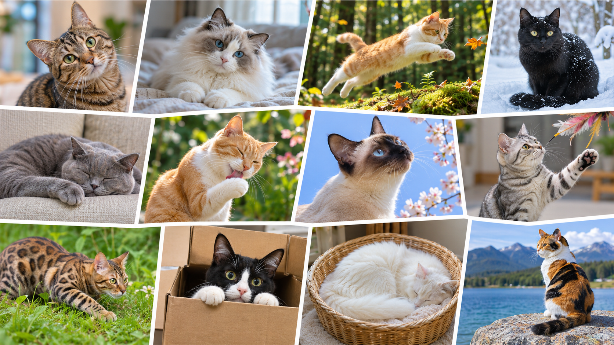
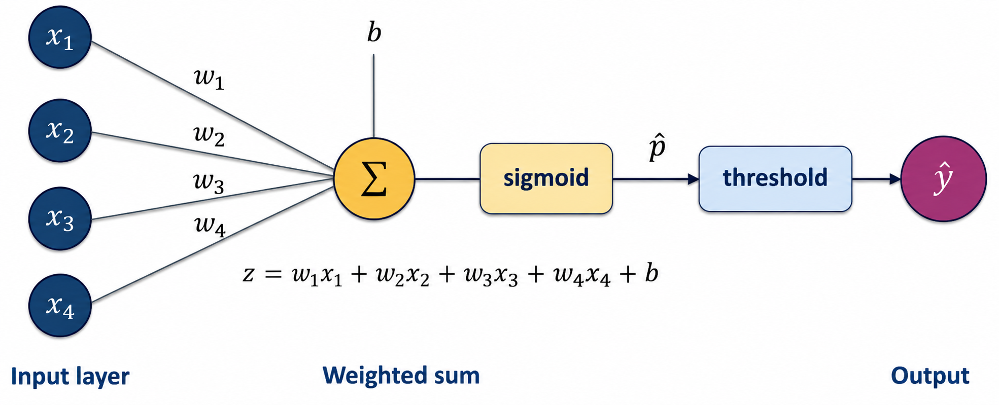
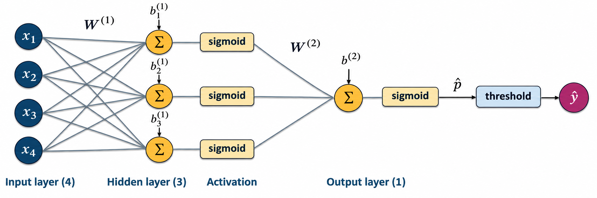
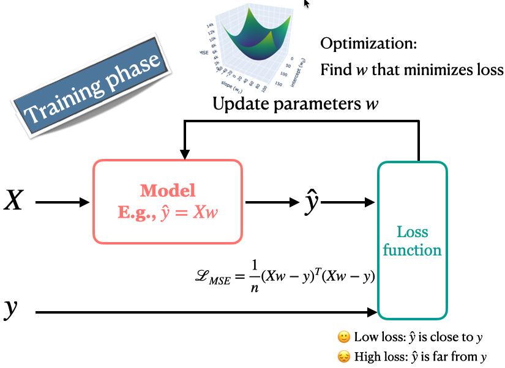
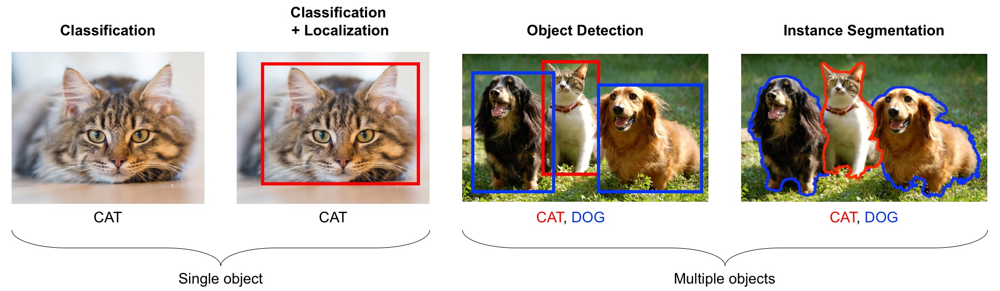
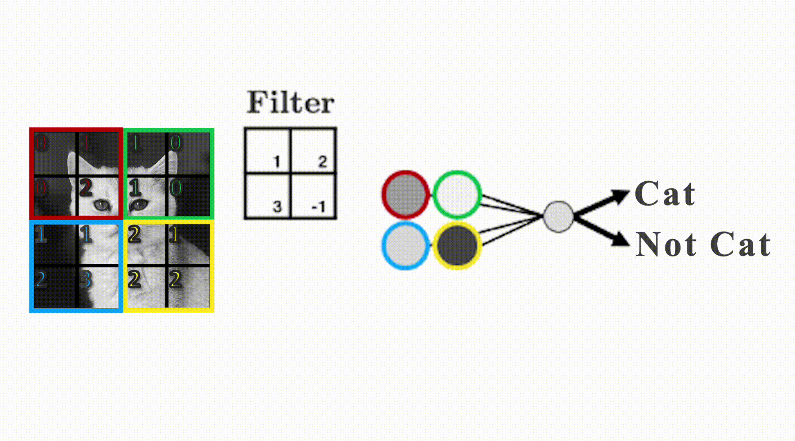
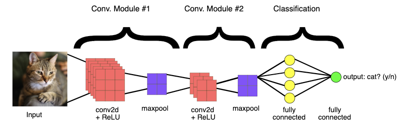

## Focus on the breath!

{.nostretch fig-align="center" width="500px"}

## Announcements
- HW7 has been released (a new homework on transfer learning)
- No classes or OH during the midterm break.
- Midterm 2 coming up next week!
- If you find the breathing exercises helpful, you're very welcome to join our weekly meditation sessions.
  - 🕑 When? **Every Tuesday at 1 PM**
  - 📍 Where? **ICCS 146**


## iClicker: shopping recommendations for Eva {.slide-your-turn .smaller}

A shop uses **content-based filtering** with backpack attributes: Waterproof, Laptop compartment, and Recycled material. Eva has rated **12 backpacks**.

**How should the shop predict Eva's rating for a new backpack?**

- **(A)** Fit Ridge using the 12 backpacks' attributes and Eva's ratings, then pass the new backpack's attributes to that model.
- **(B)** Fit Ridge using other shoppers' ratings as features and Eva's ratings as targets.
- **(C)** Fit Ridge using backpack attributes and all shoppers' ratings together, without identifying the shoppers.
- **(D)** Recommend only backpacks Eva has already rated because a new backpack has no rating.

::: {.notes}
Correct answer: A.

Use Eva's training ratings only. X has 12 rows (backpacks) and three columns (attributes). y contains Eva's 12 corresponding ratings. Fit a separate Ridge model for Eva, then supply the new backpack's three attributes in the same column order to predict her rating.

B uses other shoppers' rating patterns rather than product attributes, moving toward collaborative filtering. C pools different shoppers' preferences without representing whose rating we want to predict. D misses the benefit of content features: a new item can receive a prediction even without ratings, provided its attributes are available and Eva already has a fitted model. A shopper without training ratings would need a fallback.

Numerical follow-up: Suppose Eva's fitted coefficients for Waterproof, Laptop compartment, and Recycled material are (0.8, -0.4, 0.6), with intercept 3.0. What rating does her model predict for a backpack with attributes (1, 0, 1)?

$$\hat r_{\mathrm{Eva},j}=3.0+1(0.8)+0(-0.4)+1(0.6)=4.4.$$

These are hypothetical fitted values. Eva's model learns three feature coefficients and an intercept. The number of training backpacks determines the number of rows, not the number of coefficients. Coefficients describe associations in Eva's ratings, not causal effects on enjoyment.
:::

## Today's big questions {.slide-goals}

1. How do neural networks learn useful **features**?
2. Why do CNNs use **local, shared filters** for images?
3. How can a pretrained model help us classify **new labels**?
4. How do we evaluate the resulting classifier?

## One label, many appearances

{.nostretch fig-align="center" height="400px"}

Which differences matter for the label **cat**?

::: {.notes}
Pause and ask: “What changes across these pictures, and what stays the same?” Invite a few observations: coat colour and pattern, pose, viewpoint, lighting, and background vary, but every image still has the label cat.

To a computer, these images are arrays of numbers. Two cat images can have very different pixel values. Even moving the same cat within an image changes which pixels contain its ears, eyes, or fur. Recognizing a cat therefore requires more than matching an exact pixel pattern.

Ask: “Would coat colour change our answer?” For cat classification, usually no. If our task were to classify coat colours, it would matter. Which differences we want a model to tolerate depends on the target label.

A useful image representation should retain evidence that helps distinguish cats from other categories while tolerating variation within the cat category. We will use neural networks to produce learned features rather than try to list every useful visual feature ourselves. This does not guarantee that the model ignores backgrounds or other shortcuts, so representative evaluation images still matter.

Transition: “What model from our current toolbox would you try for image classification? What features would you give it?” Invite students to connect this task to familiar supervised-learning methods before introducing CNNs.
:::

## Image classification with our current toolbox {.slide-your-turn}

**What model would you try for image classification?**

**What features would you give it?**

Think about logistic regression, KNN, or random forests.

::: {.notes}
Allow a brief discussion. Several familiar classifiers can accept numerical image features. Ask students what one row of X would contain and what y would represent.

Pixel values are one possible starting point. Connect back to the cat images: changes in pose, lighting, or background can change many pixels without changing the label. The choice of representation matters as well as the choice of classifier.
:::

## CNNs for image classification

A **convolutional neural network (CNN)** is a neural network architecture designed to work with images.

- We will build **high-level intuition** for how CNNs work.
- We can use **pretrained CNNs** for our own tasks without studying every architectural or training detail.

Let’s begin with a brief introduction to **neural networks**.

::: {.notes}
CNNs are a common approach to image classification. Their layers learn useful image features from training examples, reducing the need to hand-design those features.

We will not derive the full architecture or train a CNN from scratch. Our practical goal is to use a pretrained model and understand enough of the workflow to apply it appropriately.

Before discussing what makes a CNN suited to images, introduce the neural-network idea using a model students already know: logistic regression.
:::

## A graphical view of logistic regression

{.nostretch fig-align="center" height="300px"}

- Weights and an intercept produce a score.
- Sigmoid converts the score into a binary class probability.
- A threshold converts that probability into a label.

## A neural network with one hidden layer

{.nostretch fig-align="center" height="320px"}

Each hidden unit computes its own weighted sum and bias, then applies a **nonlinear activation**. Its output becomes a feature for the next layer.

## How many parameters do we learn? {.slide-your-turn}

{.nostretch fig-align="center" height="320px"}

With **4 inputs, 3 hidden units, and 1 output unit**:

- How many **weights** do we learn?
- How many **biases** do we learn?

::: {.notes}
Give students a moment to count. Ask them to distinguish connections (weights) from units with an intercept (biases).

Input to hidden layer: each of the three hidden units receives four inputs, giving 4 × 3 = 12 weights and 3 biases.

Hidden layer to output: the output unit receives three hidden features, giving 3 × 1 = 3 weights and 1 bias.

Total: 15 weights and 4 biases, or 19 learned parameters.

The input nodes simply supply feature values, so they have no learned biases. Each hidden unit and the output unit has one bias. The sigmoid activation and threshold add no learned parameters here.

Compare with logistic regression on the same four inputs: 4 weights and 1 bias, or 5 parameters. Adding the hidden layer introduces intermediate learned features and increases the parameter count.
:::

## Computing the first hidden feature {.smaller}

{.nostretch fig-align="center" height="250px"}

$$
\begin{aligned}
z_1^{(1)} &= w_{11}^{(1)}x_1 + w_{12}^{(1)}x_2
             + w_{13}^{(1)}x_3 + w_{14}^{(1)}x_4 + b_1^{(1)} \\
h_1 &= \operatorname{sigmoid}\!\left(z_1^{(1)}\right)
\end{aligned}
$$

- Superscript $(1)$ identifies the **first layer**, not a power.
- $w_{12}^{(1)}$ connects **input 2 to hidden unit 1**.
- Repeat with different weights and biases to obtain $h_2$ and $h_3$.

::: {.notes}
Trace the four incoming connections to the first hidden unit in the diagram. Each input is multiplied by its own weight. Add these contributions and the unit's bias to obtain its score, z_1^(1). Apply sigmoid to obtain h_1.

In w_12^(1), the first subscript identifies the receiving hidden unit and the second identifies the input. The superscript identifies the layer. The bias also belongs to this specific hidden unit.

The other hidden units receive the same four inputs but use their own weights and biases. Their outputs can therefore represent different transformations of those inputs. We now have three learned features, h_1, h_2, and h_3. We do not threshold them.
:::

## Computing the output {.smaller}

{.nostretch fig-align="center" height="250px"}

$$
\begin{aligned}
z^{(2)} &= w_1^{(2)}h_1 + w_2^{(2)}h_2 + w_3^{(2)}h_3 + b^{(2)} \\
\hat p &= \operatorname{sigmoid}\!\left(z^{(2)}\right)
\end{aligned}
$$

- Layer $(2)$ combines the **three hidden features** using its own weights and bias.
- $\hat p$ is the predicted probability of the **positive class**.
- Computing the hidden features and prediction is a **forward pass**.

::: {.notes}
Trace the three connections from the hidden units to the output unit. This is the same weighted-sum-and-sigmoid computation as binary logistic regression, now using h_1, h_2, and h_3 as inputs instead of the original features.

The superscript (2) identifies the output layer. Since there is only one output unit, we use one subscript on each output weight to identify its incoming hidden feature.

Distinguish the roles of the sigmoid outputs: the hidden outputs are learned features, while the final output is the predicted probability of the positive class. With a decision threshold of 0.5, predict class 1 when p-hat is at least 0.5 and class 0 otherwise. Thresholding is the final decision step, not part of computing the hidden features.

A forward pass uses the current parameter values without updating them. Training is what adjusts the weights and biases.
:::

## Why nonlinear activations?

Stacking weighted sums without nonlinear activations still gives a linear model.

- Nonlinear hidden activations allow nonlinear decision boundaries.
- **ReLU** is another activation: $\operatorname{ReLU}(z)=\max(0,z)$.
- Multiple hidden layers repeatedly transform the representation.

This is the idea behind **deep learning**.

## How does a network learn? {.smaller}

{.nostretch fig-align="center" height="300px"}

A loss measures disagreement with known targets. Training adjusts weights to reduce that loss.

We’ll use a pretrained model with fixed weights to extract image features, then train a familiar model, such as logistic regression, on those features.

## Computer vision tasks

{.nostretch fig-align="center" height="360px"}

Today we focus on **image classification**: one category for an entire image.

## Images as numerical arrays

- Grayscale: height × width intensity values.
- RGB: height × width × 3 colour channels.
- A 200 × 200 RGB image has **120,000 values**.

```python
from pathlib import Path
DATA_DIR = Path("data")
image_path = next(
    (DATA_DIR / "food-transfer-learning" / "train" / "pizza").glob("*.jpg")
)
image = Image.open(image_path).convert("RGB")
np.asarray(image).shape
```
## Why use local image structure?

Flattening preserves pixel values, but an ordinary classifier does not automatically use the fact that nearby pixels form patterns.

- Moving an object can change many input values.
- Connecting every pixel to every hidden unit creates many parameters.
- A CNN uses local filters and shares their weights across locations.

## Convolutions and shared filters

{.nostretch fig-align="center" height="320px"}

A **filter** computes a weighted sum over a local patch. Reusing it across locations produces a **feature map**.

[Explore image kernels](https://setosa.io/ev/image-kernels/)

## Convolutional neural networks

{.nostretch fig-align="center" height="330px"}

Convolutions and activations build features. Pooling reduces spatial dimensions. A **classification head** maps features to scores.

::: {.notes}
Figure reused from the book chapter. Original source: Google Developers, https://developers.google.com/machine-learning.
:::

## Pretrained models

A pretrained model supplies weights already learned on another dataset.

- We use **MobileNet V3 Small**, trained for 1,000 ImageNet categories.
- Its original classifier chooses among those categories.
- It cannot invent a new output label.

**Multiclass classification:** each example receives one of several labels. Multilabel classification allows several labels per example.

## Example: Image classification using a pretrained model {.smaller}
- We reuse an image classifier trained elsewhere to predict labels for new photos.
- The model learned from labeled images during its original training; we do not train it here. 

::: {.scroll-container style="overflow-y: scroll; height: 400px;"}

```{python}
import sys, os
sys.path.append(os.path.join(os.path.abspath("."), "code"))
from plotting_functions import *
import img_classify
from PIL import Image
import glob
import matplotlib.pyplot as plt
DATA_DIR = 'data/' 
# Predict topn labels and their associated probabilities for unseen images
images = glob.glob(DATA_DIR + "test_images/*.*")
class_labels_file = DATA_DIR + 'imagenet_classes.txt'
for img_path in images:
    img = Image.open(img_path).convert('RGB')
    img.load()
    plt.imshow(img)
    plt.show();    
    df = img_classify.classify_image(img_path, class_labels_file)
    print(df.to_string(index=False))
    print("--------------------------------------------------------------")
```
:::

## Softmax probabilities

Softmax converts class scores into probabilities that sum to one.

```{python}
#|echo: true
import torch
scores = torch.tensor([1.2, -0.4, 2.0, 0.7])
probabilities = torch.softmax(scores, dim=0)
probabilities
```

Which class wins? **Class 2**, using zero-based labels.

A high probability does not guarantee a correct or useful label.

## Optional: softmax {.slide-optional}

For scores $z_1,\ldots,z_K$,

$$P(y=k)=\frac{e^{z_k}}{\sum_{j=1}^{K}e^{z_j}}.$$

Exponentiation makes values positive. Dividing by their sum makes probabilities add to one.

Every probability depends on all class scores.

## Pretrained predictions: live demo

```python
weights = models.MobileNet_V3_Small_Weights.IMAGENET1K_V1
imagenet_model = models.mobilenet_v3_small(weights=weights).eval()
imagenet_preprocess = weights.transforms()
imagenet_labels = weights.meta["categories"]
```

1. Predict labels for the chapter’s animal photographs.
2. Try the UBC photographs and the apple image.
3. Which predictions describe visible objects? Which identify the landmark?

The CNN receives resized, cropped, and normalized images.

## When the labels do not answer our question {.slide-your-turn}

Suppose our task is to identify UBC landmarks.

The model predicts an ImageNet category with high confidence.

- Does confidence establish that the landmark is correct?
- Can the model predict a landmark absent from its output vocabulary?
- How could we adapt it to our own labels?

## Frozen feature extraction

Use the pretrained CNN to produce a representation for each image.

1. Apply the preprocessing expected by the pretrained weights.
2. Remove the original classification head.
3. Keep the CNN weights fixed.
4. Train a scaler and logistic regression for our food labels.

Our seven labels can differ from ImageNet’s labels.

## Food classification: live demo

Open **lecture-17-transfer-learning.ipynb**.

- Inspect class counts and one training image per category.
- Check that training and validation use the same label mapping.
- Predict likely confusions before fitting a classifier.

The chapter uses predefined training and validation folders. A final evaluation would require a separate test set.

## Preprocessing and batches

```python
food_dir = DATA_DIR / "food-transfer-learning"
feature_datasets = {
    split: datasets.ImageFolder(
        food_dir / split, transform=imagenet_preprocess
    )
    for split in ["train", "valid"]
}
```

A `DataLoader` processes images in batches. Use `shuffle=False` to keep extracted rows aligned with the original image order.

## A frozen MobileNet feature extractor

```python
feature_model = models.mobilenet_v3_small(weights=weights)
feature_model.classifier = nn.Identity()
feature_model.requires_grad_(False)
feature_model = feature_model.to(DEVICE).eval()
```

- `nn.Identity()` removes the original classifier.
- `eval()` prepares the network for prediction.
- `torch.inference_mode()` avoids gradient tracking during extraction.
- Each image produces **576 features**.

## The feature matrix

```python
Z_train, y_train = extract_features(
    feature_model, feature_loaders["train"], DEVICE
)
Z_valid, y_valid = extract_features(
    feature_model, feature_loaders["valid"], DEVICE
)
```

**Rows:** images. **Columns:** learned representation coordinates.

The CNN learns nothing from our food data. We can reuse the matrices when changing logistic regression’s `C`.

## Image preprocessing versus feature scaling {.smaller}

| Operation | What it does | Where its settings come from |
|---|---|---|
| Image preprocessing | Resize, crop, normalize RGB input | Pretrained weight specification |
| Feature extraction | Produce 576 learned features | Frozen ImageNet weights |
| Feature scaling | Learn feature means and scales | Current training rows |
| Logistic regression | Learn food class coefficients | Training features and labels |

Keep scaling inside the scikit-learn pipeline.

## A baseline and a familiar classifier

```python
dummy = DummyClassifier(strategy="most_frequent")
dummy.fit(Z_train, y_train)

feature_pipe = make_pipeline(
    StandardScaler(),
    LogisticRegression(max_iter=3000, random_state=42),
)
feature_pipe.fit(Z_train, y_train)
```

Compare training and validation accuracy against the dummy baseline.

## Evaluation and error analysis

In the demo:

- Compare training and validation accuracy. Is there an overfitting gap?
- Inspect a labelled confusion matrix. Which categories are confused?
- Display individual mistakes with true and predicted labels.

A small validation set leaves uncertainty. Small score differences may not be decisive.

## Predicting a new food image

Apply the **same image preprocessing**, frozen extractor, and fitted pipeline.

```python
inputs = imagenet_preprocess(image).unsqueeze(0).to(DEVICE)
with torch.inference_mode():
    features = feature_model(inputs).cpu().numpy()
label_index = int(feature_pipe.predict(features)[0])
```

The classifier always chooses a known food category, even for an unrelated image. One prediction does not measure accuracy.

## What learns from our labels? {.slide-your-turn}

We extract frozen ImageNet features from 300 plant photographs and train a classifier for five species.

1. Which components learned from ImageNet? Which learn from the plants?
2. Must the species appear in ImageNet’s original labels?
3. If we change only `C`, must we run the CNN again?
4. What if we change the image preprocessing?

::: {.notes}
The CNN stays fixed. The scaler learns training feature statistics, and logistic regression learns coefficients and intercepts. The species need not match ImageNet labels. Changing C reuses features. Changing preprocessing requires new features.
:::

## Connection to HW7 {.smaller}

| Food demo | HW7 |
|---|---|
| Seven food categories | Six waste categories |
| Fixed training/validation folders | Training data with stratified CV, reserved test set |
| Dummy versus pretrained features | Also compare low-resolution pixel features |
| One logistic regression setting | Choose `C` using `GridSearchCV` |
| Validation mistakes | Final test metrics and application limits |

Both use frozen MobileNet features and a scaler inside the pipeline.

## The Golden Rule still applies

- Fit scaling and logistic regression using only the current fitting rows.
- Use validation data or CV to choose settings.
- Evaluate the selected workflow once on the reserved test set.
- Keep related images, such as frames from the same video, together when splitting.

Extracting deterministic frozen features does not fit to held-out images. Using their results to choose settings does.

## Practical limitations

- **Domain shift:** features from everyday photos may transfer poorly to other image conditions.
- Pretrained models inherit gaps and biases from their source data.
- Larger extractors cost more time and memory.
- **Fine-tuning** updates CNN weights on the new data. It is outside our scope and may overfit a small dataset.

Evaluate on images representative of the intended use.

## Summary {.slide-summary}

- Neural networks combine weighted sums and nonlinear activations to learn features.
- CNNs use local filters shared across image locations.
- Pretrained predictions use the original label vocabulary.
- Frozen feature extraction supports new labels with a familiar classifier.
- Compare baselines, inspect errors, and protect the data splits.
