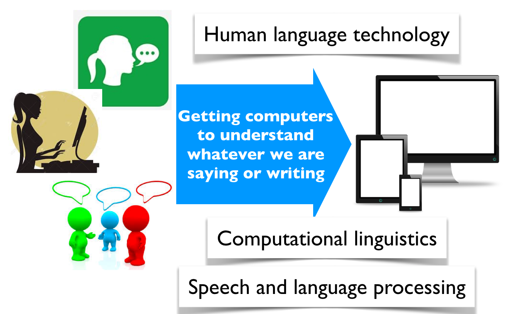
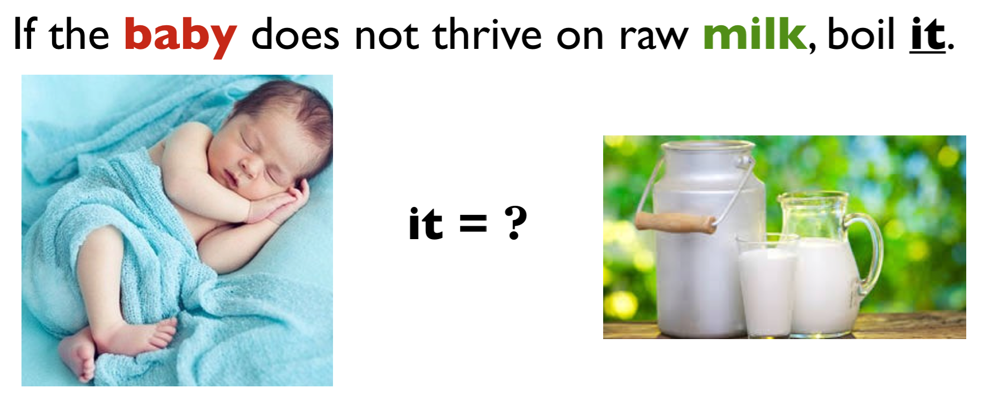
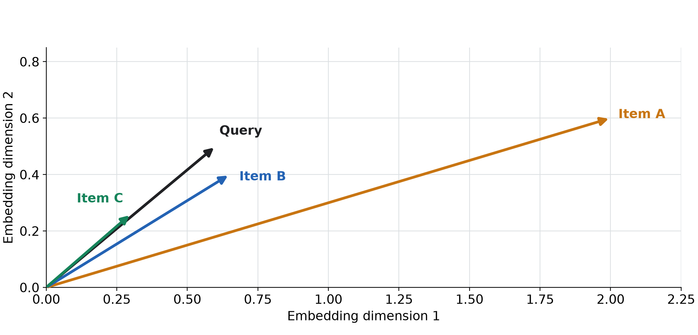
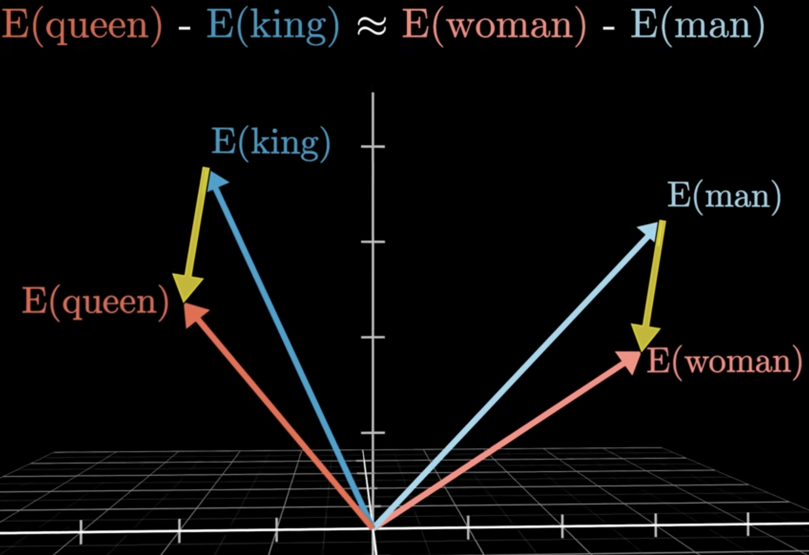
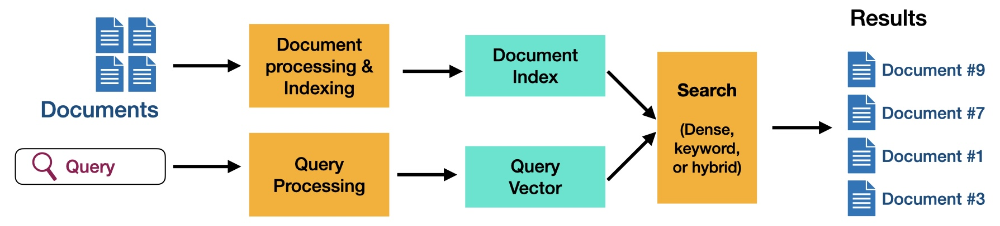
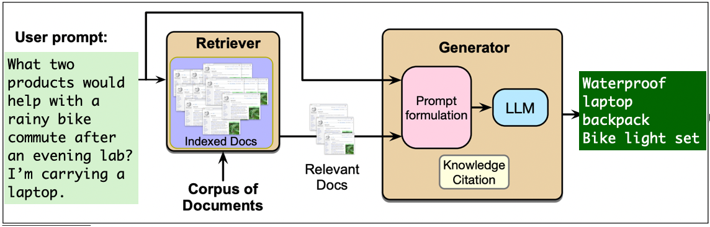

```{python}
#| include: false
from pathlib import Path

import matplotlib.pyplot as plt
import numpy as np
import pandas as pd
from IPython.display import HTML, display
from gensim.models import KeyedVectors
from sentence_transformers import SentenceTransformer
from sklearn.feature_extraction.text import CountVectorizer, TfidfVectorizer
from sklearn.metrics.pairwise import cosine_similarity

pd.set_option("display.max_colwidth", None)
```

## Focus on the breath!

{.nostretch fig-align="center" width="500px"}

::: {.notes}
Opening and goals: 0–5 minutes. Leave announcements verbal so this draft does not carry forward old dates.

Pacing for an approximately 80-minute lecture: opening 5; language challenges 5; sparse representations 9; embeddings and similarity 16; retrieval 10; language models 11; RAG overview 10; closing, discussion, and buffer 14. Activities and walkthroughs are included in those times.

Source throughout: Chapter 18, /Users/kvarada/CS/2026-27/330/cpsc330-book/book/18_natural-language-processing.ipynb. Numerical results are taken from its saved outputs, not newly executed models. Implementation details are reading material; students should interpret the components and their outputs.
:::


## Announcements

- HW7 was due yesterday 
- HW8 has been released (due next week Monday)
  - Almost there! Hang in there 😊
- Midterm 2 grading is in progress. 

## iClicker

**Select all of the following statements which are TRUE for you.**

- (A) I found the multiple-choice questions challenging.
- (B) The coding questions took a lot of time.
- (C) I didn't like the format of the midterm.
- (D) I appreciated the mix of coding, conceptual, and multiple-choice questions.
- (E) I felt the midterm was a good reflection of what we cover in the lectures and homework assignments.

## iClicker: Guess before we start {.slide-your-turn}

**Select all statements you think are true.** No prior knowledge of NLP is needed.

- **A.** ChatGPT or Claude can give a confident answer that is factually wrong.
- **B.** A search system can find a relevant document even if it shares no words with the query.
- **C.** Giving ChatGPT or Claude relevant documents can help reduce factual errors in its answer.
- **D.** If you Google “When is the CPSC 330 final exam?”, the top result must give the correct date for your section this term.

::: {.notes}
Allow about one minute for voting, then invite a couple of explanations. Frame this as a prediction activity rather than a test of terminology. Save the full debrief for the end of the lecture and ask whether students would change their selections.

True: A, B, C. False: D.

A: Fluent, confident language does not guarantee factual accuracy. This motivates supplying evidence and checking answers.

B: Dense retrieval can connect related meanings without exact word overlap. “Can” matters: it does not guarantee that every paraphrase will be retrieved successfully.

C: Supplying relevant evidence is the motivation for RAG. The generator can use documents in its context without retraining, but can still ignore or misrepresent them.

D: The best-ranked available result may refer to another term or section, or may omit the date. Ranking does not guarantee that the needed evidence is present.

Transition: Today we will examine how systems represent text, retrieve evidence, and generate answers, and where each step can fail. Revisit these statements during the closing discussion.
:::

## Today's big questions {.slide-goals}

1. How can we represent **text** numerically?
2. How can we **retrieve** information relevant to a question?
3. How can a language model **answer using evidence**?

Text representations $\to$ retrieval $\to$ language models $\to$ RAG

::: {.notes}
“You already have intuitions about what chatbots and search systems can do. Today we will look at the pieces that make those behaviours possible.”

Briefly walk through the sequence: first turn text into numbers; then use those representations to find relevant information; then supply that information to a model that generates an answer. RAG brings retrieval and generation together. Introduce the acronym without expecting students to know the mechanism yet.

Emphasize that the goal is to interpret inputs, outputs, and failures, rather than memorize library calls or learn every detail of model architecture.

Transition: “Before looking at those pieces, what makes language difficult to work with?”
:::

## What is natural language processing?

**Natural Language Processing (NLP)** develops computational methods for analyzing and generating human language.

{.nostretch fig-align="center" height="360px"}

But interpreting language is not always straightforward ...

::: {.notes}
Language challenges: about five minutes across this slide, the ambiguity examples, and the transition to representations.

Ask: “Where have you encountered a system processing language today?” Take two or three responses. Connect familiar examples to different tasks: spam filtering assigns a label, search returns documents, translation produces text in another language, and summarization produces a shorter account of an input.

“NLP includes all of these tasks, not just chatbots. What they share is the need to do something useful with human language.” Image reused from the supplied chapter.

Transition: “These tasks can feel effortless to us, but even a short sentence can have more than one interpretation. Let's look at an example.”
:::


## Language can be ambiguous

**Ambiguity:** What does *it* refer to?



::: {.notes}
Read the sentence aloud and pause: “What does ‘it’ refer to?” Students will usually answer milk. Follow up: “What helped you decide? Could the pronoun grammatically refer to the baby?”

The intended interpretation is obvious to us because we bring common sense and knowledge about the world. The sentence alone permits an unintended reading, which creates the humour. Knowing the vocabulary or locating a nearby noun is not sufficient to explain how we chose the intended referent.

Name this as referential ambiguity: deciding which entity a pronoun refers to. Avoid implying that all ambiguity is impossible for computers to resolve; the point is that useful interpretation requires more than recognizing individual words.

Transition: “Pronouns are one source of ambiguity. Sometimes the same words can also be connected or interpreted in different ways.”
:::

## [Ambiguous news headlines](http://www.fun-with-words.com/ambiguous_headlines.html)

<blockquote>
PROSTITUTES APPEAL TO POPE
</blockquote>    

<blockquote>
KICKING BABY CONSIDERED TO BE HEALTHY    
</blockquote> 

<blockquote>
MILK DRINKERS ARE TURNING TO POWDER
</blockquote>

Why are these funny?

::: {.notes}
Give students a few seconds to read, then ask for two interpretations of a headline. Discuss one or two rather than spending time on every example.

“Prostitutes appeal to Pope”: appeal can mean making a request to the Pope or being attractive to him. Different senses of the same expression change the interpretation.

“Kicking baby considered to be healthy”: kicking can describe what the baby does, or an action performed on the baby. The grammatical relationship changes.

“Milk drinkers are turning to powder”: turning to can mean choosing powdered milk or literally transforming into powder. We use everyday knowledge to favour the ordinary interpretation.

“The words have not changed. What changes is how we connect them and which meaning we choose.” These are illustrations of ambiguity; do not present them as verified reporting of actual events.

Transition: “If language depends on all this context and knowledge, what should we expect a numerical representation to preserve?”
:::

Language is ambiguous. We use **context, world knowledge, and common sense** to interpret it.

## What should a text representation capture?

Machine learning models need a **numerical representation** of that language.

The goal is not to capture every aspect of a sentence's meaning. Ask:

> **Does the representation preserve the information needed for our task?**

::: {.notes}
Connect the ambiguity examples to the choice of features. Different tasks require different distinctions: counting mentions of milk may only require matching a word, whereas determining what someone should boil requires resolving the pronoun. A representation useful for one task may lose information needed for another. Evaluate it by how well it supports the intended task, rather than by whether it captures all of language.

Pause on the question in bold: “We do not need a representation to capture everything about language before it can be useful. We need it to preserve the distinctions that matter for the particular task.” A simple word-count representation can be useful for document classification while missing relationships needed for answering a question about the document. More complex representations also need task-specific evaluation.

Transition: We will compare representations using a concrete task—finding useful items in a campus-survival catalog.
:::

## Text representations 

## A campus-survival catalog {.smaller}

**14 documents:** 12 products and 2 articles. Each full description is a document.

::: {.scroll-container}

```{python}
#| echo: false
products = pd.read_csv(Path("data") / "campus-survival-catalog.csv")
display(HTML(products[["product_id", "title", "text"]].to_html(
    index=False, escape=True,
)))
```

:::

[Download the full catalog](data/campus-survival-catalog.csv)

::: {.notes}
Sparse representations: 10–19 minutes. Scroll through the actual collection once; do not read every row aloud. The hidden code loads the full catalog and renders all 14 rows without truncating descriptions. The two informational articles are distractors. Each original description in the text column is the document used by the vectorizers. The headphones are a teaching example, not an endorsement.

Ask: “Which item would help someone study without hearing nearby conversation?” Note that an article about studying can be topically related without providing the requested product. We will return to this distinction when comparing retrieval results.
:::

## Bag-of-words: catalog descriptions to counts

```{python}
#| echo: true
bow = CountVectorizer()
product_bow = bow.fit_transform(products["text"])
print("Shape:", product_bow.shape)
print("Nonzero entries:", product_bow.nnz)
```

## {.smaller}
Selected rows and columns of the count matrix:

```{python}
#| echo: false
bow_table = pd.DataFrame(
    product_bow.toarray(),
    index=products["title"].rename("Product"),
    columns=bow.get_feature_names_out(),
)
comparison_products = [
    "Sony WH-1000XM6 headphones", "Pocket power bank",
    "Waterproof laptop backpack", "Laptop stand",
    "Ergonomic keyboard", "White-noise machine",
]
comparison_terms = ["with", "battery", "laptop", "rain", "wrist"]
display(HTML(bow_table.loc[
    comparison_products, comparison_terms,
].to_html()))
```

**Does “with” help distinguish these products? Should it count as much as a more distinctive word?**

::: {.notes}
Code executes on the complete catalog descriptions using default CountVectorizer settings. Both tables use the same six products and five terms through shared comparison_products and comparison_terms lists. Imports and data loading are omitted from the projected slide. Each row is a document; each column is a vocabulary term. Most entries are zero (231 out of 2,422 are nonzero). The displayed matrix is only a slice, not the complete vocabulary.

Start with the with column: it occurs across several descriptions of quite different products, so matching it offers little help in distinguishing those products. This motivates weighting terms by how common they are across the collection. Save the rain example for after TF–IDF: weighting still cannot distinguish weather exposure from an ambient sound. The backpack and laptop stand share laptop in the same sense: useful overlap for a search about laptop-related products, although they serve different needs. Headphones and the power bank also share battery in the same sense of electrical energy storage. Wrist occurs twice in the keyboard description. Word order is also lost. Reconnect to CountVectorizer from earlier in the course.
:::

## TF–IDF: weighting distinguishing terms {.smaller}

**Should every word count equally?**

**“With”** appears in several different product descriptions. Matching it tells us little about which product meets a need.

**Term frequency:** How often does a term appear in this document?

**Inverse document frequency:** How uncommon is it across the collection?

**TF-IDF gives higher scores to words that appear frequently in a particular document but are relatively rare across the collection of documents.**

::: {.notes}
Transition from the count table: “With appears in several unrelated product descriptions. Can we give such common terms less influence?” TF–IDF addresses term weighting. Final weights also depend on term frequency and normalization; do not promise that every with entry is smaller than every other term. After inspecting weights, revisit rain to separate weighting from interpretation.

Explain intuitively rather than deriving weights. TF–IDF gives more weight to terms that are frequent in a document but uncommon across the collection. TfidfVectorizer also normalizes document vectors by default. Rare terms are distinguishing, but rarity alone does not make a document relevant to a query. Preprocessing choices depend on the application; removing stop words mechanically can lose useful information.
:::

## TF–IDF on the catalog {.smaller}

```{python}
#| echo: true
tfidf = TfidfVectorizer()
product_tfidf = tfidf.fit_transform(products["text"])
```

**Same products and terms as before**, now with TF–IDF weights (rounded):

```{python}
#| echo: false
tfidf_table = pd.DataFrame(
    product_tfidf.toarray(),
    index=products["title"].rename("Product"),
    columns=tfidf.get_feature_names_out(),
)
display(HTML(tfidf_table.loc[
    comparison_products, comparison_terms,
].to_html(float_format=lambda value: f"{value:.2f}")))
```

**For a rainy Vancouver commute, does the shared “rain” feature make the backpack and white-noise machine useful matches?**

::: {.notes}
Computed weights fitted on all 14 original descriptions. The displayed products and terms are identical to the count table for direct comparison. Rows and columns are selected for readability; the full matrix has the same (14, 173) shape as the count matrix. Weights reflect term frequency, inverse document frequency, and default L2 normalization. Do not interpret a larger weight as a relevance probability. Only descriptions are vectorized, not product titles.

Revisit rain: the backpack protects against rain while the machine produces rain sounds. TF–IDF changes weights but still assigns both occurrences to the same feature. It does not resolve meaning. Contrast rain with laptop in the backpack and stand descriptions, which refers to the same kind of device. Useful word overlap still does not guarantee both products meet the same need. This leads directly to vocabulary mismatch. Keep the preceding TF–IDF intuition slide brief so the additional output inspection fits the existing time allocation.
:::

## Your turn: vocabulary mismatch {.slide-your-turn .smaller}

**Query:** “How can I avoid hearing people talk while I study?”

**Relevant description:**

> Sony WH-1000XM6 headphones: Over-ear wireless headphones with active noise cancellation and up to 30 hours of battery life. Useful for studying in noisy spaces.

**Would bag-of-words or TF–IDF reliably rank these headphones highly for this query?**

1. Which words would match?
2. Would changing counts to TF–IDF weights solve the problem?

::: {.notes}
Allow about one minute for students to discuss. The headphones address the need, but neither bag-of-words nor TF–IDF directly connects “avoid hearing people talk” with “noise cancellation.” Both depend on shared vocabulary; changing term weights does not create a semantic connection.

Avoid claiming that these methods can never retrieve a relevant product. Incidental overlap can help, and results depend on the full collection and preprocessing. With our default tokenization, study and studying are different terms. The full headphone description also shares common words such as “in,” so a nonzero score alone would not demonstrate that the need was recognized. The later saved TF–IDF ranking puts the Pomodoro timer first, not the headphones.

Other preprocessing could connect some word forms, but would not solve all paraphrases or context. Transition: “Can we learn representations that connect related usages, even when the words differ?”
:::

## Word embeddings: learning from context

What might **glorp** mean?

> The movie was glorp and moving.  
> What a delightful, glorp story.  
> We loved the glorp ending.

**Words used in similar contexts can receive similar vectors.**

Word2vec learns dense word vectors from word-context prediction tasks.

::: {.notes}
Embeddings and similarity: 19–35 minutes. Budget about four minutes for the new comparison and normalization activities. Ask students to infer the unfamiliar word's likely use. The contexts suggest positive sentiment without defining an exact dictionary meaning. Do not teach the word2vec optimization algorithm. A dense representation has relatively few coordinates, generally nonzero, compared with a vocabulary-sized sparse vector.
:::

## Comparing vectors {.smaller}

We want related texts to have similar vectors. But how should we measure similarity?

| Measure | Formula | What matters? |
|---|---|---|
| Euclidean distance | $\sqrt{\sum_{i=1}^d(u_i-v_i)^2}$ | Distance between endpoints; smaller is closer |
| Dot product | $\mathbf{u}^{\top}\mathbf{v}=\sum_{i=1}^d u_i v_i$ | Direction and magnitude; larger is more similar |
| Cosine similarity | $\frac{\mathbf{u}^{\top}\mathbf{v}}{\lVert\mathbf{u}\rVert_2\lVert\mathbf{v}\rVert_2}$ | Direction; larger is more similar |

Here, $\mathbf{u},\mathbf{v}\in\mathbb{R}^d$ are vectors; $u_i,v_i$ are their scalar $i$-th components.

Doubling every word count changes a vector's **length**, but preserves its **direction**.

::: {.notes}
Introduce comparison before inspecting nearest neighbours, following the revised chapter. Neither distance nor dot product has a universal threshold for relevance. Magnitude may carry useful information; choose a measure suited to the embedding model and evaluate it for the task. No measure automatically captures meaning.

Cosine similarity compares directions: more aligned vectors have higher similarity. Cosine distance is commonly defined as 1 minus cosine similarity, so smaller distance means closer vectors. A similarity score is not a probability that two texts mean the same thing. For nonzero vectors, cosine similarity ranges from −1 to 1; nonnegative TF–IDF vectors give values from 0 to 1, while dense embeddings can have negative similarities. Scores from different representations are not calibrated to a common relevance scale.
:::

## Same direction, different lengths {.slide-your-turn visibility="hidden"}

Two word-count vectors:

$$a=[1,2,1],\qquad b=[2,4,2].$$

**Predict their cosine similarity before revealing the results.**

::: {.fragment}

- Euclidean distance: $\sqrt{6}\approx 2.45$
- Dot product: $12$
- Cosine similarity: **1**

Identical relative counts do not establish identical meaning.

:::

::: {.notes}
The second document has twice each count. The direction stays fixed, so cosine is 1 even though the endpoints differ. Bag-of-words still ignores word order. Normalize by dividing a vector by its L2 norm. On unit-length vectors, dot product equals cosine similarity and squared Euclidean distance equals 2 minus twice the dot product, so all three give equivalent rankings. TfidfVectorizer normalizes document vectors by default.
:::

## Which item ranks first? {.slide-your-turn .smaller}

{.nostretch fig-align="center" height="300px"}

**Which item ranks first under each measure? Explain using the picture.**

- Euclidean distance
- Dot product
- Cosine similarity

::: {.notes}
Illustrative coordinates generated by scripts/generate_similarity_vectors.py, following the Chapter 18 comparison. Query=(0.6, 0.5), A=(2.0, 0.6), B=(0.65, 0.4), C=(0.30, 0.26). Axes have equal scaling; the dimensions have no assigned semantic meanings. Allow a brief prediction and ask students to explain without calculating exact scores.

Euclidean distance favours B: its endpoint is closest to the query's endpoint. Dot product favours A: its larger magnitude outweighs its directional mismatch. Cosine similarity favours C: it makes the smallest angle with the query.

After normalizing all vectors to length 1, all three measures favour C. Direction is preserved, and the measures produce equivalent rankings on unit-length vectors.

Optional verbal connection: in some recommender models, more popular items may acquire larger embedding norms. Dot product can then favour those items, while cosine removes the norm effect. Magnitude does not inherently represent popularity; its meaning depends on model training. Whether removing it helps depends on the task.
:::


#  Pretrained word and text embeddings

## Choosing a pretrained embedding model

As in computer vision, we can choose from many **pretrained models** to represent language.

We’ll explore the historical **Google News word2vec model**:

- About **3 million words and phrases**.
- A **300-dimensional vector** for each item.
- For our demonstration: a **410-item subset** of the original vectors.

::: {.notes}
Connect to pretrained computer-vision models: different models learn different representations from different training data. Word2vec is a useful historical example for inspecting word-level relationships; it is not the only available model or the sentence-embedding model used later.

The subset retains the original vectors; we have not retrained the model on 410 words. Nearest neighbours in our demonstration are selected only from these 410 candidates, so results may differ from a search over the full vocabulary. Source: Chapter 18's description of word2vec-google-news-300 and the course subset.
:::

```{python}
#| include: false
word_vectors = KeyedVectors.load("data/google-news-word2vec-subset.kv")
```

## Interpreting learned word vectors 

```{python}
#| echo: true
print("Words and phrases:", len(word_vectors))
print("Dimensions per word:", word_vectors.vector_size)
word_vectors["UBC"][:5]
```

An individual coordinate need not have a name such as “university-ness.”

::: {.notes}
Loads the same 410-item subset of original Google News vectors used in Chapter 18, copied into this repository so rendering does not depend on a separate checkout or a large download. The first five coordinates illustrate the numerical representation, not interpretable feature labels. The complete vector has 300 coordinates.
:::

## Nearest neighbours in word2vec {.smaller}

```{python}
#| echo: true
word_vectors.most_similar("UBC", topn=5)
```

**Are these synonyms, or words used in related contexts?**

::: {.notes}
Computed using the chapter's subset: neighbours include UVic, SFU, Simon_Fraser, UFV, and VIU. They are related institutions rather than dictionary synonyms. Only the 410 subset items are candidates; the full pretrained vocabulary is much larger, so restricting the candidates affects the neighbours. Similarity reflects usage in a particular corpus, not a guarantee of relevance in another domain.
:::

## Analogies as vector arithmetic

$$v(\text{king})-v(\text{man})+v(\text{woman})\approx v(\text{queen})$$

{.nostretch fig-align="center" height="320px"}

::: {.notes}
Source: chapter figure, screenshot from 3Blue1Brown, https://www.youtube.com/watch?v=wjZofJX0v4M&t=802s. This is a schematic two-dimensional illustration; the actual vectors have 300 dimensions. The saved nearest result is queen. Some corpus regularities correspond approximately to vector directions. This is not evidence that every analogy works or that vector arithmetic establishes a true relationship.
:::

## Trying an analogy {.smaller}

"Man is to king as woman is to ___." 

```{python}
#| echo: true
word_vectors.most_similar(
    positive=["king", "woman"], negative=["man"], topn=4
)
```

Does the model's result match your expectation?

::: {.notes}
This executes the king − man + woman example shown in the schematic. The nearest result is queen, with cosine similarity about 0.712. The result reflects regularities learned from the corpus, not a general guarantee of human-like reasoning. Transition immediately to the bias example: appealing regularities and harmful associations can both be encoded in the same geometry.
:::

## Embeddings also encode bias {.smaller}

"Man is to Computer programmer as woman is to ___." 

::: {.fragment}
The chapter's historical word2vec model returns:

$$v(\text{computer\_programmer})-v(\text{man})+v(\text{woman})$$

```{python}
#| echo: true
word_vectors.most_similar(
    positive=["computer_programmer", "woman"],
    negative=["man"], topn=5
)
```
:::

::: {.fragment}
This exposes a **gender stereotype learned from the corpus**.

Learned associations can be harmful; removing one analogy would not establish that a model is unbiased.
:::

::: {.notes}
Computed nearest result: homemaker. Show this immediately after the appealing analogy. It does not identify an appropriate relationship between occupations and genders. This old model makes one stereotype easy to expose; newer embeddings also require evaluation in their intended application. Bias is relevant to the use of representations, not an optional historical footnote.
:::

## Sentence and text embeddings {.smaller}

Traditional word2vec gives **bank** one vector, regardless of the sentence.

A text-embedding model maps a complete input text to a dense vector.

**Which two sentences should be most similar?**

1. I need a quiet place to study.
2. I want to do my coursework somewhere without noise.
3. I like studying with music playing in the background.
4. My phone is running out of battery.

::: {.notes}
These are illustrative sentences from the revised chapter, not catalog entries. Ask students to predict before advancing. All-MiniLM-L6-v2 produces one 384-dimensional vector per sentence: the embedding matrix has shape (4, 384). Columns are learned features rather than vocabulary terms; individual coordinates need not have readable labels. Averaging static word vectors is possible but loses order and often context.
:::

## Encoding sentences with a pretrained model {.smaller}

```{python}
#| echo: true
embedding_model = SentenceTransformer("all-MiniLM-L6-v2")
sentences = [
    "I need a quiet place to study.",
    "I want to do my coursework somewhere without noise.",
    "I like studying with music playing in the background.",
    "My phone is running out of battery.",
]
sentence_embeddings = embedding_model.encode(
    sentences, normalize_embeddings=True,
    show_progress_bar=False,
)
print("Embedding matrix shape:", sentence_embeddings.shape)
```

::: {.notes}
The first local execution downloads the pretrained model if it is not already cached. Rendering computes the embeddings; the published slides reuse the frozen results. No training takes place. Each row represents one sentence and the 384 columns are learned features. Predict the similarity pattern on the preceding slide before inspecting the computed heat map.
:::

## Interpreting sentence similarity

```{python}
#| echo: false
#| fig-width: 7
#| fig-height: 5.5
#| out-height: "400px"
#| fig-alt: "Computed cosine similarities for four campus-themed sentences: two requests for quiet, studying with music, and a low phone battery."
similarities = cosine_similarity(sentence_embeddings)
labels = ["Quiet place", "Coursework without noise",
          "Study with music", "Low phone battery"]
fig, ax = plt.subplots(figsize=(7, 5.5))
image = ax.imshow(similarities, cmap="viridis", vmin=-1, vmax=1)
ax.set_xticks(range(len(labels)), labels, rotation=30, ha="right")
ax.set_yticks(range(len(labels)), labels)
for row in range(len(labels)):
    for col in range(len(labels)):
        ax.text(col, row, f"{similarities[row, col]:.2f}",
                ha="center", va="center",
                color="black" if similarities[row, col] > 0.4 else "white")
fig.colorbar(image, ax=ax, label="Cosine similarity", ticks=[-1, 0, 1])
fig.tight_layout()
plt.show()
```

**Shared topic does not guarantee the same need.**

::: {.notes}
Heat map computed from the sentence embeddings during rendering, using the same model and sentences as the revised chapter. The two requests for quiet have cosine similarity about 0.73. Their similarities to studying with background music are about 0.54 and 0.49; similarities to the battery sentence are close to zero. Diagonal entries are 1. Topic overlap can coexist with a preference difference that matters for recommendations. These scores are not probabilities.

The vectors are normalized, so dot product equals cosine similarity. Encoding inputs leaves pretrained weights fixed. In HW6, students clustered recipe-title vectors; here they compare a query with catalog-description vectors. Embeddings can still miss specialized terminology, negation, contextual distinctions, and reproduce bias. Keep this and the preceding prediction to about three minutes.
:::

## iClicker: Pretrained features {.slide-your-turn .smaller}

Last lecture, a frozen pretrained CNN turned images into feature vectors. In your clustering homework, you used a pretrained text model to turn recipe titles into feature vectors.

In both cases, what does it mean for the pretrained model to be frozen?

- **A.** Every input produces the same feature vector.
- **B.** Its weights stay fixed, but different inputs can produce different feature vectors.
- **C.** Its weights update each time it processes a new input.
- **D.** Its output vectors cannot be used to train another model.

::: {.notes}
Answer: B. Frozen means the pretrained model's weights stay fixed; its output can still depend on the input. C describes updating the model rather than using it frozen. D is false: frozen features can be used to train a downstream classifier, as in last lecture. Connect to frozen image features and to the recipe-title embeddings used in HW6.
:::

# Information retrieval
## Finding useful documents {.smaller}

> How can I avoid hearing people talk while I study?

{.nostretch fig-align="center" height="300px"}

**Represent $\to$  compare $\to$ return the top-$k$ descriptions.**

::: {.notes}
Retrieval: about ten minutes. Start with the familiar shopper's question, then trace it through the diagram. Information retrieval returns a ranked list of documents that might help with a query. Unlike classification, it does not assign a class label. Here, a document is a catalog description. Figure reused from Chapter 18.

Walk through the steps: represent each description, represent the query in the same vector space, compare using cosine similarity, and return the highest-scoring descriptions. Top-k means the k highest-ranked results, not a guarantee of k useful matches.

Document vectors can be computed ahead of time; the query vector is computed when the user searches. For this tiny collection we can compare against every description. Larger collections use indexes to find candidates efficiently; no indexing internals are needed today.

Transition: “We already have two ways to represent text. What changes if we use TF–IDF versus our pretrained text model?”
:::

## Same query, two ways to search {.smaller}

> How can I avoid hearing people talk while I study?

```{python}
#| echo: false
retrieval_query = "How can I avoid hearing people talk while I study?"
sparse_scores = cosine_similarity(
    tfidf.transform([retrieval_query]), product_tfidf
).ravel()
product_embeddings = embedding_model.encode(
    products["text"].tolist(), normalize_embeddings=True,
    show_progress_bar=False,
)
query_embedding = embedding_model.encode(
    [retrieval_query], normalize_embeddings=True,
    show_progress_bar=False,
)
dense_scores = cosine_similarity(query_embedding, product_embeddings).ravel()
sparse_order = np.argsort(sparse_scores)[::-1][:3]
dense_order = np.argsort(dense_scores)[::-1][:3]
ranked_results = pd.DataFrame({
    "TF–IDF: match words": products.iloc[sparse_order]["title"].tolist(),
    "Embeddings: match related meanings": products.iloc[dense_order]["title"].tolist(),
}, index=pd.Index([1, 2, 3], name="Rank"))
display(HTML(ranked_results.to_html()))
```

Which result best meets the shopper's need to study without hearing nearby conversations?

::: {.notes}
Rankings are computed from the current catalog and embedding model during rendering. The two representations use the same collection, query, cosine scoring, and k=3. Only the representation changes. TF–IDF shares study with the timer but does not connect avoid hearing people talk with noise cancellation. Dense retrieval can make that connection and ranks the headphones first in the chapter example.

Inspect the descriptions, not just the titles: the study-skills article is related to studying but does not supply the same way to reduce nearby conversation. TF–IDF's zero-score results are ties, not additional useful matches. Scores are omitted to focus attention on the ranking; scores across representations should not be treated as a shared relevance scale.

Transition: “Does that mean we should always use embeddings?”
:::

## Which search method should we use? {.smaller}

| Query | What needs to match? | Useful approach |
|---|---|---|
| “Avoid hearing people talk while I study” | Related meanings despite different wording | **Dense retrieval:** text embeddings |
| “HUB-7X” | A specific identifier | **Sparse retrieval:** e.g. TF–IDF, plus an exact identifier check |

**Neither method always wins.**

**Hybrid retrieval** combines word matching and embedding-based search.

::: {.notes}
Introduce sparse and dense as names for approaches students have just seen, rather than prerequisites for understanding the example. Sparse retrieval compares vocabulary features; dense retrieval compares learned embedding features. Dense similarity can overlook exact constraints. Sparse retrieval is useful for exact vocabulary but still requires care with tokenization: the default vectorizer splits HUB-7X into hub and 7x. Enforce exact model-number constraints explicitly.

These are strengths, not guarantees. A paraphrase may still share useful words, and embeddings may also retrieve an exact identifier successfully. Hybrid retrieval combines candidate lists or scores from the two methods; a separate reranker is optional and outside today's implementation.
:::

## iClicker: an absent model number {.slide-your-turn}

A query asks for **HUB-7Y**. The catalog lists **HUB-7X**.

The retriever ranks HUB-7X first. What can we conclude?

- **A.** HUB-7Y is available.
- **B.** The two models are interchangeable.
- **C.** A related item was found; availability of HUB-7Y is unconfirmed.
- **D.** Dense retrieval would guarantee an exact match.

::: {.notes}
Answer: C. Neither representation can retrieve an exact listing that is absent. The best available match need not answer the actual question. Returning a related candidate does not establish availability or interchangeability. Connect to opening statement D: Google's top result need not give the correct final-exam date for the current section and term.
:::

## Did the search find what we needed?

For each realistic query, check the returned descriptions:

- Is the needed information in the **top-$k$**?
- Are the results useful, or merely related in topic?
- What happens when the catalog **has no answer**?

**A ranking is a starting point, not proof that an answer is available.**

::: {.notes}
Evaluate exact identifiers, paraphrases, and unanswerable questions. Decide which documents should help before judging the returned list. Improve with development queries, then evaluate on held-out queries rather than repeatedly tuning to the same examples. Increasing k may recover relevant evidence but also adds irrelevant context. Detailed retrieval metrics remain optional reading.

Timing checkpoint: roughly 45 minutes. Transition: “Search gives us documents. What if we want a short answer explaining which products meet our needs? Next we will look at how language models generate text. Then we will combine retrieval and generation.”
:::

# Language models and large language models (LLMs)

## Become a language model {.slide-your-turn .smaller}

Suggest several next words and rough probabilities.

| Context | Possible next words and probabilities |
|---|---|
| **Too much …** | ? |
| **My model works perfectly on …** | ? |
| **I sat on the bank of the …** | ? |
| **The capital of Canada is …** | ? |

For each context, the full distribution should sum to **1**.

::: {.notes}
Language models: 45–56 minutes. Spend 2–3 minutes eliciting suggestions. Students can reserve probability for other words rather than enumerate a vocabulary. Contrast an open-ended context with one that strongly favours Ottawa. A model can still prefer an incorrect continuation. These are rough human judgments, not measured model probabilities.
:::

## What did you do?

You used context to assign probabilities to possible continuations.

$$P(\text{next token}\mid\text{context})$$

A **tokenizer** splits text into tokens: words, parts of words, or punctuation.

One word does **not** always equal one token; the split depends on the tokenizer.

A language model assigns probabilities to token sequences through these conditional predictions.

::: {.notes}
The word-based game is an intuition; actual tokenization need not follow word boundaries. A model outputs a distribution, not only one answer. Optional historical remark: Shannon studied probabilistic models of language and human prediction; omit the history slide to preserve time.
:::

## Generating text one token at a time

1. Predict a distribution over the next token.
2. Choose a token from that distribution.
3. Append it to the context.
4. Repeat.

> My model works perfectly on $\to$ training $\to$ data $\to$ but $\to$ …

**A plausible continuation can still be factually wrong.**

::: {.notes}
For this illustration only, suppose each displayed word is one token. Each new prediction uses the full preceding context, including the newly appended words. Choosing a token may involve sampling or selecting a high-probability token. The repeated prediction mechanism can generate an answer, translation, or summary when conditioned on an appropriate input. This describes autoregressive generation, rather than every possible language-model architecture.
:::

## Large language models (LLMs)

A **large language model** is a language model built with a large neural network and trained on large amounts of data.

- It learns patterns by predicting tokens from context.
- Given a **prompt**, it can generate an answer, summary, translation, or other text.
- ChatGPT and Claude are familiar applications powered by LLMs.

**How does token prediction become a useful assistant?**

## Pretraining, post-training, and prompting {.smaller}

| Stage | What happens? | Weights change? |
|---|---|---|
| **Pretraining** | Learn token prediction from large amounts of text | Yes |
| **Post-training** | Further training, e.g. instruction-response examples or preference feedback | Yes |
| **Prompting** | Supply instructions and context to a trained model | No |

**Embedding model:** returns a numerical vector.  
**Generative language model:** produces text.

::: {.notes}
An LLM uses a large neural network trained on large amounts of data. Training recipes differ; RLHF is one possible post-training method, not a universal step. Connect next-token prediction to assistants: instruction tuning teaches useful response patterns, but does not guarantee correctness. We are not studying transformer internals in this lecture.
:::

## Clear instructions versus supplied evidence {.smaller}

**Compare these prompts in your favourite chatbot.**

**Prompt A:** Recommend gear for my commute.

**Prompt B:** I cycle home after evening labs in Vancouver rain and carry a laptop. Recommend exactly two products and briefly explain why.

B gives clearer **instructions**: the shopper's needs and the requested output.

::: {.fragment}
A sensible suggestion is a start. Now imagine you are building an assistant for **MEC**:

> Recommend only products in **MEC's current catalog**, and explain your choices using their **documented specifications**.

:::

::: {.fragment}
Clearer instructions specify **what to do**. Catalog descriptions supply **evidence to answer from**.

**How can we find the relevant descriptions and give them to the chatbot?**
::: 

::: {.notes}
Ask: “What does B improve?” It communicates the shopper's situation, constraints, and requested output. It may produce sensible recommendations, but does not itself supply evidence about a particular store's products or specifications.

If trying the prompt live, do not rely on the chatbot failing. A useful backpack or bike-light suggestion still leaves the question: is this recommendation supported by the intended catalog? If the interface visibly searches the web and uses retrieved pages, connect that behaviour to retrieval-augmented generation. Product links alone do not establish that a search occurred; avoid asserting an unseen implementation.

Use MEC as a hypothetical application, not a claim about MEC's actual systems. Ask: “How could we make this answer depend on our store's catalog rather than general product knowledge?” Invite students to suggest supplying the catalog descriptions. Then connect to the retrieval system they have already seen: retrieve relevant descriptions, add them to the prompt, and ask the generator to recommend products using that evidence.

Both clearer instructions and supplied evidence leave the model's weights unchanged. A small catalog could fit entirely in the prompt; a larger collection may exceed the context window or include distracting material. Retrieval selects focused evidence. A catalog listing or product specification does not establish current stock availability unless the source explicitly provides that information.

Transition: “We already know how to find relevant descriptions. Now we can give those descriptions to a language model to help it write a supported answer. That combination is RAG.”
:::

## Retrieval-augmented generation

**Retrieve** relevant text $\to$ **add it to the prompt** $\to$ **generate** an answer.

{.nostretch fig-align="center" height="360px"}

::: {.notes}
Keep this section to roughly 8–10 minutes, including the evidence-check activity. Trace the shopper's question through the picture: search the catalog, give the relevant descriptions to the language model with the question, and ask it to answer using that evidence. “Augment” simply means adding the retrieved text to the prompt.

The retriever finds evidence; the generator writes the answer. The model's weights do not change. RAG can supply information that was not in the generator's training data. Figure reused from Chapter 18. Students should understand this relationship, rather than indexing, chunking, or framework details.
:::

## Why retrieve instead of include everything?

A small document or catalog might fit in a prompt.

A large collection may exceed the model's **context window**: the amount of text it can process at once.

A retriever selects **relevant passages** to supply with the question.

**RAG adds evidence; it does not retrain the language model.**

::: {.notes}
Connect to uploading a document and asking questions about it: both give the model evidence. A document-question-answering application may itself use retrieval. The distinction is how evidence is selected, rather than uploading versus RAG. For a small collection we could include all descriptions, but irrelevant text can also make answering harder.

Retrieval already produces a ranking. Some applications add a reranker, but this is optional and unnecessary for the high-level explanation. No need to discuss vector stores or metadata filtering here.
:::

## RAG in our campus catalog {.smaller}

**Question:** “I cycle home after evening labs in the rain and carry a laptop. Which two products would help?”

| Retrieved evidence | Example answer based on that evidence |
|---|---|
| Backpack: keeps electronics and notes dry during wet commutes | **Waterproof laptop backpack:** protects your laptop and notes from rain. |
| Bike lights: improve visibility when commuting after dark | **Bike-light set:** helps you stay visible after evening labs. |

The prompt contains the **question + retrieved descriptions + instructions**.

::: {.notes}
These are excerpts from the actual catalog and an illustrative supported answer, not a claim that a particular generator produced this wording. Ask students to connect each recommendation to its supporting description. The actual prompt includes the full relevant descriptions; the table is shortened for readability.

Explain verbally: “Use these descriptions to answer the shopper's question. If they do not contain enough information, say so.” This is enough prompt detail to understand augmentation. Sources can be returned with the answer so the user can inspect the evidence.
:::

## Does RAG guarantee a correct answer? {.slide-your-turn}

**Retrieved description:** “Rechargeable bike lights. Improves visibility when commuting after dark.”

**Generated answer:** “These lights will run for 12 hours on a single charge.”

**Does the description support the answer? What should the system say instead?**

::: {.notes}
No: rechargeable does not establish battery runtime. A better answer says the catalog gives no runtime, so 12 hours cannot be confirmed. Relevant documents may reduce factual errors, but the generator can still add unsupported claims. A citation alone does not establish support.

Keep the failure model simple: the system can retrieve the wrong evidence, or generate an unsupported answer even with useful evidence. The source collection can also be incomplete or wrong. Checking the source passages matters in each case. Do not require memorizing a four-part failure taxonomy.

Revisit the opening quiz: A, B, and C are true; D is false. Ask whether anyone would change their prediction. Emphasize the difference between “may help” and “guarantees.”
:::

## Today's takeaways {.slide-summary}

- **Representations** determine which similarities we can detect.
- **Sparse and dense retrieval** have different strengths; rankings need evaluation.
- **Language models** generate tokens conditioned on context; fluency does not establish truth.
- **RAG** supplies retrieved evidence without changing generator weights.
- **Check the evidence:** a fluent answer can still make unsupported claims.

::: {.notes}
Return to the three opening questions and leave time for discussion. The shorter RAG overview leaves room for earlier representation activities without rushing the evidence check.
:::

## Exit question {.slide-your-turn}

**In your own words, what does the retriever do, and what does the generator do in a RAG system?**

Does giving the model retrieved documents change its weights?

::: {.notes}
The retriever selects potentially relevant source text. The generator uses the question, that text, and instructions to produce an answer. Supplying evidence changes the context, not the model weights. RAG may help ground answers but does not guarantee correctness.
:::

## Indexing and query time {visibility="hidden"}

**When documents are added or changed:**

Load documents $\to$ split into chunks $\to$ embed chunks $\to$ store text, metadata, and vectors.

**For each question:**

Embed query $\to$ retrieve chunks $\to$ construct prompt $\to$ generate answer with sources.

::: {.notes}
The embedding model and generator have different jobs. Our tiny example can store vectors in a NumPy array and text in a DataFrame; a particular vector database or framework is not required to understand the pipeline. Document indexing does not train the embedding model. A changed collection requires updating its index; changing the embedding model generally requires re-embedding the collection.
:::


## Chunking must preserve qualifications {visibility="hidden"}

> The hub supports two monitors. **This requires a laptop with Thunderbolt support.**

What if a chunk boundary separates these sentences?

- Retrieval may find the claim but lose its qualification.
- Chunk size, overlap, and document structure affect the evidence available.
- More or larger chunks also consume context and may add irrelevant text.

::: {.notes}
This is an illustrative passage, not a specification for the catalog's USB-C hub. In the chapter, each catalog description is already short enough to remain a single chunk. Longer documents need meaningful boundaries; overlap can help, but is not a guarantee of complete context.
:::


## Inspect the augmented prompt {visibility="hidden"}

```text
Answer using only the context below.
If evidence is insufficient, say that you do not know.
Recommend exactly two products. Explain why each fits.
Use exact product titles and cite supporting source IDs.

CONTEXT
[C003-0] Waterproof laptop backpack: ...
[C010-0] Bike-light set: ...

QUESTION
I commute by bike after evening labs in Vancouver rain
and carry a laptop. Which two products should I consider,
and why?
```

::: {.notes}
Condensed version of the chapter's actual prompt; ellipses stand for the full descriptions on the preceding slide. The model receives those descriptions, not merely the IDs. Identify instructions, evidence, and question separately. The model cannot use a passage that was never included. The two-product instruction suits this task; it would need changing for an availability question.
:::


## Inspect the generated answer {visibility="hidden"}

Saved output from the chapter's small local generator:

> Bike-light set and waterproof laptop backpack

| Requirement | Met? |
|---|---|
| Name two relevant products | Yes |
| Explain how each helps | No |
| Cite supporting source IDs | No |

**Retrieval succeeded; generation was incomplete.**

::: {.notes}
The model is google/flan-t5-small, a small demonstration generator rather than an LLM by contemporary standards. This is an actual saved answer, not an idealized illustration. Keep retrieval and generation separate. A larger model may follow instructions better but still needs evidence checks. Students do not need to download models during class.
:::


## Where did the RAG system fail? {visibility="hidden"}

| Failure | What went wrong? | What to inspect |
|---|---|---|
| **Retrieval** | Needed evidence was not retrieved | Query, rankings, filters |
| **Context** | A relevant chunk lost a qualification | Chunk boundaries and supplied context |
| **Generation** | Answer ignored or distorted supplied evidence | Prompt, answer, supporting passages |
| **Knowledge base** | Information was absent, incorrect, or outdated | Source documents |

**Different failures need different fixes.**

::: {.notes}
Changing the prompt cannot recover a passage that never reached it. A new embedding model cannot fix an inaccurate source. Evaluate intermediate outputs as well as the final answer. Documents are untrusted input and can contain prompt injection; application instructions must be distinguished from document content. Source freshness, privacy, bias, latency, and cost also matter in deployment. Keep those risks brief and attached to the relevant component.
:::


