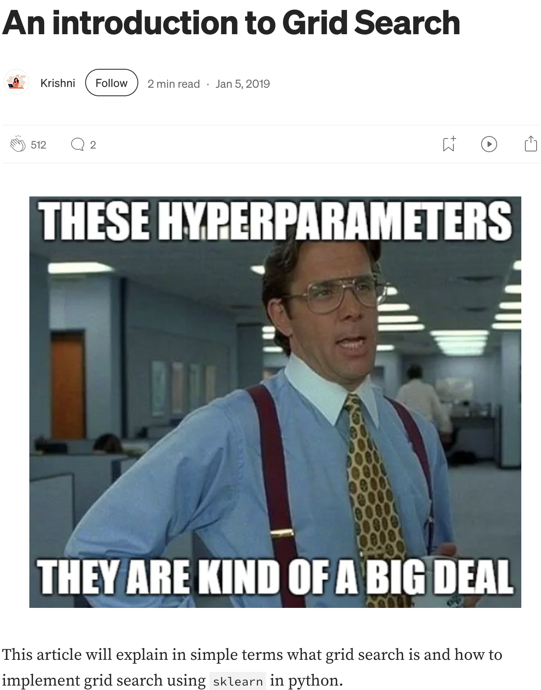

## Focus on the breath!

{.nostretch fig-align="center" width="500px"}

## Announcements

- HW9 has been released (due on December 4th)
  - Almost there! You've got this! 😊
- Next lecture on Ethics will be delivered by Firas (Section 101 instructor)
- Please take a moment to sign the card for Mick, our movement break facilitator.

## Recap: iClicker {.slide-your-turn .smaller}

**Select all of the following statements which are TRUE.**

- (A) Right censoring occurs when the endpoint of event has not been observed for all study subjects by the end of the study period.
- (B) Right censoring implies that the data is missing completely at random.
- (C) In the presence of right-censored data, binary classification models can be applied directly without any modifications or special considerations.
- (D) Treating an active customer’s observed tenure as their final lifetime understates that customer’s eventual lifetime.

::: {.notes}
Answers: A and D. B is not implied by censoring. C ignores the unknown outcome after follow-up ends. D concerns replacing a lower bound with an exact target; it is not a guarantee about every prediction made by Ridge.
:::

## Recap: incomplete lifetimes

- An active customer’s observed tenure is a **lower bound**, not a final lifetime.
- Keep both the **duration** and whether the **event was observed**.
- Kaplan–Meier estimates a survival curve without customer features.
- Cox models relate features to the hazard; their output can support survival predictions under model assumptions.

**How would you explain a retention curve to a manager?**

## Today’s goals {.slide-goals}

1. **Start from the reader’s needs:** choose language, examples, and structure for the audience.
2. **Match the claim to the evidence:** connect results to a justified next step.
3. **Present fair comparisons:** make evidence easy to interpret.

Communication → ethics → deployment and course reflection

## Why communication?

- ML work involves people with different backgrounds and priorities.
- A model score alone may not answer their question.
- Clear explanations help teams question assumptions and choose what to do next.

**Communication supports the whole workflow.**

## Is this misleading? {.slide-your-turn .smaller}

{.nostretch fig-align="center" height="380px"}

What task, population, baseline, and metric would you need to assess this claim?

::: {.notes}
Keep this as a brief hook. Ask what the headline establishes versus what readers might infer about usefulness in practice. Return to this distinction in the housing example.
:::

# Task 1: Explain a method to a newcomer

## Compare two explanations {.slide-your-turn .smaller}

Imagine reading these on **Day 1 of CPSC 330**. Focus on the explanation, not learning grid search again.

:::: {.columns}
::: {.column width="50%"}

**Explanation 1: settings and a problem**

{.nostretch fig-align="center" height="280px"}

:::
::: {.column width="50%"}

**Explanation 2: terminology and code**

{.nostretch fig-align="center" height="280px"}

:::
::::

Read the two explanations in **Chapter 21, Task 1** of the course notes.

::: {.notes}
Allow time to read the explanations in the updated notes. The screenshots are reminders, not reading-sized copies. Neither explanation is a template to copy unchanged.
:::

## Choose an opening {.slide-your-turn .smaller}

Your teammate knows Python but has not studied ML. Which opening would you use?

- **A.** “We are performing hyperparameter optimization using cross-validation.”
- **B.** “The model has settings we must choose before training. We will compare several choices using held-out portions of our training data.”
- **C.** “Random forests have settings such as `max_depth`, `max_features`, and `n_estimators`.”

**What does each assume? When would A be appropriate?**

::: {.notes}
B gives this newcomer a purpose before labels, but may still require explaining held-out data. A is useful shorthand for an experienced teammate. C names settings without explaining why they matter.
:::

## Choose a worked example {.slide-your-turn .smaller}

You have room for one worked example. Which plan would you choose?

- **A.** Random-forest settings → grid of combinations → the same settings in code → output.
- **B.** Random-forest settings → SVR search code → results from a third model.
- **C.** Complete search code → glossary of unfamiliar terms at the end.

What must the reader keep track of? Could you borrow anything useful from another plan?

::: {.notes}
A reduces simultaneous unfamiliar ideas. B can demonstrate transfer after the first procedure is understood. C may work as a reference for experienced readers; a glossary alone does not explain relationships.
:::

## What would you add next? {.slide-your-turn .smaller}

The reader understands the search, but asks: **“Does tuning always help?”**

- **A.** More hyperparameters to try.
- **B.** Default and tuned model scores on the same evaluation data, beside the code.
- **C.** A diagram of the search loop.

Which answers their question? Which helps explain **how the search works**?

::: {.notes}
B addresses whether tuning helped in this experiment, not whether it always helps. C addresses the procedure. A expands the list without answering either question.
:::

## Concepts before labels

- Explain the settings and why choosing them is difficult.
- Show a way to compare choices.
- Then introduce **hyperparameter optimization** and **grid search**.

The **curse of knowledge**: once we know an idea, we can forget what a newcomer needs explained.

For an experienced reader, the label may be useful shorthand.

## Critique both explanations {.slide-your-turn .smaller}

- Does the full random-forest constructor establish the problem, overwhelm the reader, or both?
- Does the cockpit analogy clarify settings? Where could it mislead?
- Does each image explain something or mainly attract attention?
- Does the code connect to the prose and show the relevant result?

**Choose one detail to revise and explain why.**

::: {.notes}
A short selection of settings can establish the problem with less distraction. A cockpit can suggest continuously adjustable controls, although settings such as tree count are integers. The second excerpt says “accuracy” for an SVR search scored by negative MSE and overstates optimality: best among tried settings is not universally optimal. Its X and y are undefined in the excerpt. Invite critique of technical precision as well as style.
:::

## Top down or bottom up? {.smaller}

:::: {.columns}
::: {.column width="50%"}

**Top down**

Start with the conclusion or overall picture, then supporting details.

{.nostretch fig-align="center" height="240px"}

:::
::: {.column width="50%"}

**Bottom up**

Build from concrete examples or component ideas towards the larger idea.

{.nostretch fig-align="center" height="240px"}

:::
::::

**Choose the starting point for the audience and purpose.**

::: {.notes}
A newcomer may need settings and combinations before the search procedure. An experienced teammate deciding whether to continue tuning may want the comparison with defaults first. Neither order is always best.
:::

## Build understanding step by step

1. Introduce a few settings and their combinations.
2. Explain how cross-validation compares them.
3. Connect the steps to code and output.

**Reuse the same example** across prose, tables, code, and results.

A second example can show transfer once the first idea is clear.

## Use complementary explanations {.smaller}

| Reader’s question | Useful addition |
|---|---|
| Which combinations are tried? | A small grid table |
| How do I run the search? | Matching code |
| Did tuning help here? | Default-versus-tuned comparison |
| How does another search differ? | Grid versus randomized search |

Choose the angle that addresses the difficulty.

## Keep results close to the explanation

- Show the relevant output beside the procedure.
- Explain what the reader should notice.
- Include disappointing or inconclusive findings.
- Say what the experiment supports and what remains unresolved.

**Best among the settings tried** does not mean **universally best**.

## It’s not about you {.smaller}

When reluctant to remove a detail, ask:

- Does it help the reader, or make me sound knowledgeable?
- Am I afraid the work looks too simple without it?
- Am I including it because I spent time on it?
- Am I overexplaining because I fear being judged?

**Keep essential assumptions, limitations, and reproducibility details available.**

::: {.notes}
“If it doesn’t serve the audience, it’s noise.” Necessary qualifications may be difficult or unexciting but still serve readers. Supporting material can preserve detail without interrupting the main explanation.
:::

## Check understanding while it can help

Ask a specific question:

> “Does this split represent how we will use the model?”

Or ask a colleague to explain what they think the result means.

**Their interpretation can reveal assumptions you missed.**

# Task 2: Help a team decide what to do next

## The housing-project update {.slide-your-turn}

Staff want to use house-price predictions to advise sellers about asking prices. A manager must decide whether to fund a **limited pilot**.

> “Our model has the best validation score, so we should deploy it. It will help sellers get better prices.”

**Which claims need more evidence?**

::: {.notes}
The comparison uses one training/validation split and several tree counts; a separate test set is reserved. No pilot has measured changes in staff decisions or seller outcomes. Keep this draft in view through the plotting and rewriting tasks.
:::

## Think beyond the prediction

| Piece | Housing example |
|---|---|
| **Decision** | What asking price should staff advise? |
| **Objectives** | Sale proceeds, time to sale, seller priorities |
| **Context** | Market conditions, location, timing |
| **Current practice** | Staff estimates and existing advice |

**Accurate sale-price predictions do not establish that using them improves seller outcomes.**

## What does the manager need? {.slide-your-turn .smaller}

What should we settle before recommending a pilot?

- **A.** Which algorithm has the highest validation score?
- **B.** How would staff use predictions, and what counts as improvement over current practice?
- **C.** How many more hyperparameter combinations can we try?

In a two-minute update, would you move the **baseline**, **full search settings**, or **important failure conditions** to supporting material?

::: {.notes}
B connects the task to a decision and objective. Model selection still matters but cannot establish what users need. The full search settings usually belong in supporting material for this manager; the baseline and failure conditions affect the decision. A technical collaborator reproducing the work may need the settings.
:::

## Which next step would you prioritize? {.slide-your-turn .smaller}

Choose one request for the next team meeting:

- **A.** Compare errors with staff estimates.
- **B.** Check coverage of intended locations and market conditions.
- **C.** Outline a pilot measuring staff decisions and seller outcomes.

**State an assumption that makes your choice the priority.**

What missing information could change your choice?

::: {.notes}
There is no single best answer without context. A addresses current practice, B representativeness, C the effects of acting on predictions. If the dataset is from a different market, B may come first. Require a reason rather than a universal ranking.
:::

## What? So what? Now what? {.smaller}

| Question | Role | Housing update |
|---|---|---|
| **What?** | Observation | Report validation results and the comparison. |
| **So what?** | Interpretation | Explain what they tell us about the pilot decision, including limits. |
| **Now what?** | Recommendation | Propose work that addresses a specific evidence gap. |

**A score alone leaves the reader to supply the “So what?”**

::: {.notes}
Keep observations, interpretations, and recommendations distinct even if combined in one paragraph. “Now what?” can mean further investigation or continuing current practice; it need not mean deployment. Task 3 supplies specific measured scores.
:::

## Other useful message structures {.smaller}

**Project overview**

Problem → Approach → Result → Limitation

**Decision needed first**

Recommendation → Reasons and evidence → Caveats

Choose the order for the reader’s purpose. Keep important qualifications beside the claims they limit.

## Make uncertainty specific {.smaller}

| Unresolved question | Evidence that would help |
|---|---|
| Better than current practice? | Comparison with staff estimates |
| Relevant to intended use? | Coverage of locations and market conditions |
| Stable performance? | Appropriate additional evaluation; final untouched test set |
| Better seller outcomes? | A pilot measuring the effect of using predictions |

**Clearer wording cannot repair an unsuitable evaluation or data leakage.**

::: {.notes}
One split can give an unstable comparison. Repeated searches can overfit validation results; keep test data separate from selection. Even a strong historical result cannot guarantee future performance. Replace vague “more data needed” statements with the specific missing evidence and why it matters.
:::

## A probability is not evidence of reliability {.slide-your-turn .smaller}

A fraud classifier assigns a transaction probability **0.9**. A colleague says: “We are 90% sure the model is trustworthy.”

Which interpretation is appropriate?

- **A.** The model is reliable for 90% of transactions.
- **B.** The model estimates a 90% probability of fraud here; that output alone does not establish its reliability.
- **C.** The estimate is meaningless until we know this transaction’s outcome.

**What additional evidence would you want?**

::: {.notes}
B. Relevant held-out outcomes are needed to assess probability estimates. Uncertainty does not make them useless. One outcome cannot establish reliability: either outcome is possible at a probability of 0.9. An explanation of why the model made a prediction is also distinct from evidence that the prediction is reliable.
:::

# Task 3: Present a fair comparison

## Housing comparison: setup {.smaller}

- Kaggle housing data from Chapter 10.
- Random forest and gradient boosting: **3, 10, 30, 100, 300 trees**.
- One fixed training/validation split; **a separate test set stays untouched**.
- Preprocessing fitted on training data only.
- Train on log-transformed prices; convert predictions to dollars before scoring.

**Metric: $R^2$ on original sale prices, not percentage accuracy.**

[Open the reproducible class demo](demos/lecture-21-communication.ipynb)

::: {.notes}
The local notebook reproduces the updated course notes. Its split reserves 10% for testing, then 20% of the remainder for validation. Equal tree counts do not mean equal computation or equally thorough tuning. This is a communication example, not an exhaustive model search.
:::

## Inspect the measured results {.smaller}

| Trees | RF training | RF validation | GB training | GB validation |
|---:|---:|---:|---:|---:|
| 3 | 0.941 | 0.760 | 0.260 | 0.313 |
| 10 | 0.974 | 0.869 | 0.633 | 0.652 |
| 30 | 0.977 | 0.867 | 0.892 | 0.867 |
| 100 | 0.979 | 0.869 | 0.967 | 0.906 |
| 300 | 0.978 | 0.871 | 0.989 | 0.913 |

RF = random forest; GB = gradient boosting. Values are $R^2$.

**How does the comparison change across tree counts?**

::: {.notes}
Values rounded from the executed Chapter 21 notebook; no new performance measurements are invented. At small counts RF has higher validation scores; around 30 the scores are close; at larger counts GB has higher validation scores in this split.
:::

## Choose the display {.slide-your-turn .smaller}

Technical teammates ask how the methods compare **across the settings tried**.

- **A.** Show only small tree counts where the difference is easiest to explain.
- **B.** Show all five settings with labelled axes, shared vertical scales, and separate training/validation panels.
- **C.** Use a vertical range so wide that the curves look nearly identical.

Predict how A or C changes the apparent conclusion.

When might restricting the comparison to small models be justified?

::: {.notes}
B preserves the evidence required for this question. A could be justified by a stated resource constraint that makes larger models infeasible; otherwise it hides relevant settings. C obscures differences. Restricted ranges are not inherently dishonest; judge them against the question and claim.
:::

## Same results, different stories {.smaller}

{.nostretch fig-align="center" width="1000px"}

What does each display omit or make harder to see?

::: {.notes}
First: only the first three settings, hiding the change at larger tree counts. Second: all settings, but linear spacing compresses the smaller counts. Third: an excessively wide vertical range obscures differences. These panels reproduce outputs from the updated notes.
:::

## A fairer comparison {.smaller}

{.nostretch fig-align="center" height="420px"}

All five settings; shared vertical scale; separate training and validation; labelled log horizontal axis.

::: {.notes}
A log horizontal scale makes multiplicative increases easier to compare. Explain it explicitly. The chart supports a comparison on this split, with these settings and this metric. It does not establish general algorithm superiority or operational benefits. The test set remains untouched.
:::

## Choose axes for the question {.smaller}

- **Bar charts:** generally start at zero because lengths encode magnitude.
- **Lines and scatter plots:** a narrower range can reveal useful variation; label it clearly.
- **Comparisons of the same metric:** use a shared scale.
- **Dual vertical axes:** independent scales can manufacture apparent agreement or divergence.

Check whether the range exaggerates **or hides** differences.

## Other ways a display can mislead {.smaller}

- Selectively omit settings, cases, or unfavourable results.
- Change histogram bins to suggest a fragile pattern.
- Exaggerate quantities through disproportionate areas or volumes.
- Add decoration that competes with the evidence.
- Force data into an attractive chart that obscures the comparison.

**Start with the comparison the reader needs to make.**

## Complete the housing update {.slide-your-turn .smaller}

Rewrite the original draft for the manager in **at most 100 words**.

Include:

1. A specific measured result and comparison.
2. Why it matters for the pilot decision.
3. A limitation that affects that decision.
4. A justified next step.

Identify **What / So what / Now what**. Do not invent benefits to sellers.

Would the manager need the full technical plot, a simpler visual, or a sentence?

::: {.notes}
Allow individual writing followed by partner exchange. Ask partners what decision the message supports and what remains unknown. Revise wording that led to stronger conclusions than intended. A recommendation-first structure is also acceptable.
:::

## One possible update {.smaller}

> On one held-out split of historical sales, gradient boosting with 300 trees achieved $R^2 = 0.913$, compared with 0.871 for a random forest with 300 trees. This helps select an approach for further evaluation, but we have not compared either model with staff estimates or measured benefits to sellers. I recommend checking whether these data represent our intended market and defining a pilot before committing to deployment. Which staff decisions should the pilot improve, and how would we measure that improvement?

::: {.notes}
Show after students write. Explain R² further for a manager unfamiliar with it: it compares squared prediction errors with variation in observed sale prices; higher is better on this evaluation. Do not translate it to percentage accuracy or seller benefit. A sentence can carry the main comparison; put the technical plot and setup in supporting material. Other next steps can be reasonable with stated assumptions.
:::

## Before sharing: audience and evidence {.smaller}

- [ ] **Audience:** language, examples, and detail they can follow?
- [ ] **Purpose:** which question or decision does this address?
- [ ] **Comparison:** result, relevant baseline, metric, and evaluation data?
- [ ] **Relevance:** why does this finding matter for the decision?
- [ ] **Evidence:** intended use represented, leakage checked, test data kept separate?

## Before sharing: limits and action {.smaller}

- [ ] **Limits:** assumptions and uncertainty beside the claims they qualify?
- [ ] **Predictions:** useful explanations distinguished from reliability evidence?
- [ ] **Probabilities:** estimates distinguished from observed calibration?
- [ ] **Next action:** justified by evidence and addressing a specific gap?
- [ ] **After deployment:** what to monitor, who reviews it, and what triggers change?

## What did we learn today? {.slide-summary}

1. **Start from the reader’s needs.** Choose examples, language, and structure for the audience and purpose.
2. **Match the claim to the evidence.** Separate observation, interpretation, and recommendation.
3. **Make comparisons fair.** Show relevant evidence and explain display choices.

**What? → So what? → Now what?**

## Have a great weekend!

{.nostretch fig-align="center" width="500px"}

# Optional activities and resources

## Calibration: checking probabilities {.slide-optional .smaller}

Among **100 held-out transactions** assigned probabilities near **0.9**, we would expect roughly **90 fraud cases** if estimates match observed frequencies.

- If only about 60 are fraudulent, estimates are too high for this group.
- Check patterns across enough relevant held-out cases and probability ranges.
- One transaction cannot establish calibration.
- Calibration alone does not establish usefulness or overall trustworthiness.

::: {.notes}
Counts fluctuate by chance, especially for small groups. Good ranking does not imply calibration; assigning everyone the base rate can be calibrated in aggregate but unhelpful for prioritizing investigations. Overall patterns can also hide subgroup problems.
:::

## Transfer: customer-support routing {.slide-optional .smaller}

A classifier routes support requests to departments:

- Historical held-out accuracy: **88%**; most-common-department baseline: **70%**.
- Uses only text available at arrival; mistakes require manual rerouting.
- Time saved has not been measured; a product launch may change requests.

Write **≤120 words** for the support manager deciding whether to fund a pilot. Explain evidence, uncertainty, and your next step. Include one question for the manager.

::: {.notes}
Use as an exit ticket or follow-up exercise. Do not invent time savings. Ask students to explain two wording/detail choices and what they would add for a technical reviewer. A next step should address the missing operational outcome or changed request mix, with an assumption supporting the priority.
:::

## Transfer: YouTube recommendations {.slide-optional .smaller}

You train a recommender from user–video clicks, but recommendations are poor.

- Do clicks represent the user experience you want to improve?
- Who decides what “good” means?
- What alternatives, context, and additional evidence matter?

**A convenient target may not match the objective.**

## Further examples {.slide-optional .smaller}

- [Feynman: knowing a name versus understanding](https://www.youtube.com/watch?v=px_4TxC2mXU)
- [Calling Bullshit visualization videos](https://www.youtube.com/playlist?list=PLPnZfvKID1Sje5jWxt-4CSZD7bUI4gSPS)
- [Simplifying a chart](https://www.darkhorseanalytics.com/blog/data-looks-better-naked)

Use the resources to ask: **What claim does this display support, and what might a reader infer beyond it?**
