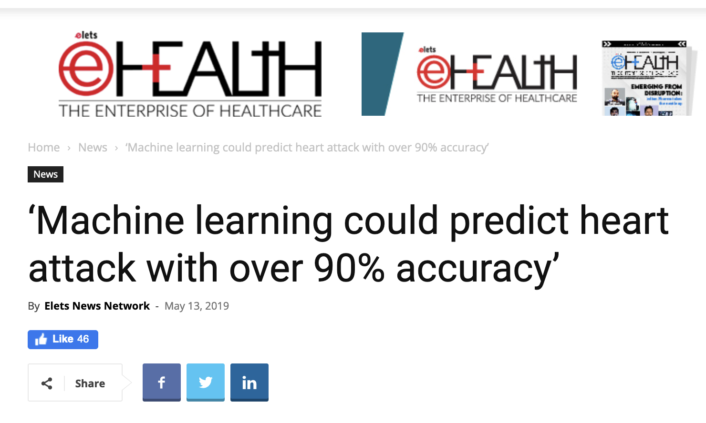
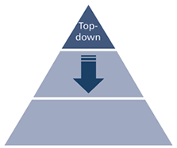
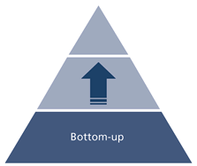

## Focus on the breath!

{.nostretch fig-align="center" width="500px"}

## Announcements

- HW9 has been released (due on December 4th)
  - Almost there! You've got this! 😊
- Next lecture on Ethics will be delivered by Firas (Section 101 instructor)
- Please take a moment to sign the card for Mick, our movement break facilitator.

## Recap: iClicker {.slide-your-turn .smaller}

**Select all of the following statements which are TRUE.**

- (A) Right censoring occurs when the endpoint of event has not been observed for all study subjects by the end of the study period.
- (B) Right censoring implies that the data is missing completely at random.
- (C) In the presence of right-censored data, binary classification models can be applied directly without any modifications or special considerations.
- (D) Treating an active customer’s observed tenure as their final lifetime understates that customer’s eventual lifetime.

::: {.notes}
Answers: A and D. B is not implied by censoring. C ignores the unknown outcome after follow-up ends. D concerns replacing a lower bound with an exact target; it is not a guarantee about every prediction made by Ridge.
:::

## Recap: incomplete lifetimes

- An active customer’s observed tenure is a **lower bound**, not a final lifetime.
- Keep both the **duration** and whether the **event was observed**.
- Kaplan–Meier estimates a survival curve without customer features.
- Cox models relate features to the hazard; their output can support survival predictions under model assumptions.

## Today’s goals {.slide-goals}

1. **Start from the reader’s needs:** choose language, examples, and structure for the audience.
2. **Match the claim to the evidence:** connect results to a justified next step.
3. **Present fair comparisons:** make evidence easy to interpret.

## Why communication?

- ML work involves people with different backgrounds and priorities.
- A model score alone may not answer their question.
- Clear explanations help teams question assumptions and choose what to do next.

**Communication supports the whole workflow.**

## Is this misleading? {.slide-your-turn .smaller}

{.nostretch fig-align="center" height="380px"}

What task, population, baseline, and metric would you need to assess this claim?

::: {.notes}
Keep this as a brief hook. Ask what the headline establishes versus what readers might infer about usefulness in practice. Return to this distinction in the housing example.
:::

# Task 1: Explain a method to a newcomer

## Compare two explanations {.slide-your-turn .smaller}

Imagine reading these on **Day 1 of CPSC 330**. Focus on the explanation, not learning grid search again.

:::: {.columns}
::: {.column width="50%"}

**Explanation 1**

{.nostretch fig-align="center" height="280px"}

:::
::: {.column width="50%"}

**Explanation 2**

{.nostretch fig-align="center" height="280px"}

:::
::::

Read the explanations from [Chapter 21](https://ubc-cs.github.io/cpsc330-book/book/21_communication.html#compare-two-explanations)

::: {.notes}
Allow time to read the explanations in the updated notes. The screenshots are reminders, not reading-sized copies. Neither explanation is a template to copy unchanged.
:::

## Critique both explanations {.slide-your-turn .smaller}

- Does the full random-forest constructor establish the problem, overwhelm the reader, or both?
- Does the cockpit analogy clarify settings? Where could it mislead?
- Does each image explain something or mainly attract attention?
- Does the code connect to the prose and show the relevant result?

**Choose one detail to revise and explain why.**

::: {.notes}
A short selection of settings can establish the problem with less distraction. A cockpit can suggest continuously adjustable controls, although settings such as tree count are integers. The second excerpt says “accuracy” for an SVR search scored by negative MSE and overstates optimality: best among tried settings is not universally optimal. Its X and y are undefined in the excerpt. Invite critique of technical precision as well as style.
:::

## Choose an opening {.slide-your-turn .smaller}

Your teammate knows Python but has not studied ML. Which opening would you use?

- **A.** We are performing hyperparameter optimization using cross-validation.
- **B.** The model has settings we must choose before training. We will compare several choices using held-out portions of our training data.
- **C.** Random forests have settings such as `max_depth`, `max_features`, and `n_estimators`.

**What does each assume? When would A be appropriate?**

::: {.notes}
B gives this newcomer a purpose before labels, but may still require explaining held-out data. A is useful shorthand for an experienced teammate. C names settings without explaining why they matter.
:::

## Choose a worked example {.slide-your-turn .smaller}

You have room for one worked example. Which plan would you choose?

- **A.** Random-forest settings $\to$ grid of combinations $\to$ the same settings in code → output.
- **B.** Introduce hyperparameters using random-forest settings $\to$ demonstrate grid search with SVR $\to$ explain its output to show how tuning applies to another model.
- **C.** Complete search code $\to$ glossary of unfamiliar terms at the end.

What must the reader keep track of? Could you borrow anything useful from another plan?

::: {.notes}
A keeps the settings consistent across the explanation and code, reducing simultaneous unfamiliar ideas. B uses a second model to show that tuning applies beyond random forests, but asks the newcomer to connect the search procedure to a new set of hyperparameters. Discuss whether that transfer is useful at this stage or better introduced after one complete example. C may work as a reference for experienced readers; a glossary alone does not explain relationships.
:::

## What would you add next? {.slide-your-turn .smaller}

Your reader now understands **how grid search works**. They ask:

> “Did grid search help in this case? Does it always help?”

**Which response would you give, and what evidence would you include?**

- **A.** “Grid search selected the settings with the highest mean cross-validation score. Show the search results as evidence that tuning improved the model.”
- **B.** “Compare the default and selected models on the same held-out data that were not used for tuning. Report whether performance improved here; explain that improvement is not guaranteed on other tasks.”
- **C.** “Compare default and tuned models across several datasets. Use those comparisons to explain when tuning tends to help and when it may offer little benefit.”

What can each piece of evidence establish? What would remain uncertain?

::: {.notes}
A confuses selecting settings with demonstrating improvement over defaults: the search results alone do not establish that comparison, and the winning cross-validation score can be optimistic after selection. B directly addresses this case using evaluation data not used for tuning and appropriately limits the claim. Explain the metric and the observed difference, including evaluation uncertainty. C adds evidence relevant to the broader question, though its conclusions depend on the datasets, search budgets, and evaluation design. It still cannot establish that grid search always helps. B and C are complementary rather than mutually exclusive; invite students to justify the scope of their response.
:::

## Concepts before labels

- Explain the settings and why choosing them is difficult.
- Show a way to compare choices.
- Then introduce **hyperparameter optimization** and **grid search**.

The **curse of knowledge**: once we know an idea, we can forget what a newcomer needs explained.

For an experienced reader, the label may be useful shorthand.

## Top down or bottom up? {.smaller}

:::: {.columns}
::: {.column width="50%"}

**Top down**

Start with the conclusion or overall picture, then supporting details.

{.nostretch fig-align="center" height="240px"}

:::
::: {.column width="50%"}

**Bottom up**

Build from concrete examples or component ideas towards the larger idea.

{.nostretch fig-align="center" height="240px"}

:::
::::

**Choose the starting point for the audience and purpose.**

::: {.notes}
A newcomer may need settings and combinations before the search procedure. An experienced teammate deciding whether to continue tuning may want the comparison with defaults first. Neither order is always best.
:::

## Build understanding step by step

1. Introduce a few settings and their combinations.
2. Explain how cross-validation compares them.
3. Connect the steps to code and output.

**Reuse the same example** across prose, tables, code, and results.

A second example can show transfer once the first idea is clear.

## Use complementary explanations {.smaller}

| Reader’s question | Useful addition |
|---|---|
| Which combinations are tried? | A small grid table |
| How do I run the search? | Matching code |
| Did tuning help here? | Default-versus-tuned comparison |
| How does another search differ? | Grid versus randomized search |

Choose the angle that addresses the difficulty.

## Keep results close to the explanation

- Show the relevant output beside the procedure.
- Explain what the reader should notice.
- Include disappointing or inconclusive findings.
- Say what the experiment supports and what remains unresolved.

**Best among the settings tried** does not mean **universally best**.

## It’s not about you {.smaller}

When reluctant to remove a detail, ask:

- Does it help the reader, or make me sound knowledgeable?
- Am I afraid the work looks too simple without it?
- Am I including it because I spent time on it?
- Am I overexplaining because I fear being judged?

**Keep essential assumptions, limitations, and reproducibility details available.**

::: {.notes}
“If it doesn’t serve the audience, it’s noise.” Necessary qualifications may be difficult or unexciting but still serve readers. Supporting material can preserve detail without interrupting the main explanation.
:::

# Task 2: Help a team decide what to do next

## The housing-project update {.slide-your-turn}

Staff currently estimate sale prices themselves and use those estimates to advise sellers about asking prices.

The team proposes a **limited pilot** using ML predictions instead of staff estimates. A manager must decide whether to fund it.

The team’s draft update says:

> “Our model outperformed the other approaches we tested on validation data. Let’s pilot it to give staff more consistent price estimates and help sellers choose asking prices that lead to faster sales and better offers.”

**Which claims need more evidence?**

::: {.notes}
The validation comparison is between ML models, not ML predictions and staff estimates. It uses one training/validation split and several tree counts; a separate test set is reserved. No evidence yet establishes more consistent estimates, faster sales, or better offers. Ask what “consistent” means: reproducible outputs, agreement across staff, or consistently small errors? These require different checks. Keep this draft in view through the plotting and rewriting tasks.
:::

## Think beyond the prediction {.smaller}

Today, staff estimate sale prices. The pilot would use **ML estimates instead**. What would need to improve?

| Question to ask | In the housing project |
|---|---|
| **What decision will it support?** | Staff recommend an asking price to the seller. |
| **What does success mean to the seller?** | A higher sale price? A faster sale? A balance of both? |
| **What circumstances matter?** | The local market and how soon the seller needs to move. |
| **What should we compare it with?** | Staff estimates for the same homes, using information available at the same time. |

**Predicting a sale price accurately does not tell us whether the advice helps sellers.**

## What does the manager need? {.slide-your-turn .smaller}

What should the manager clarify before funding the proposed pilot?

- **A.** Which algorithm has the highest validation score?
- **B.** What would count as success when ML estimates replace staff estimates: more accurate estimates, faster sales, or better offers?
- **C.** How many more hyperparameter combinations can we try?

In a two-minute update, would you move the **baseline**, **full search settings**, or **important failure conditions** to supporting material?

::: {.notes}
B makes the pilot’s success criteria explicit. The draft promises several benefits, which require different evidence. Higher validation R² among ML models does not establish improvement over staff estimates or seller outcomes. The full search settings usually belong in supporting material for this manager; the baseline and failure conditions affect the decision. A technical collaborator reproducing the work may need the settings.
:::

## Which next step would you prioritize? {.slide-your-turn .smaller}

Choose one request for the next team meeting:

- **A.** Compare ML and staff estimates for the same homes against their eventual sale prices.
- **B.** Check whether the data cover the locations and market conditions planned for the pilot.
- **C.** Design a pilot comparing ML-based and current advice, measuring time to sale and sale outcomes.

**State an assumption that makes your choice the priority.**

What missing information could change your choice?

::: {.notes}
There is no single best answer without context. A checks prediction errors using estimates recorded before outcomes are known, with comparable information and timing. B checks relevance to the pilot. C investigates the claimed seller benefits; a randomized comparison, where feasible, helps separate the effect of advice from market differences. Agree on what “better offers” means and how it will be measured. If the dataset is from a different market, B may come first. Require a reason rather than a universal ranking.
:::

## What? So what? Now what? {.smaller}

| Question | Role | Housing update |
|---|---|---|
| **What?** | Observation | One ML model scored higher than another on validation data. |
| **So what?** | Interpretation | A candidate for the pilot, but not yet shown to improve on staff estimates or seller outcomes. |
| **Now what?** | Recommendation | Compare with staff estimates and define how the pilot would test the promised benefits. |

**A score alone leaves the reader to supply the “So what?”**

::: {.notes}
Keep observations, interpretations, and recommendations distinct even if combined in one paragraph. “Now what?” can mean further investigation or continuing current practice; it need not mean deployment. Task 3 supplies specific measured scores.
:::

## Other useful message structures {.smaller}

**Project overview**

Problem $\to$ Approach $\to$ Result $\to$ Limitation

**Decision needed first**

Recommendation $\to$ Reasons and evidence $\to$ Caveats

Choose the order for the reader’s purpose. Keep important qualifications beside the claims they limit.

## Make uncertainty specific {.smaller}

| Unresolved question | Evidence that would help |
|---|---|
| More accurate than staff? | Compare errors for the same homes and prediction time |
| “More consistent” estimates? | Define consistency and measure it against staff estimates |
| Relevant to the pilot? | Check locations, market conditions, and held-out performance |
| Faster sales or better offers? | Compare outcomes under ML-based advice and current advice |

**Clearer wording cannot repair an unsuitable evaluation or data leakage.**

::: {.notes}
One split can give an unstable comparison. Repeated searches can overfit validation results; keep test data separate from selection. Even a strong historical result cannot guarantee future performance. Replace vague “more data needed” statements with the specific missing evidence and why it matters.
:::

## A probability is not evidence of reliability {.slide-your-turn .smaller}

A fraud classifier assigns a transaction probability **0.9**. A colleague says: “We are 90% sure the model is trustworthy.”

Which interpretation is appropriate?

- **A.** The model is reliable for 90% of transactions.
- **B.** The model estimates a 90% probability of fraud here; that output alone does not establish its reliability.
- **C.** The estimate is meaningless until we know this transaction’s outcome.

**What additional evidence would you want?**

::: {.notes}
B. Relevant held-out outcomes are needed to assess probability estimates. Uncertainty does not make them useless. One outcome cannot establish reliability: either outcome is possible at a probability of 0.9. An explanation of why the model made a prediction is also distinct from evidence that the prediction is reliable.
:::

# Task 3: Present a fair comparison

## Housing comparison: setup {.smaller}

- Kaggle housing data from Chapter 10: **ML models only; no staff estimates**.
- Random forest and gradient boosting: **3, 10, 30, 100, 300 trees**.
- One fixed training/validation split; **a separate test set stays untouched**.
- Preprocessing fitted on training data only.
- Train on log-transformed prices; convert predictions to dollars before scoring.

**Metric: $R^2$ on original sale prices, not percentage accuracy.**

[Open the reproducible class demo](demos/lecture-21-communication.ipynb)

::: {.notes}
The local notebook reproduces the updated course notes. Its split reserves 10% for testing, then 20% of the remainder for validation. Equal tree counts do not mean equal computation or equally thorough tuning. This is a communication example, not an exhaustive model search.
:::

## Inspect the measured results {.smaller}

| Trees | RF training | RF validation | GB training | GB validation |
|---:|---:|---:|---:|---:|
| 3 | 0.941 | 0.760 | 0.260 | 0.313 |
| 10 | 0.974 | 0.869 | 0.633 | 0.652 |
| 30 | 0.977 | 0.867 | 0.892 | 0.867 |
| 100 | 0.979 | 0.869 | 0.967 | 0.906 |
| 300 | 0.978 | 0.871 | 0.989 | 0.913 |

RF = random forest; GB = gradient boosting. Values are $R^2$.

**How does the comparison change across tree counts?**

Does this table tell us whether ML estimates are better than staff estimates?

::: {.notes}
Values rounded from the executed Chapter 21 notebook; no new performance measurements are invented. At small counts RF has higher validation scores; around 30 the scores are close; at larger counts GB has higher validation scores in this split.
:::

## Choose the display {.slide-your-turn .smaller}

Technical teammates ask how the methods compare **across the settings tried**.

- **A.** Show only small tree counts where the difference is easiest to explain.
- **B.** Show all five settings with labelled axes, shared vertical scales, and separate training/validation panels.
- **C.** Use a vertical range so wide that the curves look nearly identical.

Predict how A or C changes the apparent conclusion.

When might restricting the comparison to small models be justified?

::: {.notes}
B preserves the evidence required for this question. A could be justified by a stated resource constraint that makes larger models infeasible; otherwise it hides relevant settings. C obscures differences. Restricted ranges are not inherently dishonest; judge them against the question and claim.
:::

## Same results, different stories {.smaller}

{.nostretch fig-align="center" width="1000px"}

What does each display omit or make harder to see?

::: {.notes}
First: only the first three settings, hiding the change at larger tree counts. Second: all settings, but linear spacing compresses the smaller counts. Third: an excessively wide vertical range obscures differences. These panels reproduce outputs from the updated notes.
:::

## A fairer comparison {.smaller}

{.nostretch fig-align="center" height="420px"}

All five settings; shared vertical scale; separate training and validation; labelled log horizontal axis.

::: {.notes}
A log horizontal scale makes multiplicative increases easier to compare. Explain it explicitly. The chart supports a comparison on this split, with these settings and this metric. It does not establish general algorithm superiority, improvement over staff estimates, more consistent advice, faster sales, or better offers. The test set remains untouched.
:::

## Choose axes for the question {.smaller}

- **Bar charts:** generally start at zero because lengths encode magnitude.
- **Lines and scatter plots:** a narrower range can reveal useful variation; label it clearly.
- **Comparisons of the same metric:** use a shared scale.
- **Dual vertical axes:** independent scales can manufacture apparent agreement or divergence.

Check whether the range exaggerates **or hides** differences.

## Other ways a display can mislead {.smaller}

- Selectively omit settings, cases, or unfavourable results.
- Change histogram bins to suggest a fragile pattern.
- Exaggerate quantities through disproportionate areas or volumes.
- Add decoration that competes with the evidence.
- Force data into an attractive chart that obscures the comparison.

**Start with the comparison the reader needs to make.**

## Complete the housing update {.slide-your-turn .smaller}

The manager is deciding whether to fund a pilot **replacing staff estimates with ML estimates**. Rewrite the draft in **at most 100 words**.

Include:

1. A specific measured result and comparison.
2. Why it matters for the pilot decision.
3. What remains untested about staff estimates and the promised seller benefits.
4. A next step that addresses one of those evidence gaps.

Identify **What / So what / Now what**. Do not invent benefits to sellers.

Would the manager need the full technical plot, a simpler visual, or a sentence?

::: {.notes}
Allow individual writing followed by partner exchange. Ask partners what decision the message supports and what remains unknown. Revise wording that led to stronger conclusions than intended. A recommendation-first structure is also acceptable.
:::

## One possible update {.smaller}

> Gradient boosting made smaller prediction errors overall than random forest on our validation data ($R^2$: 0.913 versus 0.871, both with 300 trees). It is a candidate for the proposed pilot, but we have not compared it with staff estimates or shown that it gives more consistent estimates, speeds up sales, or improves offers. Before funding a pilot, I recommend comparing ML and staff estimates for the same homes and agreeing how the pilot would measure seller outcomes. Which benefit matters most to sellers, and what improvement would justify changing the current approach?

::: {.notes}
Show after students write. Explain R² further for a manager unfamiliar with it: it compares squared prediction errors with variation in observed sale prices; higher is better on this evaluation. Do not translate it to percentage accuracy or seller benefit. A sentence can carry the main comparison; put the technical plot and setup in supporting material. Other next steps can be reasonable with stated assumptions.
:::

## Before sharing: is my message clear? {.smaller}

- [ ] **Who am I talking to?** Have I explained terms they may not know?
- [ ] **What do they need?** Is it clear what question or decision I am helping with?
- [ ] **What did we find?** Have I explained the score, what we compared against, and which data we used?
- [ ] **Why does it matter?** Have I connected the result to their decision?
- [ ] **Was the comparison fair?** Did we keep test data out of model selection and use only information available at prediction time?

## Before sharing: are my claims supported? {.smaller}

- [ ] **What is still unknown?** Have I said where the model has not been tested and what could change the conclusion?
- [ ] **Am I claiming too much?** Explaining a prediction does not prove it is correct; a model score does not prove benefits for users.
- [ ] **If I report a probability, have we checked it?** For predictions near 90%, did the event happen about 90% of the time on relevant held-out data? If we have not checked, have I said so?
- [ ] **What should happen next?** Have I proposed a step that addresses a specific unanswered question?
- [ ] **If we use the model, who will check it?** What will they monitor, and when should they investigate or make a change?

## What did we learn today? {.slide-summary}

1. **Start from the reader’s needs.** Choose examples, language, and structure for the audience and purpose.
2. **Match the claim to the evidence.** Separate observation, interpretation, and recommendation.
3. **Make comparisons fair.** Show relevant evidence and explain display choices.

**What? $\to$ So what? $\to$ Now what?**

## Have a great weekend!

{.nostretch fig-align="center" width="500px"}

# Optional activities and resources

## Calibration: checking probabilities {.slide-optional .smaller}

Among **100 held-out transactions** assigned probabilities near **0.9**, we would expect roughly **90 fraud cases** if estimates match observed frequencies.

- If only about 60 are fraudulent, estimates are too high for this group.
- Check patterns across enough relevant held-out cases and probability ranges.
- One transaction cannot establish calibration.
- Calibration alone does not establish usefulness or overall trustworthiness.

::: {.notes}
Counts fluctuate by chance, especially for small groups. Good ranking does not imply calibration; assigning everyone the base rate can be calibrated in aggregate but unhelpful for prioritizing investigations. Overall patterns can also hide subgroup problems.
:::

## Transfer: customer-support routing {.slide-optional .smaller}

A classifier routes support requests to departments:

- Historical held-out accuracy: **88%**; most-common-department baseline: **70%**.
- Uses only text available at arrival; mistakes require manual rerouting.
- Time saved has not been measured; a product launch may change requests.

Write **≤120 words** for the support manager deciding whether to fund a pilot. Explain evidence, uncertainty, and your next step. Include one question for the manager.

::: {.notes}
Use as an exit ticket or follow-up exercise. Do not invent time savings. Ask students to explain two wording/detail choices and what they would add for a technical reviewer. A next step should address the missing operational outcome or changed request mix, with an assumption supporting the priority.
:::

## Transfer: YouTube recommendations {.slide-optional .smaller}

You train a recommender from user–video clicks, but recommendations are poor.

- Do clicks represent the user experience you want to improve?
- Who decides what “good” means?
- What alternatives, context, and additional evidence matter?

**A convenient target may not match the objective.**

## Further examples {.slide-optional .smaller}

- [Feynman: knowing a name versus understanding](https://www.youtube.com/watch?v=px_4TxC2mXU)
- [Calling Bullshit visualization videos](https://www.youtube.com/playlist?list=PLPnZfvKID1Sje5jWxt-4CSZD7bUI4gSPS)
- [Simplifying a chart](https://www.darkhorseanalytics.com/blog/data-looks-better-naked)

Use the resources to ask: **What claim does this display support, and what might a reader infer beyond it?**
