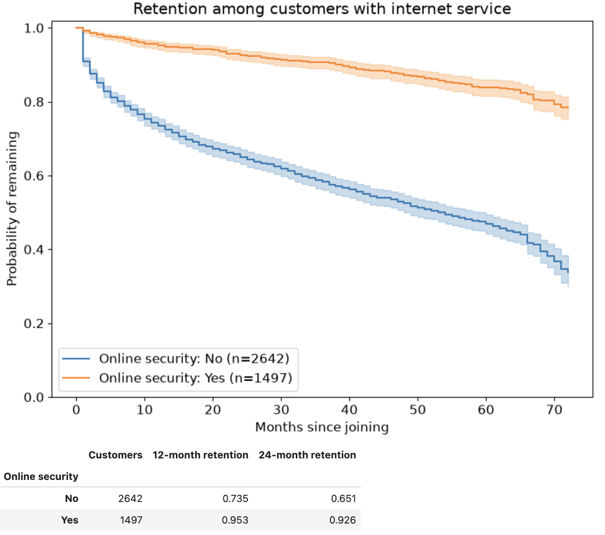
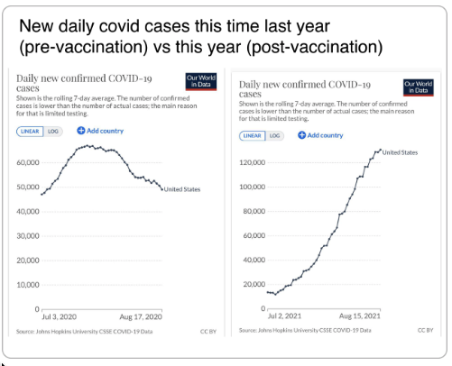

## Focus on the breath!

{.nostretch fig-align="center" width="500px"}

::: {.notes}
Before we begin, let’s take a moment to settle in. Take a few comfortable breaths and let your attention come back to the room.
:::

## Announcements

- HW9 has been released (due on December 4th)
  - Almost there! You've got this! 😊
- Next lecture on Ethics will be delivered by Firas (Section 101 instructor)
- Please take a moment to sign the card for Mick, our movement break facilitator.

::: {.notes}
HW9 is out, and the deadline is December 4. You’re nearly there! Our next lecture, on ethics, will be delivered by Firas, the Section 101 instructor. Please also take a moment to sign the card for Mick, our movement break facilitator.
:::

## Recap: Would online security prevent churn? {.slide-your-turn .smaller}

:::: {.columns}
::: {.column width="60%"}

{.nostretch fig-align="center" height="440px"}

:::
::: {.column width="40%"}

Customers with online security have **higher estimated retention**.

Would this justify recommending online security **as a way to prevent churn**?

**Why or why not?**

:::
::::

::: {.notes}
Let’s return to the survival curves from last lecture. The vertical axis is the estimated probability of remaining subscribed, and the horizontal axis is months since joining. Customers with online security have higher estimated retention. Does that justify recommending online security as a way to prevent churn? What else would you want to know?

The curves show an association, but they do not tell us what would happen if we sold online security to customers who currently lack it. The groups might differ in contract type, service bundles, or other characteristics. Those are possible explanations to investigate, not facts established by this plot. We would also need to know when online security was purchased: its status when data were collected need not be its status when the customer joined.

This finding could motivate further investigation, but it does not establish that selling online security prevents churn. A suitable intervention study, such as a randomized offer with clearly defined outcomes, could help us assess an action; the effect of offering a product is also distinct from the effect of actually using it.

Notice how easily “customers with security stay longer” becomes “security makes customers stay longer.” A careful update would say: “Customers with online security have higher estimated retention in these data. We have not established that offering it would reduce churn.” Today we’ll practise communicating results without making that unsupported jump. We’ll see the same distinction when we ask whether better house-price predictions lead to better outcomes for sellers.
:::

## Today’s goals {.slide-goals}

1. **Start from the reader’s needs:** choose language, examples, and structure for the audience.
2. **Match the claim to the evidence:** connect results to a justified next step.
3. **Present fair comparisons:** make evidence easy to interpret.

::: {.notes}
Today we’ll practise three communication tasks. First, how do we explain a familiar method to someone new to ML? Second, how do we help a manager decide what to do with a result? Third, how do we present a comparison fairly? Our housing example will connect the decision and visualization tasks.
:::

## Why communication?

- ML work involves people with different backgrounds and priorities.
- A model score alone may not answer their question.
- Clear explanations help teams question assumptions and choose what to do next.

**Communication supports the whole workflow.**

::: {.notes}
Communication starts before we train a model, when we discuss the goal and question our assumptions. It continues when we explain results. A technically correct score can still leave someone wondering what they should do next. Our aim is to help people understand and decide using appropriate evidence. Adoption is useful only when the evidence supports it.
:::

## Is this misleading? {.slide-your-turn .smaller}

{.nostretch fig-align="center" height="380px"}

What task, population, baseline, and metric would you need to assess this claim?

::: {.notes}
What would you need to know before accepting this headline? What exactly was predicted, for whom, and on which data? What was the baseline? What does the metric measure, and how uncertain is the result?

We cannot settle all of that from a headline. The result might be useful, but we need the evaluation context before drawing that conclusion. Notice the distinction between what a result establishes and what a reader might infer from it. We’ll return to that in the housing example.
:::

# Task 1: Explain a method to a newcomer

::: {.notes}
You already know grid search. For this task, imagine you know Python but have not studied ML. What would an explanation need to establish before its terminology and code become useful?
:::

## Compare two explanations {.slide-your-turn .smaller}

Imagine reading these on **Day 1 of CPSC 330**. Focus on the explanation, not learning grid search again.

:::: {.columns}
::: {.column width="50%"}

**Explanation 1**

{.nostretch fig-align="center" height="280px"}

:::
::: {.column width="50%"}

**Explanation 2**

{.nostretch fig-align="center" height="280px"}

:::
::::

Read the explanations from [Chapter 21](https://ubc-cs.github.io/cpsc330-book/book/21_communication.html#compare-two-explanations)

::: {.notes}
Please open the two explanations in Chapter 21. The screenshots here are reminders; the full text is in the notes. Take a few minutes to read, and identify one helpful choice and one assumption about the reader in each explanation.

The first explanation connects a problem to a running example and output. The second assumes more vocabulary and context, though an experienced reader looking for an API example might find parts useful. Neither is a template we should copy unchanged.
:::

## Critique both explanations {.slide-your-turn .smaller}

- Does the full random-forest constructor establish the problem, overwhelm the reader, or both?
- Does the cockpit analogy clarify settings? Where could it mislead?
- Does each image explain something or mainly attract attention?
- Does the code connect to the prose and show the relevant result?

**Choose one detail to revise and explain why.**

::: {.notes}
What would you revise for a newcomer, and why?

The full constructor shows that there are many settings, but a shorter selection could make that point with less distraction. The cockpit analogy conveys choices, though it might suggest continuous controls when tree count, for example, is an integer. It also does not explain the search itself. A grid diagram could do that more directly; a meme may mainly attract attention.

The first explanation carries the random-forest settings through the grid, code, and output. The second uses SVR, leaves X and y undefined in the excerpt, and does not display a result. It also says “accuracy” although its score is negative mean squared error. We can improve technical precision as well as style: show fewer settings, name the metric correctly, or add output with an explanation. Different revisions can work if they address the reader’s needs.
:::

## Choose an opening {.slide-your-turn .smaller}

Your teammate knows Python but has not studied ML. Which opening would you use?

- **A.** We are performing hyperparameter optimization using cross-validation.
- **B.** The model has settings we must choose before training. We will compare several choices using held-out portions of our training data.
- **C.** Random forests have settings such as `max_depth`, `max_features`, and `n_estimators`.

**What does each assume? When would A be appropriate?**

::: {.notes}
Which opening would you choose for this teammate? What background does each assume?

I would start with B. It explains why we are comparing settings before naming the procedure, although we may still need to explain held-out data. A assumes the reader knows optimization and cross-validation; it could be excellent shorthand for an experienced teammate. C names settings but does not explain their purpose. The choice depends on what knowledge we share with the reader.
:::

## Choose a worked example {.slide-your-turn .smaller}

You have room for one worked example. Which plan would you choose?

- **A.** Random-forest settings $\to$ grid of combinations $\to$ the same settings in code → output.
- **B.** Introduce hyperparameters using random-forest settings $\to$ demonstrate grid search with SVR $\to$ explain its output to show how tuning applies to another model.
- **C.** Complete search code $\to$ glossary of unfamiliar terms at the end.

What must the reader keep track of? Could you borrow anything useful from another plan?

::: {.notes}
What would the reader need to keep track of in each plan?

A keeps one model’s settings consistent across prose, the grid, code, and output. B has a useful goal: showing that tuning applies to another model. But the reader must also learn SVR’s settings while learning the search procedure. C asks them to interpret code while holding several unresolved terms in mind; a glossary helps reference, but does not explain the relationships.

For this newcomer, I would complete A first, then borrow B’s second model to show transfer. C’s glossary could remain available as supporting material. Variety can be useful; its timing matters.
:::

## What would you add next? {.slide-your-turn .smaller}

Your reader now understands **how grid search works**. They ask:

> “Did grid search help in this case? Does it always help?”

**Which response would you give, and what evidence would you include?**

- **A.** Show the winning cross-validation score as evidence that tuning helped.
- **B.** Compare default and tuned models on data not used for tuning. Limit the conclusion to this experiment.
- **C.** Compare default and tuned models across several datasets to investigate when tuning helps.

What can each piece of evidence establish? What would remain uncertain?

::: {.notes}
How would you answer these two questions, and what evidence would you provide?

A tells us which settings won the search. It does not, on its own, demonstrate improvement over defaults, and the winning cross-validation score may look optimistic after selection. B directly addresses this case: compare default and tuned models on data not used for tuning, explain the metric and difference, and acknowledge evaluation uncertainty.

C investigates the broader question using several datasets. Its conclusions still depend on which datasets, search budgets, and evaluations we chose. It cannot establish that tuning always helps. B and C can complement each other: one answers what happened here, the other explores how widely that result holds.
:::

## Concepts before labels

- Explain the settings and why choosing them is difficult.
- Show a way to compare choices.
- Then introduce **hyperparameter optimization** and **grid search**.

The **curse of knowledge**: once we know an idea, we can forget what a newcomer needs explained.

For an experienced reader, the label may be useful shorthand.

::: {.notes}
Opening B gives the reader something to attach the label to. We have settings to choose, a reason to compare choices, and then a name for that process. A name alone does not provide understanding.

Once a term becomes familiar, it is easy to forget how much background we needed to understand it. That is the curse of knowledge. For a colleague who already understands the concept, starting with the label can be efficient.
:::

## Top down or bottom up? {.smaller}

:::: {.columns}
::: {.column width="50%"}

**Top down**

Start with the conclusion or overall picture, then supporting details.

{.nostretch fig-align="center" height="240px"}

:::
::: {.column width="50%"}

**Bottom up**

Build from concrete examples or component ideas towards the larger idea.

{.nostretch fig-align="center" height="240px"}

:::
::::

**Choose the starting point for the audience and purpose.**

::: {.notes}
A top-down explanation starts with the conclusion or overall picture. A bottom-up explanation builds towards it from concrete examples or smaller ideas.

A newcomer may need to see settings and combinations before understanding the search procedure. An experienced teammate deciding whether to continue tuning may want the result compared with defaults first. Neither order is always better. The audience’s background and purpose determine the useful starting point.
:::

## Build understanding step by step {.smaller}

**Keep one running example** across prose, tables, code, and output.

| Reader’s next question | Add this next |
|---|---|
| Which settings will we try? | A small grid of combinations |
| How will we compare them? | Explain cross-validation |
| How do I run it? | Code using those same settings |
| Did tuning help? | Default-versus-tuned results |

Introduce another model or search method when it answers a new question.

::: {.notes}
We can keep the reader oriented by answering one question at a time. Which settings will we try? Here is a small grid. How will we compare them? Here is the role of cross-validation. How do we run it? Here is matching code. Did it help? Here is the comparison with defaults.

Keeping the example consistent reduces how many new things the reader must connect at once. Another model or search method becomes useful when it answers their next question.
:::

## Keep results close to the explanation

- Show the relevant output beside the procedure.
- Explain what the reader should notice.
- Include disappointing or inconclusive findings.
- Say what the experiment supports and what remains unresolved.

**Best among the settings tried** does not mean **universally best**.

::: {.notes}
When we show an experiment, the relevant result should be easy to find, with an explanation of what to notice. For grid search, best_params_ identifies the best settings among those tried. It does not establish improvement over defaults or universal optimality.

If improvement is the question, we need the appropriate comparison. Disappointing or inconclusive findings belong in the explanation too; choosing only a successful run would give the reader an incomplete picture.

In a longer presentation, it can also help to give a sneak peek of the main result at the beginning. That gives the audience a reason to care and a destination to keep in mind. Then we can explain how we got there—our approach—before walking through the evaluation and detailed results. Any important qualification should stay with the preview, so the opening does not promise more than the evidence supports. We can return to the result with more detail once the audience understands the setup.
:::

## It’s not about you {.smaller}

When reluctant to remove a detail, ask:

- Does it help the reader, or make me sound knowledgeable?
- Am I afraid the work looks too simple without it?
- Am I including it because I spent time on it?
- Am I overexplaining because I fear being judged?

**Keep essential assumptions, limitations, and reproducibility details available.**

::: {.notes}
Sometimes we keep a detail because we worked hard on it, worry that the work looks too simple, or want to show what we know. I find it useful to ask: what does this detail help the reader understand or decide?

“If it doesn’t serve the audience, it’s noise.” But important assumptions and limitations do serve the audience, even when they are difficult or unexciting. Supporting material lets us preserve necessary detail without interrupting the main explanation.
:::

# Task 2: Help a team decide what to do next

::: {.notes}
Let’s change audiences. Our newcomer wanted to understand a method. This manager needs to decide whether to fund a pilot. We’ll keep asking what the reader needs, while separating prediction performance from the effects of using those predictions.
:::

## The housing-project update {.slide-your-turn .smaller}

Staff currently estimate sale prices themselves and use those estimates to advise sellers about asking prices.

**The model estimates the eventual sale price; it does not choose the asking price.**

The team proposes a **limited pilot** using ML predictions instead of staff estimates. A manager must decide whether to fund it.

The team’s draft update says:

> “Our model outperformed the other approaches we tested on validation data. Let’s pilot it to give staff more consistent price estimates and help sellers choose asking prices that lead to faster sales and better offers.”

**Which claims need more evidence?**

::: {.notes}
Staff currently estimate sale prices and use them to advise sellers about asking prices. The team wants to try ML estimates instead. The model predicts a sale price; it does not directly decide the asking price.

Which claims in this draft need more evidence?

Our validation comparison is between ML models, not between ML and staff. It does not yet establish more consistent estimates, faster sales, or better offers. Even “consistent” needs a definition: repeatable outputs, agreement across staff, or consistently small errors?

There is another complication: changing asking-price advice might itself change the eventual sale price. Historical prediction accuracy does not tell us the effect of acting on predictions. We’ll keep this draft in view as we examine the results.
:::

## Think beyond the prediction {.smaller}

Today, staff estimate sale prices. The pilot would use **ML estimates instead**. What would need to improve?

| Question to ask | In the housing project |
|---|---|
| **What decision will it support?** | Staff recommend an asking price to the seller. |
| **What does success mean to the seller?** | A higher sale price? A faster sale? A balance of both? |
| **What circumstances matter?** | The local market and how soon the seller needs to move. |
| **What should we compare it with?** | Staff estimates for the same homes, using information available at the same time. |

**Predicting a sale price accurately does not tell us whether the advice helps sellers.**

::: {.notes}
The prediction is one part of a chain. Staff use an estimated sale price to recommend an asking price, and that advice may affect outcomes the seller cares about. What would need to improve?

A seller who must move soon may value speed more than someone who can wait. We need to agree on success with the people affected. To compare prediction accuracy, we need staff and ML estimates for the same homes, using information available at the same time. That comparison still would not establish faster sales or better offers from changing the advice.
:::

## What does the manager need? {.slide-your-turn .smaller}

What should the manager clarify before funding the proposed pilot?

- **A.** Which algorithm has the highest validation score?
- **B.** What would count as success when ML estimates replace staff estimates: more accurate estimates, faster sales, or better offers?
- **C.** How many more hyperparameter combinations can we try?

In a two-minute update, would you move the **baseline**, **full search settings**, or **important failure conditions** to supporting material?

::: {.notes}
Which question should the manager clarify first?

B makes success explicit. A can help us choose a candidate, but it cannot tell us what a successful pilot means. C may be worthwhile if the candidates are inadequate, but more search will not resolve an undefined objective.

For the two-minute update, I would usually move the full search settings to supporting material. The baseline and important failure conditions affect the manager’s decision, so they belong in the main message. A technical collaborator reproducing our work would need more of those settings. What evidence would this manager need for each promised benefit?
:::

## Which next step would you prioritize? {.slide-your-turn .smaller}

Choose one request for the next team meeting:

- **A.** Compare ML and staff estimates for the same homes against their eventual sale prices.
- **B.** Check whether the data cover the locations and market conditions planned for the pilot.
- **C.** Design a pilot comparing ML-based and current advice, measuring time to sale and sale outcomes.

**State an assumption that makes your choice the priority.**

What missing information could change your choice?

::: {.notes}
Choose a next step and explain the assumption that makes it your priority. There is no single best answer without more context.

A checks prediction errors against staff estimates recorded before outcomes are known, using comparable information and timing. B checks whether our evaluation is relevant to the proposed pilot. If our data come from a different market, that could be the first concern. C investigates the effects of changing advice. A randomized comparison, where feasible, can help separate those effects from market differences.

We would also need to define “better offers.” Your priority should follow from the most important missing evidence, and it could change when you learn more.
:::

## What? So what? Now what? {.smaller}

| Question | Role | Housing update |
|---|---|---|
| **What?** | Observation | One ML model scored higher than another on validation data. |
| **So what?** | Interpretation | A candidate for the pilot, but not yet shown to improve on staff estimates or seller outcomes. |
| **Now what?** | Recommendation | Compare with staff estimates and define how the pilot would test the promised benefits. |

**A score alone leaves the reader to supply the “So what?”**

::: {.notes}
A useful short update answers three questions. What did we observe? One ML candidate scored higher than another. So what does that mean for this reader? It gives us a candidate to investigate, but does not settle whether to replace staff estimates. Now what? Compare with staff and define how a pilot would test the promised benefits.

We can combine these into one paragraph, while keeping observation, interpretation, and recommendation distinct. The next step could be further investigation or continuing current practice. It does not have to be deployment.
:::

## Same evidence, different audiences {.smaller}

:::: {.columns}
::: {.column width="50%"}

**Technical teammate**

“On the same validation split, gradient boosting had higher $R^2$ than random forest. Neither was compared with staff estimates. Next, compare their prediction errors with staff errors on the same homes.”

:::
::: {.column width="50%"}

**Manager deciding on the pilot**

“Before deciding on the pilot, compare the model’s estimates with staff estimates. It predicted prices more accurately than the other ML approach in our validation comparison, but we do not yet know whether it improves on staff.”

:::
::::

**What changed in the language, detail, and order? What stayed the same?**

::: {.notes}
What changed between these two messages? What stayed the same?

Both describe the same model comparison, acknowledge the missing staff comparison, and propose the same next step. The technical version names the metric and evaluation setup. The manager version leads with the decision and explains the result in ordinary language. Neither claims benefits to sellers.

We have changed the language, detail, and order without changing the evidence. The full evaluation setup and exact scores can remain available as supporting material. Which of those details would your audience need in the main message?
:::

## Other useful message structures {.smaller}

**Project overview**

Problem $\to$ Approach $\to$ Result $\to$ Limitation

**Decision needed first**

Recommendation $\to$ Reasons and evidence $\to$ Caveats

Choose the order for the reader’s purpose. Keep important qualifications beside the claims they limit.

::: {.notes}
For a project overview, we might start with the problem, describe the approach, report the result, and explain the limitation. Here, staff need estimates; we compare ML approaches; we report the validation findings; and we acknowledge that staff estimates have not been compared.

When the reader needs a decision first, we could lead with our recommendation, give the reasons and evidence, then state the caveats. These are starting points rather than mandatory templates. Important qualifications should stay beside the claims they limit.
:::

## Make uncertainty specific {.smaller}

| Unresolved question | Evidence that would help |
|---|---|
| More accurate than staff? | Compare errors for the same homes and prediction time |
| “More consistent” estimates? | Define consistency and measure it against staff estimates |
| Relevant to the pilot? | Check locations, market conditions, and held-out performance |
| Faster sales or better offers? | Compare outcomes under ML-based advice and current advice |

**Clearer wording cannot repair an unsuitable evaluation or data leakage.**

::: {.notes}
“We need more data” leaves the reader wondering what to do. A more useful limitation identifies the unanswered question and the evidence that could address it. To compare with staff, we need comparable estimates. To assess relevance, we need coverage of the intended locations and conditions. To assess seller benefits, we need outcomes under the advice strategies.

One split may also give an unstable comparison, and repeated searches can overfit validation results. That is why we keep test data separate from selection. Clear wording helps us communicate these limits, but it cannot repair leakage or an unsuitable evaluation.
:::

# Task 3: Present a fair comparison

::: {.notes}
Now let’s look at the evidence display for the same housing project. We’ll inspect the full results, then see how different presentations of those scores can suggest different stories.
:::

## Two comparisons, two questions

| Comparison | What does it help us decide? |
|---|---|
| **ML model versus ML model** | Which candidate should we investigate further? |
| **ML estimates versus staff estimates** | Could changing the current approach be worthwhile? |

The plots answer the **first** question. The pilot decision also needs the **second** comparison and evidence about seller outcomes.

::: {.notes}
These are two distinct comparisons. Comparing ML models helps us select a candidate to investigate. Comparing ML estimates with staff estimates helps us assess whether changing the current approach might be worthwhile.

Our data contain no staff estimates, so the plots answer only the first question. Even a good staff comparison would concern prediction performance. Evidence about the effects on advice and seller outcomes would require a pilot or another suitable evaluation of changing practice.
:::

## Housing comparison: setup {.smaller}

- Kaggle housing data from Chapter 10: **ML models only; no staff estimates**.
- Random forest and gradient boosting: **3, 10, 30, 100, 300 trees**.
- One fixed training/validation split; **a separate test set stays untouched**.
- Preprocessing fitted on training data only.
- Train on log-transformed prices; convert predictions to dollars before scoring.

**Metric: $R^2$ on original sale prices, not percentage accuracy.**

[Open the reproducible class demo](demos/lecture-21-communication.ipynb)

::: {.notes}
We’re using the housing data from Chapter 10 and comparing random forest with gradient boosting at five tree counts. The notebook reserves ten percent for testing, then twenty percent of the remainder for validation. The test set stays untouched, and preprocessing is fitted on training data only.

Both models train on log-transformed prices, but predictions are converted back to dollars before calculating R². Equal tree counts do not mean equal computing cost or equally thorough tuning. This is a communication example using a limited comparison, not an exhaustive model search.
:::

## Inspect the measured results {.smaller}

| Trees | RF training | RF validation | GB training | GB validation |
|---:|---:|---:|---:|---:|
| 3 | 0.941 | 0.760 | 0.260 | 0.313 |
| 10 | 0.974 | 0.869 | 0.633 | 0.652 |
| 30 | 0.977 | 0.867 | 0.892 | 0.867 |
| 100 | 0.979 | 0.869 | 0.967 | 0.906 |
| 300 | 0.978 | 0.871 | 0.989 | 0.913 |

RF = random forest; GB = gradient boosting. Values are $R^2$.

**How does the comparison change across tree counts?**

Does this table tell us whether ML estimates are better than staff estimates?

::: {.notes}
How does the comparison change as we increase the tree count?

At three and ten trees, random forest has higher validation R². At thirty, the scores are close. At one hundred and three hundred, gradient boosting is higher on this split. Higher training scores alone would not tell us which candidate to select.

Does the table show that ML beats staff? No: it contains no staff predictions. Also, 0.913 is not 91.3 percent accuracy, and its difference from 0.871 is not a percentage improvement in seller outcomes. These are rounded results from one fixed split; they do not establish a statistically significant or universal difference.
:::

## Choose the display {.slide-your-turn .smaller}

Technical teammates are selecting a candidate for further evaluation. Which display would you use?

- **A.** Validation results only, across all five settings: focus on performance on unseen cases.
- **B.** Separate training and validation panels: also show the gap between training and validation performance.
- **C.** Results only for models within a stated computing budget: focus on feasible options.

**What question does each answer? What would you need to explain or disclose?**

::: {.notes}
Which display would help these teammates, and what would you disclose?

A focuses directly on validation performance across the tried settings. B adds the training–validation gap, which helps us inspect generalization. C could be appropriate if a real computing constraint limits feasible options. But tree count alone is not a fair measure of cost across algorithms; we would need runtime or memory measurements and a stated budget.

There is no universally best display. Its scope should match the question, and any exclusions need an explanation. Next we’ll see how omissions and axis choices can change the apparent story.
:::

## Same results, different stories {.smaller}

{.nostretch fig-align="center" width="1000px"}

What does each display omit or make harder to see?

::: {.notes}
What is harder to see in each panel?

The first shows only the small ensembles. It can suggest that random forest dominates, because it omits the larger settings where gradient boosting has higher validation scores. The second includes every setting, but linear spacing crowds the smaller counts. That spacing is not inherently wrong; it makes some comparisons harder. The third uses such a wide vertical range that the differences become difficult to see.

The question is whether the choice helps answer the stated question or hides relevant evidence. A restriction needs a reason that the reader can assess.
:::

## A fairer comparison {.smaller}

{.nostretch fig-align="center" height="420px"}

All five settings; shared vertical scale; separate training and validation; labelled log horizontal axis.

::: {.notes}
Here we show all five settings, separate training from validation, and use a shared vertical scale. The horizontal axis is logarithmic: equal distances represent equal ratios in tree count. This makes the multiplicative increases easier to inspect.

We can now compare the measured scores across the settings tried. The chart still does not establish general algorithm superiority, improvement over staff, or benefits such as faster sales and better offers. The test set remains untouched.
:::

## Choose axes for the question {.smaller}

- **Bar charts:** generally start at zero because lengths encode magnitude.
- **Lines and scatter plots:** a narrower range can reveal useful variation; label it clearly.
- **Comparisons of the same metric:** use a shared scale.
- **Dual vertical axes:** independent scales can manufacture apparent agreement or divergence.

Check whether the range exaggerates **or hides** differences.

::: {.notes}
Bar lengths encode magnitude, so truncating their baseline can distort relative values. Lines and points encode positions; a clearly labelled narrower range can reveal useful variation. Starting at zero is therefore not a universal requirement, and an excessively wide range can hide differences too.

Shared scales help when we compare the same metric across panels. Independently chosen dual axes can manufacture apparent agreement or divergence between series. Whenever we use a logarithmic axis, we need to make its meaning clear to the audience.
:::

## Other ways a display can mislead {.smaller}

- Selectively omit settings, cases, or unfavourable results.
- Change histogram bins to suggest a fragile pattern.
- Exaggerate quantities through disproportionate areas or volumes.
- Add decoration that competes with the evidence.
- Force data into an attractive chart that obscures the comparison.

**Start with the comparison the reader needs to make.**

::: {.notes}
Axes are only one part of the problem. What has been omitted? Would a histogram’s apparent pattern survive reasonable changes to the bins? If area or volume represents a quantity, does its size change proportionally? Does decoration help us compare values or distract from them?

Showing only feasible models can be reasonable if we state the scope and constraint. A useful display makes the relevant evidence visible. But even a clean display can accompany an unsupported interpretation, as we’ll see next.
:::

## Clear chart but misleading story {.slide-your-turn .smaller}

:::: {.columns}
::: {.column width="58%"}

{.nostretch fig-align="center" height="390px"}

:::
::: {.column width="42%"}

The post uses this comparison to suggest that vaccination failed.

- What do the charts actually show?
- What does that claim add?
- What missing context would you need?

[Source: *How People Actually Lie With Charts*](https://vdl.sci.utah.edu/blog/2023/04/17/misleading/#cherry-picking)

:::
::::

::: {.notes}
What do these charts actually show, and what does the surrounding claim add?

They show seven-day averages of reported daily confirmed US cases during selected periods in 2020 and 2021. The vertical scales differ, so equal heights do not mean equal case counts. The interpretation adds a conclusion about vaccination that these two time windows do not establish.

We would want the full time course, vaccination coverage, testing and reporting context, and other differences between the periods. We also need to clarify which outcome the claim concerns. The article by Maxim Lisnic explains that the selected window omits an earlier decline in cases. Before-and-after timing alone is not evidence of causation.

This is the same reasoning problem as the housing claim. A measured difference in prediction scores does not establish that changing advice will improve offers. We need to assess a chart together with its caption, selection of data, and surrounding claim.
:::

## Before sharing: is my message clear? {.smaller}

- [ ] **Who am I talking to?** Have I explained terms they may not know?
- [ ] **What do they need?** Is it clear what question or decision I am helping with?
- [ ] **What did we find?** Have I explained the score, what we compared against, and which data we used?
- [ ] **Why does it matter?** Have I connected the result to their decision?
- [ ] **Was the comparison fair?** Did we keep test data out of model selection and use only information available at prediction time?

::: {.notes}
Let’s apply this checklist to the housing update. Our audience is a manager who may not know R². The purpose is a pilot decision. The finding is a comparison of ML models on one validation split. Its relevance is that we have a candidate to investigate, with no staff comparison yet.

For a fair evaluation, we fitted preprocessing only on training data and kept test data out of model selection. If these questions reveal a problem with the analysis, better wording alone will not solve it. We need to address the problem before relying on the result.
:::

## Before sharing: are my claims supported? {.smaller}

- [ ] **What is still unknown?** Have I stated the important limits?
- [ ] **Am I claiming too much?** Have we measured the benefits I describe?
- [ ] **What should happen next?** Does my proposal address a specific unanswered question?
- [ ] **Who will check the model in use?** What would trigger a review or change?

::: {.notes}
Have we said where the model has not been tested and what could change the conclusion? Have we actually measured the benefits we describe? Explaining why a prediction was made does not prove it is correct, and a model score does not establish benefits for users.

Our proposed next step should address a specific unanswered question. If we recommend using the model, we also need to say who will monitor it and what would trigger investigation or change. The optional probability example illustrates another distinction between an output and evidence that supports relying on it.
:::

## Exit question: revise one claim {.slide-your-turn}

Choose one claim from the housing draft:

- “More consistent price estimates”
- “Faster sales”
- “Better offers”

In **one or two sentences**, explain what we know, what remains unknown, and what we should do next.

::: {.notes}
Take one minute to revise one of these claims. What do we know, what remains unknown, and what should happen next?

For consistency, one response is: “The validation comparison favours one ML candidate, but does not show greater consistency than staff estimates. We should define consistency and compare both on the same homes.”

For sales speed: “Our evidence concerns price prediction, not time to sale. We should compare sales times in a pilot of ML-based versus current advice.”

For offers: “Higher validation performance does not show better offers. We should define the desired offer outcome and compare advice strategies in a pilot.” Other next steps can be reasonable when they address a specific gap.
:::

## After class: Complete the housing update {.slide-your-turn .smaller}

Write **at most 100 words** for the manager deciding whether to fund a pilot replacing staff estimates with ML estimates.

Include:

1. A measured result and comparison, explained for the manager.
2. Why it matters and what remains untested.
3. A next step that addresses a specific evidence gap.

Label **What / So what / Now what** outside the word limit. Briefly justify your choice of a sentence, simple visual, or full plot.

**Review for:** accuracy, audience fit, clear limitations, and a justified next step.

::: {.notes}
After class, write the manager’s update in at most one hundred words. Explain a measured comparison, why it matters, what remains untested, and a next step. Label your What, So what, and Now what outside the word limit, and briefly justify your choice of a sentence or visual.

Your message should report the evidence accurately, fit the manager’s background, state the important limits, and propose a justified action. You may put the recommendation first. A sentence may be enough for the main comparison, with the full technical plot available as supporting material.

For example, an update could say: “Gradient boosting made smaller prediction errors overall than random forest on our validation data. It is a candidate for the pilot, but we have not compared it with staff estimates or demonstrated faster sales or better offers. Before funding a pilot, I recommend comparing estimates on the same homes and agreeing how to measure seller outcomes.”

That is one possible response rather than a required template. Use the checklist to review your own wording. If you include R², explain it for the reader rather than presenting it as percentage accuracy.
:::

## What did we learn today? {.slide-summary}

1. **Start from the reader’s needs.** Choose examples, language, and structure for the audience and purpose.
2. **Match the claim to the evidence.** Separate observation, interpretation, and recommendation.
3. **Make comparisons fair.** Show relevant evidence and explain display choices.

**What? $\to$ So what? $\to$ Now what?**

::: {.notes}
We practised starting from the reader’s needs, matching claims to evidence, and presenting fair comparisons. In the grid-search example, that meant choosing language and a starting point for a newcomer. In the housing project, it meant separating prediction scores from hoped-for benefits. In the plots, it meant choosing a display that serves the question.

What, So what, and Now what can help us plan a message. We do not need to use those headings every time, and a justified next step can be further evaluation rather than deployment.
:::

## Have a great weekend!

{.nostretch fig-align="center" width="500px"}

::: {.notes}
Thank you, everyone. The after-class housing update is your chance to put these ideas together and apply the checklist. What questions would you like to discuss before we finish? Have a great weekend!
:::

# Optional activities and resources

::: {.notes}
These optional examples extend today’s ideas. We can use them to examine probability estimates and practise communicating in a different application. They are also available for you to explore independently.
:::

## A probability is not evidence of reliability {.slide-optional .smaller}

A fraud classifier assigns a transaction probability **0.9**. A colleague says: “We are 90% sure the model is trustworthy.”

Which interpretation is appropriate?

- **A.** The model is reliable for 90% of transactions.
- **B.** The model estimates a 90% probability of fraud here; that output alone does not establish its reliability.
- **C.** The estimate is meaningless until we know this transaction’s outcome.

**What additional evidence would you want?**

::: {.notes}
Which interpretation would you choose, and what evidence would you want?

B separates the model’s estimate from evidence about its reliability. A probability of 0.9 estimates the chance of fraud for this transaction; it does not mean we are ninety percent sure the whole model is trustworthy. A makes that unsupported jump. C goes too far: uncertainty does not make the estimate meaningless.

We need relevant held-out outcomes to check probability estimates across many predictions. One outcome cannot establish reliability, because either outcome is possible at a probability of 0.9. Knowing why the model predicted fraud would not establish reliability either.
:::

## Calibration: checking probabilities {.slide-optional .smaller}

Among **100 held-out transactions** assigned probabilities near **0.9**, we would expect roughly **90 fraud cases** if estimates match observed frequencies.

- If only about 60 are fraudulent, estimates are too high for this group.
- Check patterns across enough relevant held-out cases and probability ranges.
- One transaction cannot establish calibration.
- Calibration alone does not establish usefulness or overall trustworthiness.

::: {.notes}
Suppose we collect one hundred held-out transactions assigned probabilities near 0.9. If those estimates match observed frequencies, roughly ninety should be fraudulent. If only about sixty are, the estimates are too high for that group.

The counts fluctuate by chance, especially in small groups, so we look across enough relevant cases and across the probability range. Good ranking does not guarantee calibration. Conversely, giving everyone the overall fraud rate might be calibrated in aggregate but unhelpful for prioritizing investigations. An overall pattern can also hide problems for particular groups. Calibration is useful evidence, but not a complete demonstration of trustworthiness.
:::

## Transfer: customer-support routing {.slide-optional .smaller}

A classifier routes support requests to departments:

- Historical held-out accuracy: **88%**; most-common-department baseline: **70%**.
- Uses only text available at arrival; mistakes require manual rerouting.
- Time saved has not been measured; a product launch may change requests.

Write **≤120 words** for the support manager deciding whether to fund a pilot. Explain evidence, uncertainty, and your next step. Include one question for the manager.

::: {.notes}
How would you explain this evidence to the support manager without inventing time savings?

One possible update is: “The model routed eighty-eight percent of historical requests correctly, compared with seventy percent when always choosing the largest department. We have not measured staff time saved, and requests may change after the product launch. I recommend a small pilot checking routing errors and total handling time before wider use. Which misrouted requests cost your team the most time?”

That wording makes the comparison concrete and keeps the unmeasured benefit visible. For a technical teammate, I would add split details, department-level errors, class balance, and evidence that historical requests represent future use. The eighteen-percentage-point accuracy difference cannot be translated directly into time saved.
:::

## Transfer: YouTube recommendations {.slide-optional .smaller}

You train a recommender from user–video clicks, but recommendations are poor.

- Do clicks represent the user experience you want to improve?
- Who decides what “good” means?
- What alternatives, context, and additional evidence matter?

**A convenient target may not match the objective.**

::: {.notes}
Do clicks measure the experience we want to improve? A misleading title can attract a click even when the video disappoints the viewer. We need to ask whose objective matters: the viewer’s, the creator’s, or the platform’s, and what tradeoffs we are making.

We could compare against the current recommender or a popularity baseline, collect explicit feedback, and evaluate whether people find the recommendations useful. Viewing time is another imperfect proxy rather than an automatic definition of quality. Several proposals can work, as long as we explain the objective and the evidence we would need.
:::

## Further examples {.slide-optional .smaller}

- [How People Actually Lie With Charts — misleading interpretations, cherry-picking, and missing context](https://vdl.sci.utah.edu/blog/2023/04/17/misleading/)
- [Feynman: knowing a name versus understanding](https://www.youtube.com/watch?v=px_4TxC2mXU)
- [Calling Bullshit visualization videos](https://www.youtube.com/playlist?list=PLPnZfvKID1Sje5jWxt-4CSZD7bUI4gSPS)
- [Simplifying a chart](https://www.darkhorseanalytics.com/blog/data-looks-better-naked)

Use the resources to ask: **What claim does this display support, and what might a reader infer beyond it?**

::: {.notes}
These resources explore different parts of communication. The misleading-charts article examines reasoning and missing context. Feynman discusses understanding beyond knowing a name. The visualization videos examine display choices, and the chart-simplification example shows how clutter affects interpretation.

For any example, ask what the evidence shows and what the surrounding story adds. Would we need an omitted baseline, more context, or a causal argument to support the claim? A cleaner chart can still tell a misleading story.
:::
